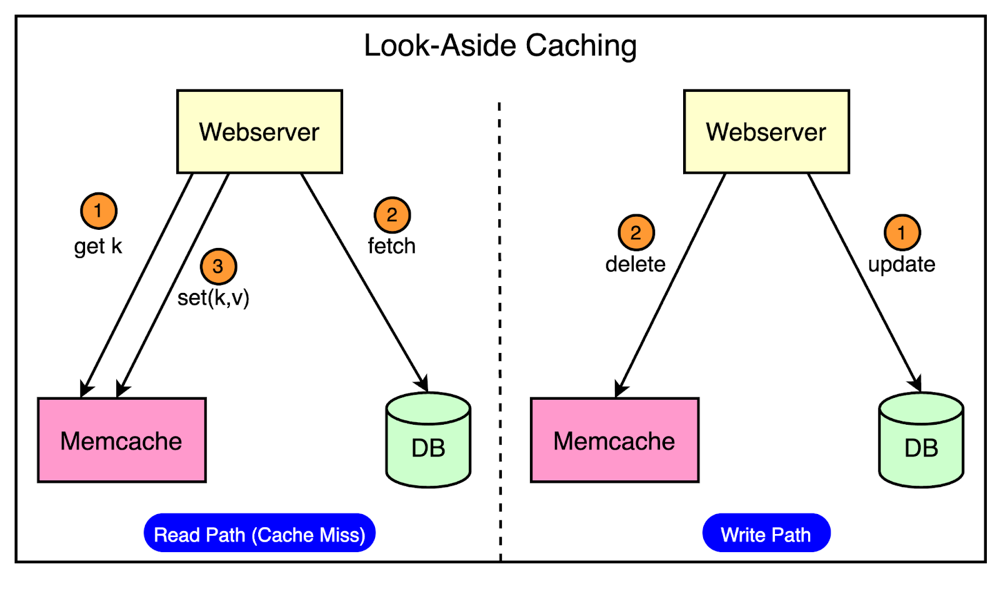
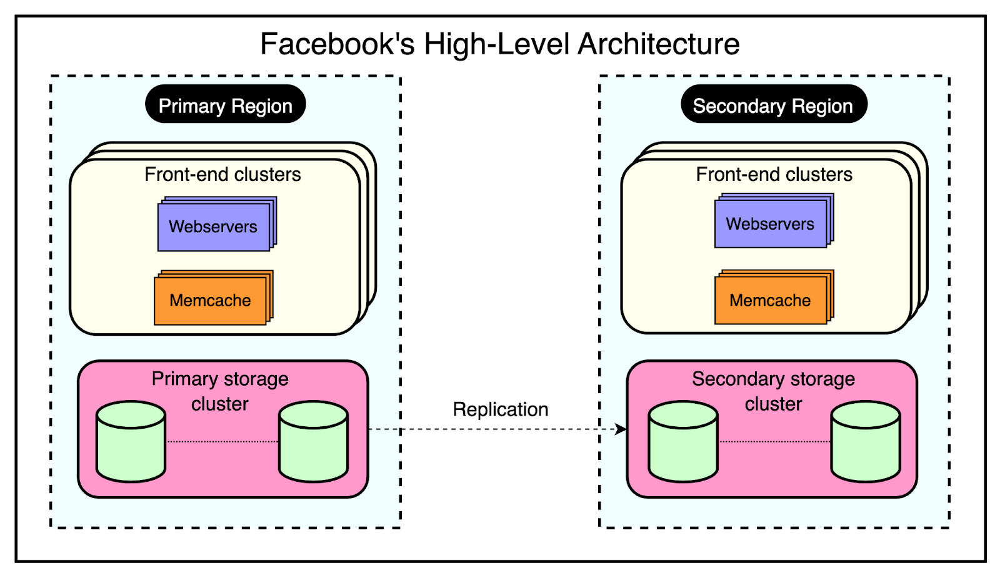
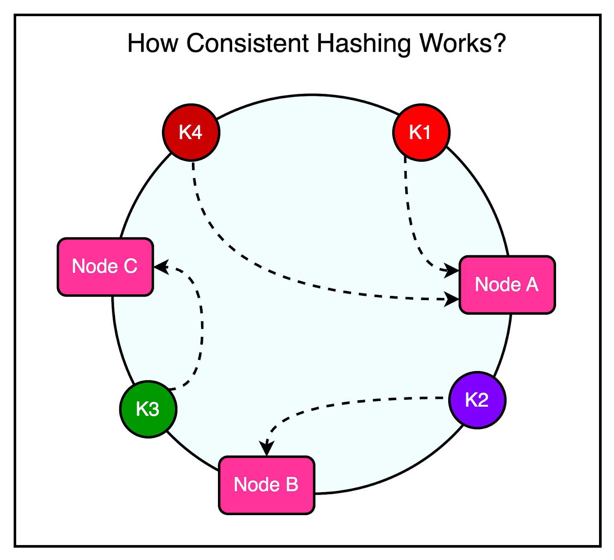
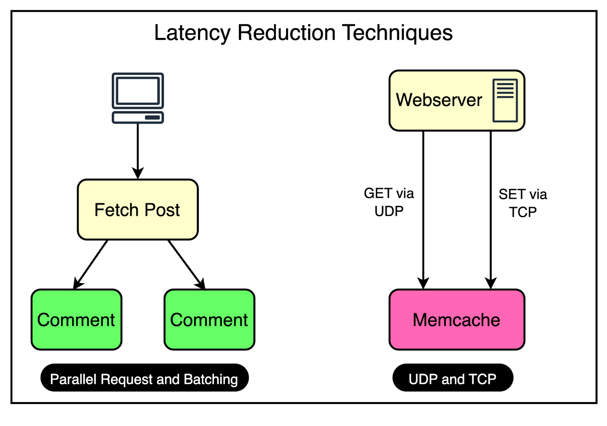
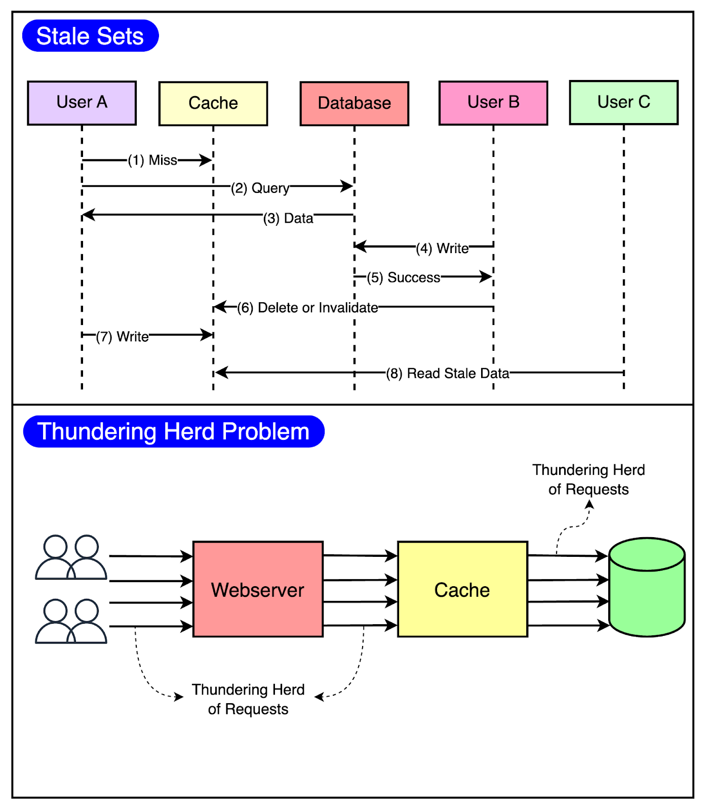
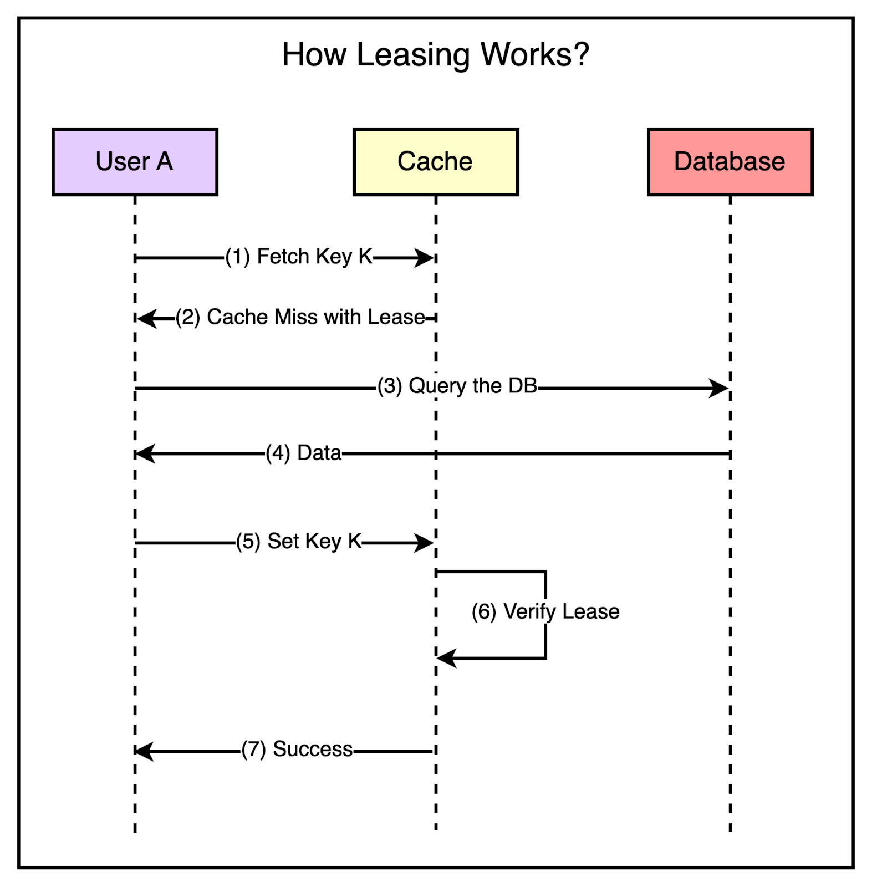

# Scaling Memcached at Facebook

## Summary

Facebook used Memcached as a demand-filled look-aside cache in front of MySQL to serve billions of requests per second. The design is organized in regions, frontend clusters and a storage cluster. It reduces latency with parallel, batched requests and UDP reads, and reduces load and inconsistency with leases against stale sets and thundering herds.

## Prerequisites

TODO: link the notes a reader should know first.

## Core concepts

There are two absolute truths about running a social network at the scale of Facebook:

- First, it cannot go down.
- Second, it cannot run slow.

These two factors determine whether people are going to stay on your social network or not.

Even a few people leaving impacts the entire user base because the users are interconnected. Most people are online because their friends or relatives are online and there’s a domino effect at play. If one user drops off due to issues, there are chances that other users will also leave. Facebook had to deal with these issues early on because of its popularity. At any point in time, millions of people were accessing Facebook from all over the world.

In terms of software design, this meant a few important requirements:

- Facebook had to support real-time communication.
- They had to build capabilities for on-the-fly content aggregation.
- Scale to handle billions of user requests.
- Store trillions of items across multiple geographic locations.

To achieve these goals, Facebook took up the open-source version of Memcached and enhanced it to build a distributed key-value store. This enhanced version was known as Memcache.

### Introduction to Memcached

Memcached is an in-memory key-value store that supports a simple set of operations such as set, get, and delete.

The open-source version provided a single-machine in-memory hash table. The engineers at Facebook took up this version as a basic building block to create a distributed key-value store known as [Memcache.In](http://Memcache.In) other words, “Memcached” is the source code or the running binary whereas “Memcache” stands for the distributed system behind it. Technically, Facebook used Memcache in two main ways:

#### Query cache

The job of the query cache was to reduce the load on the primary source-of-truth databases.

In this mode, Facebook used Memcache as a demand-filled look-aside cache. You may have also heard about it as the cache-aside pattern. The below diagram shows how the look-aside cache pattern works for the read and write path.

The read path utilizes a cache that is filled on-demand. This means that data is only loaded into the cache when a client specifically requests it.

Before serving the request, the client first checks the cache. If the desired data is not found in the cache (a cache miss), the client retrieves the data from the database and also updates the cache.

The write path takes a more interesting approach to updating data.

After a particular key is updated in the database, the system doesn’t directly update the corresponding value in the cache. Instead, it removes the data for that key from the cache entirely. This process is known as cache invalidation.

By invalidating the cache entry, the system ensures that the next time a client requests data for that key, it will experience a cache miss and be forced to retrieve the most up-to-date value directly from the database. This approach helps maintain data consistency between the cache and the database.

#### Generic cache

Facebook also leverages Memcache as a general-purpose key-value store. This allows different teams within the organization to utilize Memcache for storing pre-computed results generated from computationally expensive machine learning algorithms.

By storing these pre-computed ML results in Memcache, other applications can quickly and easily access them whenever needed.

This approach offers several benefits such as improved performance and resource optimization.

### High-level architecture of Facebook

Facebook’s architecture is built to handle the massive scale and global reach of its platform.

At the time of their Memcached adoption, Facebook’s high-level architecture consisted of three key components:

#### 1 - Regions

Facebook strategically places its servers in various locations worldwide, known as regions. These regions are classified into two types:

- **Primary Region:** The primary region is responsible for handling the majority of user traffic and data management.
- **Secondary Region:** Multiple secondary regions are distributed globally to provide redundancy, load balancing, and improved performance for users in different geographical areas.

Each region, whether primary or secondary, contains multiple frontend clusters and a single storage cluster.

#### 2 - Frontend clusters

Within each region, Facebook employs frontend clusters to handle user requests and serve content. A frontend cluster consists of two main components:

- **Web Servers:** These servers are responsible for processing user requests, rendering pages, and delivering content to the users.
- **Memcache Servers:** Memcache servers act as a distributed caching layer, storing frequently accessed data in memory for quick retrieval.

The frontend clusters are designed to scale horizontally based on demand. As user traffic increases, additional web and Memcache servers can be added to the cluster to handle the increased load.

#### 3 - Storage cluster

At the core of each region lies the storage cluster. This cluster contains the source-of-truth database, which stores the authoritative copy of every data item within Facebook’s system. The storage cluster takes care of data consistency, durability, and reliability. By replicating data across multiple regions and employing a primary-secondary architecture, Facebook achieves high availability and fault tolerance.

The below diagram shows the high-level view of this architecture:

One major philosophy that Facebook adopted was a willingness to expose slightly stale data instead of allowing excessive load on the backend.

Rather than striving for perfect data consistency at all times, Facebook accepted that users may sometimes see outdated information in their feeds. This approach allowed them to handle high traffic loads without crumbling under excessive strain on the backend infrastructure.

To make this architecture work at an unprecedented scale of billions of requests every day, Facebook had to solve multiple challenges such as:

- Managing latency and failures within a cluster.
- Managing data replication within a region.
- Managing data consistency across regions.

In the next few sections, we will look at how Facebook handled each of these challenges.

### Within cluster challenges

There were three important goals for the within-cluster operations:

- Reducing latency
- Reducing the load on the database
- Handling failures

#### 1 - Reducing latency

As mentioned earlier, every frontend cluster contains hundreds of Memcached servers, and items are distributed across these servers using techniques like Consistent Hashing.

For reference, Consistent Hashing is a technique that allows the distribution of a set of keys across multiple nodes in a way that minimizes the impact of node failures or additions. When a node goes down or a new node is introduced, Consistent Hashing ensures that only a small subset of keys needs to be redistributed, rather than requiring a complete reshuffling of data.

The diagram illustrates the concept of Consistent Hashing where keys are mapped to a circular hash space, and nodes are assigned positions on the circle. Each key is assigned to the node that falls closest to it in a clockwise direction.

| |  | |
| --- | --- | --- |

At Facebook's scale, a single web request can trigger hundreds of fetch requests to retrieve data from Memcached servers. Consider a scenario where a user loads a popular page containing numerous posts and comments.

Even a single request can require the web servers to communicate with multiple Memcached servers in a short timeframe to populate the necessary data.

This high-volume data fetching occurs not only in cache hit situations but also when there’s a cache miss. The implication is that a single Memcached server can turn into a bottleneck for many web servers, leading to increased latency and degraded performance for the end user.

To reduce the possibility of such a scenario, Facebook uses a couple of important tricks visualized in the diagram.

| |  | |
| --- | --- | --- |

##### Parallel requests and batching

To understand the concept of parallel requests and batching, consider a simple analogy.

Imagine going to the supermarket every time you need an item. It would be incredibly time-consuming and inefficient to make multiple trips for individual items. Instead, it’s much more effective to plan your shopping trip and purchase a bunch of items together in a single visit.

The same optimization principle applies to data retrieval in Facebook's frontend clusters.

To maximize the efficiency of data retrieval, Facebook constructs a Directed Acyclic Graph (DAG) that represents the dependencies between different data items.

The DAG provides a clear understanding of which data items can be fetched concurrently and which items depend on others.

By analyzing the DAG, the web server can determine the optimal order and grouping of data fetches. It identifies data items that can be retrieved in parallel, without any dependencies, and groups them in a single batch request.

##### Using UDP

Facebook employed a clever strategy to optimize network communication between the web servers and the Memcache server.

For fetch requests, Facebook configured the clients to use UDP instead of TCP.

As you may know, UDP is a connectionless protocol and much faster than TCP. By using UDP, the clients can send fetch requests to the Memcache servers with less network overhead, resulting in faster request processing and reduced latency.

However, UDP has a drawback: it doesn’t guarantee the delivery of packets. If a packet is lost during transmission, UDP doesn’t have a built-in mechanism to retransmit it.

To handle such cases, they treated UDP packet loss as a cache miss on the client side. If a response isn’t received within a specific timeframe, the client assumes that the data is not available in the cache and proceeds to fetch it from the primary data source.

For update and delete operations, Facebook still used TCP since it provided a reliable communication channel that ensured the delivery of packets in the correct order. It removed the need for adding a specific retry mechanism, which is important when dealing with update and delete operations.

All these requests go through a special proxy known as **mcrouter** that runs on the same machine as the webserver. Think of the **mcrouter** as a middleman that performs multiple duties such as data serialization, compression, routing, batching, and error handling. We will look at **mcrouter** in a later section.

#### 2 - Reducing load

The most important goal for Memcache is to reduce the load on the database by reducing the frequency of data fetching from the database.

Using Memcache as a look-aside cache solves this problem significantly. But at Facebook’s scale, two caching-related issues can easily appear.

- **Stale Set:** This happens when the cache is set with outdated data and there’s no easy way of invalidating it.
- **Thundering Herd:** This problem occurs in a highly concurrent environment when a cache miss triggers a thundering herd of requests to the database.

The below diagram visualizes both of these issues.

| |  | |
| --- | --- | --- |

To minimize the probability of these two critical issues, Facebook used a technique known as leasing.

Leasing helped solve both stale sets and thundering herds, helping Facebook reduce peak DB query rates from 17K/second to 1.3K/second.

##### Stale sets

Consider that a client requests memcache for a particular key and it results in a cache miss.

Now, it’s the client’s responsibility to fetch the data from the database and also update memcache so that future requests for the same key don’t result in a cache miss.

This works fine most of the time but in a highly concurrent environment, the data being set by the client may get outdated by the time it gets updated in the cache.

Leasing prevents this from happening.

With leasing, Memcache hands over a lease (a 64-bit token bound to a specific key) to a particular client to set data into the cache whenever there’s a cache miss.

The client has to provide this token when setting the value in the cache and memcache can verify whether the data should be stored by verifying the token. If the item was already invalidated by the time the client tried to update, Memcache will invalidate the lease token and reject the request.

The below diagram shows the concept of leasing in a much better manner.

| |  | |
| --- | --- | --- |

##### Thundering herds

A slight modification to the leasing technique also helps solve the thundering herd issue.

In this modification, Memcache regulates the rate of issuing the lease tokens. For example, it may return a token once every 5 seconds per key.

For any requests for the key within 5 seconds of the lease token being issued, Memcache sends a special response requesting the client to wait and retry so that these requests don’t hit the database needlessly. This is because there’s a high probability that the client holding the lease token will soon update the cache and the waiting clients will get a cache hit when they retry.

## Worked example

TODO: add a concrete, reproducible example with real values.

## Trade offs and when to use it

TODO: describe benefits, costs, alternatives and when this is the wrong choice.

## Common mistakes

TODO: list frequent misunderstandings and failure modes, with the fix for each.

## Practice

TODO: add three to five questions, with answers at the bottom.

## Further reading

- Nishtala, R., et al. (2013). [*Scaling Memcache at Facebook*](https://www.usenix.org/conference/nsdi13/technical-sessions/presentation/nishtala). USENIX NSDI. The NSDI 2013 paper on leases, regions, clusters and consistency of the Facebook memcache deployment.

TODO: check the content of this note against the sources above and record what was verified and when.
