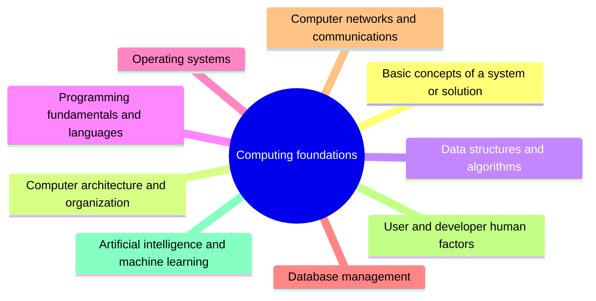

# Computing foundations

Computing foundations are the computer science concepts a software engineer builds on: systems, computer organization, data structures and algorithms, programming languages, operating systems, databases, networks, human factors and artificial intelligence.

This knowledge area follows Chapter 16 of the [SWEBOK Guide V4.0](https://www.computer.org/education/bodies-of-knowledge/software-engineering) (IEEE Computer Society, 2024). Its sections are the topics of that chapter, in the same order.

## Map

The map shows the sections of this part of the library.

## Topics

- [Basic concepts of a system or solution](basic-concepts-of-a-system/README.md) (1 note): What a system is, how it differs from an application and a platform, and the vocabulary of systems engineering used by software engineers.
- [Computer architecture and organization](computer-architecture-and-organization/README.md) (planned): How computers are built from processors, memory and input and output, and why it matters for software performance.
- [Data structures and algorithms](data-structures-and-algorithms/README.md) (9 notes): Ways of organizing data in memory and the algorithms that operate on them, with their time and space costs.
- [Programming fundamentals and languages](programming-fundamentals-and-languages/README.md) (4 notes): Programming concepts that apply across languages: paradigms, type systems, execution models and memory management.
- [Operating systems](operating-systems/README.md) (planned): Processes, threads, scheduling, memory management, file systems and input and output.
- [Database management](database-management/README.md) (2 notes): Database concepts a software engineer needs: transactions, data models, indexing and data integration.
- [Computer networks and communications](computer-networks-and-communications/README.md) (3 notes): Network protocols and models that software depends on, from transport protocols to HTTP.
- [User and developer human factors](user-and-developer-human-factors/README.md) (planned): How human abilities and limits affect the use and the creation of software.
- [Artificial intelligence and machine learning](artificial-intelligence-and-machine-learning/README.md) (planned): AI and ML concepts relevant to software engineers building or using intelligent components.
