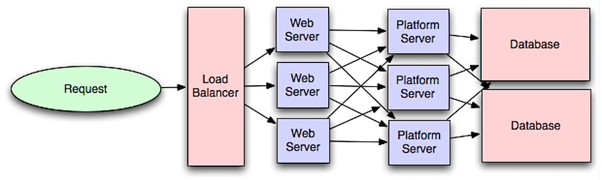

# System, application and platform

## Summary

A system is a set of components that interact to achieve a goal. An application is software that delivers a specific function to its users, and a platform is a foundation, such as an operating system or a cloud service, on which other applications are built and run. Telling the three apart helps decide what a team owns and what it builds on.

## Prerequisites

TODO: link the notes a reader should know first.

## Core concepts

### System

A **system** in applications refers to a set of components that work together to achieve a specific goal. It's like a team, where each player has a role, and they must cooperate to win the game.

#### Elements

1. **Components**: These are the parts or elements that make up a system. They can be hardware, software, or both.
2. **Interaction**: The components interact with each other through well-defined processes and rules.
3. **Purpose**: Every system has a clear purpose or function it's designed to perform.
4. **Input and Output**: Systems take input, process it, and produce an output. Think of it like a blender: you put in fruits (input), it blends them (process), and you get a smoothie (output).
5. **Feedback**: This is information the system uses to adjust its performance. It's like a coach giving players tips during a game.
6. **Environment**: The system operates within an environment and must adapt to any changes. It's like playing a sport indoors vs. outdoors.

##### Example

Let's look at a **school library system**:

- **Components**: Books, librarians, catalog database, computers, and borrowers.
- **Interaction**: Librarians enter book data into the computer, borrowers search for books, and the system tracks who borrows what.
- **Purpose**: To organize, manage, and provide access to books and resources.
- **Input and Output**: Input could be new books being added, and output is the information provided to borrowers about book availability.
- **Feedback**: If books are often missing, the system might need a better tracking method.
- **Environment**: The library system must work within the school's rules and hours.

In summary, systems in applications are all about different parts working together smoothly to get something done. Whether it's a library, a smartphone, or even a video game, systems help make complex tasks manageable and efficient.

### Application

#### Definition

**An application, or software application**, is a computer program that aims to complete a specific task separate from that of the operating system. Some applications have a single, narrow focus. Others contain several programs within them.

Enterprise applications are delivered in a three-tier architecture:

- The presentation tier is provided by a browser.
- The application tier contains the business logic that supports the application’s core functions.
- The data tier provides access to the data the application needs.

Applications run locally on a server or computer system. They use application programming interfaces (APIs) to talk to other applications.

**Applications cover many functions**. At one end, they are complex database systems or deployment tools. On the other, they are simple programs like word processors or image editors.

### Platform

#### Definition

A platform runs on both hardware (e.g., a server) and software (an operating system). It is the **foundation on which applications run**. A platform is there to be built upon and connect with external systems.

This means that any smartphone is a platform because it includes hardware (form factor), an operating system, and connects with other systems.

#### Application as a platform

An application can also be called a platform in the sense that a platform’s function is to perform meaningful work within an organization.

Take, for example, a Relational Database Management System (RDBMS). This is a type of software application. It is used to store, manage, query, and retrieve business data stored in a relational database. RDBMSs communicate with CRM and ERP systems. So, although RDBMSs are applications, they also function as platforms.

Another example is web server apps. It is increasingly common for businesses to operate through web app platforms such as partner portals.

#### Platforms and software development

Developers have choices to make. They can:

- **Develop software to be platform-specific**: the application is developed for a single platform.
- **Design their software to be cross-platform**: the application works on pre-defined platforms.
- **Create platform-agnostic applications**: the software runs on any platform. In this case, it is usually accessed via a web browser.

Many organizations want to write software on different platforms. However, they can’t afford the costs of housing multiple platforms. So, many employ a form of cloud computing called Platform as a Service (PaaS).

#### Platform as a service (PaaS)

PaaS is a type of cloud computing. Gartner defines it as delivering application infrastructure from a third party to a business. PaaS is delivered over the internet and can be provider-managed or self-managed. It can also be multitenant or dedicated.

Platform as a service can enable companies to take advantage of streamlined development and new automation capabilities.

These tools are especially valuable for application development. With PaaS, developers are freed from any need for local infrastructure. This is very convenient. It also streamlines development and other internal processes that can get in the way of application development.

PaaS is a step in the right direction for the evolution of applications. No one can predict the needs of end-users five or ten years from now. PaaS creates a foundation for adaptive applications that can be rapidly changed to meet new expectations or market conditions.

## Worked example

TODO: add a concrete, reproducible example with real values.

## Trade offs and when to use it

TODO: describe benefits, costs, alternatives and when this is the wrong choice.

## Common mistakes

TODO: list frequent misunderstandings and failure modes, with the fix for each.

## Practice

TODO: add three to five questions, with answers at the bottom.

## Further reading

TODO: add primary sources (specification, original paper or official documentation), with one sentence on why each is worth reading.
