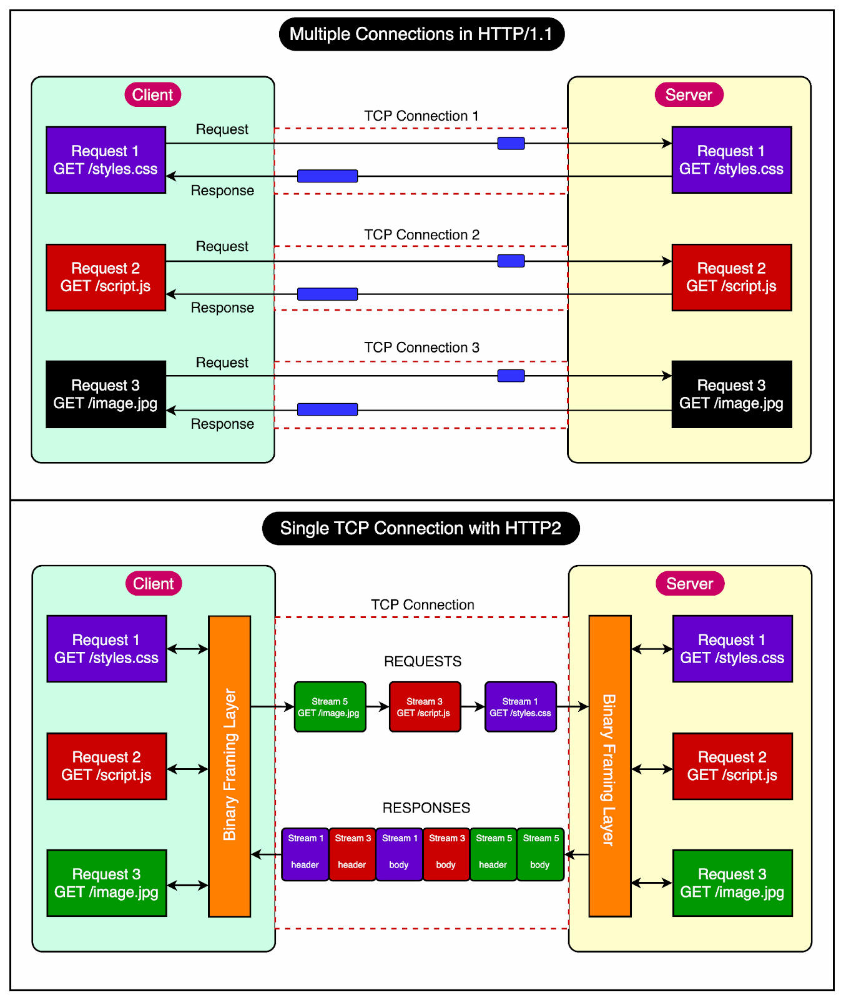

# Hypertext Transfer Protocol (HTTP)

## Summary

HTTP is a method for encoding and transporting data between a client and a server. It is a request/response protocol: clients issue requests and servers issue responses with relevant content and completion status info about the request. HTTP is self-contained, allowing requests and responses to flow through many intermediate routers and servers that perform load balancing, caching, encryption, and compression.

## Prerequisites

- [Transmission Control Protocol (TCP)](tcp.md)

## Core concepts

### Definition

HTTP is a method for encoding and transporting data between a client and a server. It is a request/response protocol: clients issue requests and servers issue responses with relevant content and completion status info about the request. HTTP is self-contained, allowing requests and responses to flow through many intermediate routers and servers that perform load balancing, caching, encryption, and compression.

A basic HTTP request consists of a verb (method) and a resource (endpoint).

#### Versions

##### HTTP/0.9

- HTTP/0.9 was the first documented version of HTTP, introduced in 1991
- It had a single method called GET for client requests
- Requests were simple, like `GET /index.html`
- Server responses consisted of the response body followed by connection closure
- There were no headers in the protocol
- Only the `GET` method was allowed
- Responses had to be in HTML format

##### HTTP/1.0

- HTTP/1.0 expanded beyond HTML response to handle various formats like images, video files, and plain text
- Added new methods such as POST and HEAD
- Request/response formats were updated
- Introduced HTTP headers in both requests and responses
- Included status codes for response identification
- Introduced character set support
- Added multi-part types, authorization, caching, and content encoding
- HTTP/1.0 includes version number and status code 200 with reason phrase
- Response body can be any type: image, video, HTML, plain text, etc.
- Introduction of different content types led to "Hyper Text" in HTTP becoming a misnomer
- Drawback of HTTP/1.0: only one request per connection allowed
- Multiple connections needed for each item on a webpage, causing performance issues
- Some implementations of HTTP/1.0 introduced the Connection: keep-alive header to address connection closure issues
- The Connection: keep-alive header aimed to instruct servers not to close connections
- However, this feature was not widely supported and the problem persisted
- HTTP is a stateless protocol, meaning servers do not retain client information
- Each request must contain all necessary information for the server to process it independently
- This lack of state maintenance leads to increased bandwidth usage due to redundant data transmission

##### HTTP/1.1

- HTTP/1.1 released in 1999, after 3 years of HTTP/1.0
- Addition of new HTTP methods: PUT, PATCH, OPTIONS, DELETE
- Hostname Identification made required in HTTP/1.1
- Introduction of Persistent Connections to allow multiple sequential requests
- Support for Pipelining, enabling clients to send multiple requests without waiting for responses
- Introduction of Chunked Transfers for dynamic content transmission
- Unlike HTTP/1.0 which had Basic authentication only, HTTP/1.1 included digest and proxy authentication
- Caching
- Byte Ranges
- Character sets
- Language negotiation
- Client cookies
- Enhanced compression support
- New status codes

##### HTTP/2

- Binary instead of Textual
- Multiplexing - Multiple asynchronous HTTP requests over a single connection
- Header compression using HPACK
- Server Push - Multiple responses for single request
- Request Prioritization
- Security

### HTTP/2

#### Binary protocol

HTTP/2 tends to address the issue of increased latency that existed in HTTP/1.x by making it a binary protocol. Being a binary protocol, it easier to parse but unlike HTTP/1.x it is no longer readable by the human eye. The major building blocks of HTTP/2 are Frames and Streams.

HTTP/2 messages consist of frames like HEADERS for metadata and DATA for the payload, among others (RST_STREAM, SETTINGS, etc.), detailed in the HTTP/2 specs. Each message has a unique stream ID and is split into binary frames, forming a Stream. Frames have a common header and stream IDs, with odd numbers for client requests and even for server responses. The RST_STREAM frame can abort a stream without closing the connection, unlike HTTP/1.1, reducing latency and allowing other streams to continue.

#### Multiplexing

HTTP/2, a binary protocol using frames and streams, allows asynchronous requests and responses over a single TCP connection. This eliminates HTTP/1.x's head-of-line blocking by processing multiple requests without waiting for slower ones.

#### Header compression

The RFC aimed to optimize header data redundancy in HTTP requests. HTTP/2 introduced header compression to reduce repetitive header transmission, using Huffman coding and a shared headers table between client and server. This conserves bandwidth and lowers latency. Despite this, HTTP/1.1 headers remain, with the addition of pseudo-headers like `:method`, `:scheme`, `:host`, and `:path`.

#### Server push

HTTP/2's server push preempts client requests by sending resources the server anticipates the client will need, using a PUSH_PROMISE frame to alert the client and reduce roundtrips.

#### Request prioritization

Clients can prioritize streams using the HEADERS frame upon opening or by sending a PRIORITY frame later. Without priority, servers handle requests asynchronously; with it, they allocate resources based on the given priorities.

#### Security

There was extensive discussion on whether security (through TLS) should be made mandatory for HTTP/2 or not. In the end, it was decided not to make it mandatory. However, most vendors stated that they will only support HTTP/2 when it is used over TLS. So, although HTTP/2 doesn’t require encryption by specs but it has kind of become mandatory by default anyway. With that out of the way, HTTP/2 when implemented over TLS does impose some requirements like TLS version 1.2 or higher must be used, there must be a certain level of minimum keysizes, ephemeral keys are required etc.

## Worked example

TODO: add a concrete, reproducible example with real values.

## Trade offs and when to use it

TODO: describe benefits, costs, alternatives and when this is the wrong choice.

## Common mistakes

TODO: list frequent misunderstandings and failure modes, with the fix for each.

## Practice

TODO: add three to five questions, with answers at the bottom.

## Further reading

- Fielding, R., Nottingham, M., Reschke, J. (2022). [*RFC 9110: HTTP Semantics*](https://www.rfc-editor.org/rfc/rfc9110.html). IETF. The current specification of HTTP methods, status codes, headers and the meaning of idempotent and safe methods.
- Thomson, M., Benfield, C. (2022). [*RFC 9113: HTTP/2*](https://www.rfc-editor.org/rfc/rfc9113.html). IETF. The specification of HTTP/2 framing, streams, multiplexing and header compression.

TODO: check the content of this note against the sources above and record what was verified and when.
