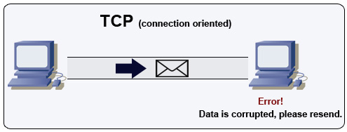
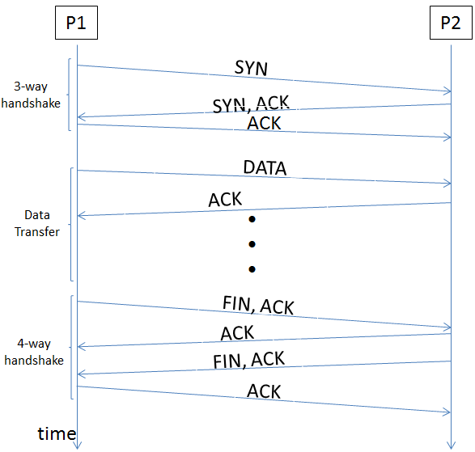

# Transmission Control Protocol (TCP)

## Summary

TCP is a connection-oriented protocol over an IP network. Connection is established and terminated using a handshake. All packets sent are guaranteed to reach the destination in the original order and without corruption through:

## Prerequisites

TODO: link the notes a reader should know first.

## Core concepts

### Definition

TCP is a connection-oriented protocol over an IP network. Connection is established and terminated using a handshake. All packets sent are guaranteed to reach the destination in the original order and without corruption through:

- Sequence numbers and checksum fields for each packet
- Acknowledgement packets and automatic retransmission

If the sender does not receive a correct response, it will resend the packets. If there are multiple timeouts, the connection is dropped. TCP also implements flow control and congestion control. These guarantees cause delays and generally result in less efficient transmission than UDP.

To ensure high throughput, web servers can keep a large number of TCP connections open, resulting in high memory usage. It can be expensive to have a large number of open connections between web server threads and say, a memcached server. Connection pooling can help in addition to switching to UDP where applicable.

TCP is useful for applications that require high reliability but are less time critical. Some examples include web servers, database info, SMTP, FTP, and SSH.

Use TCP over UDP when:

- You need all of the data to arrive intact
- You want to automatically make a best estimate use of the network throughput

#### Applications of TCP

- **World Wide Web (WWW)**: When you browse websites, TCP ensures reliable data transfer between your browser and web servers.
- **Email**: TCP is used for sending and receiving emails. Protocols like **SMTP** (Simple Mail Transfer Protocol) handle email delivery across servers.
- **File Transfer Protocol (FTP)**: FTP relies on TCP to transfer large files securely. Whether you’re uploading or downloading files, TCP ensures data integrity.
- **Secure Shell (SSH)**: SSH sessions, commonly used for remote administration, rely on TCP for encrypted communication between client and server.
- **Streaming Media**: Services like Netflix, YouTube, and Spotify use TCP to stream videos and music. It ensures smooth playback by managing data segments and retransmissions.

#### Advantages of TCP

- It is reliable for maintaining a connection between Sender and Receiver.
- It is responsible for sending data in a particular sequence.
- Its operations are not dependent on Operating System.
- It allows and supports many routing protocols.
- It can reduce the speed of data based on the speed of the receiver.

#### Disadvantages

- It is slower than UDP and it takes more bandwidth.
- Slower upon starting of transfer of a file.
- Not suitable for LAN and PAN Networks.
- It does not have a multicast or broadcast category.
- It does not load the whole page if a single data of the page is missing.

### How it works

#### Connection establishment (three-way handshake)

- **SYN:** The client sends a SYN (synchronize) packet to the server to initiate a connection.
- **SYN-ACK:** The server responds with a SYN-ACK (synchronize-acknowledge) packet, acknowledging the receipt of the SYN packet and indicating its readiness to establish a connection.
- **ACK:** The client sends an ACK (acknowledge) packet back to the server, completing the three-way handshake and establishing a connection.

##### Data transfer

- **Data Segmentation:** Data from the application is segmented into smaller packets suitable for transmission.
- **Sequencing:** Each segment is assigned a sequence number to ensure data is delivered in the correct order.
- **Acknowledgments:** The recipient acknowledges the receipt of data segments. If a segment is lost or corrupted, the sender retransmits it.
- **Flow Control:** TCP uses a sliding window mechanism to control the flow of data and ensure that the sender does not overwhelm the receiver.
- **Error Detection and Correction:** TCP includes checksums to detect errors in transmitted segments and uses acknowledgments and retransmissions to ensure correct delivery.

###### Connection termination

- **FIN:** The client or server sends a FIN (finish) packet to initiate the termination of the connection.
- **ACK:** The receiver of the FIN packet acknowledges it with an ACK.
- **FIN:** The receiver sends its own FIN packet to the other party.
- **ACK:** The original sender of the FIN packet acknowledges the receipt of the second FIN, completing the termination process.

## Worked example

TODO: add a concrete, reproducible example with real values.

## Trade offs and when to use it

### TCP vs UDP

| **TCP** | **UDP** |
| --- | --- |
| *Reliability*: TCP is connection-oriented protocol. When a file or message send it will get delivered unless connections fails. If connection lost, the server will request the lost part. There is no corruption while transferring a message. | *Reliability*: UDP is connectionless protocol. When you a send a data or message, you don’t know if it’ll get there, it could get lost on the way. There may be corruption while transferring a message. |
| *Ordered*: If you send two messages along a connection, one after the other, you know the first message will get there first. You don’t have to worry about data arriving in the wrong order. | *Ordered*: If you send two messages out, you don’t know what order they’ll arrive in i.e. **no ordered** |
| *Heavyweight*:, when the low level parts of the TCP “stream” arrive in the wrong order, resend requests have to be sent, and all the out of sequence parts have to be put back together, so requires a bit of work to piece together. | *Lightweight*: No ordering of messages, no tracking connections, etc. It’s just fire and forget! This means it’s a lot quicker, and the network card / OS have to do very little work to translate the data back from the packets. |
| *Streaming*: Data is read as a “stream,” with nothing distinguishing where one packet ends and another begins. There may be multiple packets per read call. | *Datagrams*: Packets are sent individually and are guaranteed to be whole if they arrive. One packet per one read call. |
| *Examples*: World Wide Web (Apache TCP port 80), e-mail (SMTP TCP port 25 Postfix MTA), File Transfer Protocol (FTP port 21) and Secure Shell (OpenSSH port 22) etc. | *Examples*: Domain Name System (DNS UDP port 53), streaming media applications such as IPTV or movies, Voice over IP (VoIP), Trivial File Transfer Protocol (TFTP) and online multiplayer games etc |

## Common mistakes

TODO: list frequent misunderstandings and failure modes, with the fix for each.

## Practice

TODO: add three to five questions, with answers at the bottom.

## Further reading

- Eddy, W. (ed.) (2022). [*RFC 9293: Transmission Control Protocol (TCP)*](https://www.rfc-editor.org/rfc/rfc9293.html). IETF. The consolidated TCP specification: connection setup, sequence numbers, retransmission and flow control.

TODO: check the content of this note against the sources above and record what was verified and when.
