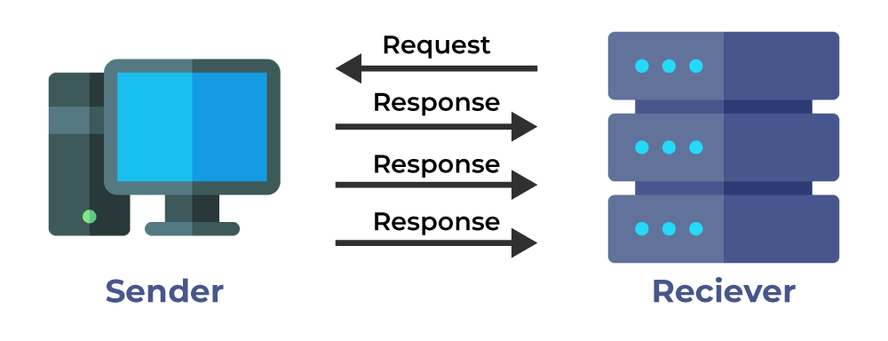

# User Datagram Protocol (UDP)

## Summary

UDP is a core protocol of the Internet Protocol Suite. It provides a simpler, connectionless communication model compared to TCP. UDP does not guarantee the delivery, order, or error-checking of data, making it faster and more suitable for applications that can tolerate some loss of data, such as streaming audio and video.

## Prerequisites

TODO: link the notes a reader should know first.

## Core concepts

### Definition

UDP is a core protocol of the Internet Protocol Suite. It provides a simpler, connectionless communication model compared to TCP. UDP does not guarantee the delivery, order, or error-checking of data, making it faster and more suitable for applications that can tolerate some loss of data, such as streaming audio and video.

UDP can broadcast, sending datagrams to all devices on the subnet. This is useful with DHCP because the client has not yet received an IP address, thus preventing a way for TCP to stream without the IP address.

UDP is less reliable but works well in real time use cases such as VoIP, video chat, streaming, and realtime multiplayer games.

Use UDP over TCP when:

- You need the lowest latency
- Late data is worse than loss of data
- You want to implement your own error correction

#### Application

- **Real-Time Multimedia Streaming**: UDP is ideal for streaming audio and video content. Its low-latency nature ensures smooth playback, even if occasional data loss occurs.
- **Online Gaming**: Many online games rely on UDP for fast communication between players.
- **DNS (Domain Name System) Queries**: When your device looks up domain names (like converting “[www.example.com](http://www.example.com)” to an IP address), UDP handles these requests efficiently^.
- **Network Monitoring**: Tools that monitor network performance often use UDP for lightweight, rapid data exchange.
- **Multicasting**: UDP supports packet switching, making it suitable for multicasting scenarios where data needs to be sent to multiple recipients simultaneously.
- **Routing Update Protocols**: Some routing protocols, like RIP (Routing Information Protocol), utilize UDP for exchanging routing information among routers.

#### Advantages

- It does not require any connection for sending or receiving data.
- Broadcast and Multicast are available in UDP.
- UDP can operate on a large range of networks.
- UDP has live and real-time data.
- UDP can deliver data if all the components of the data are not complete.

#### Disadvantages

- We can not have any way to acknowledge the successful transfer of data.
- UDP cannot have the mechanism to track the sequence of data.
- UDP is connectionless, and due to this, it is unreliable to transfer data.
- In case of a Collision, UDP packets are dropped by Routers in comparison to TCP.
- UDP can drop packets in case of detection of errors.

### How it works

UDP is connectionless. Datagrams (analogous to packets) are guaranteed only at the datagram level. Datagrams might reach their destination out of order or not at all. UDP does not support congestion control. Without the guarantees that TCP support, UDP is generally more efficient.

#### No connection establishment

- Unlike TCP, UDP does not establish a connection before data transfer. There is no handshake process, which reduces latency.

##### Data transfer

- **Data Packaging:** The application data is packaged into UDP datagrams. Each datagram is a self-contained message that includes the source and destination ports and the data payload.
- **Transmission:** The datagrams are sent independently over the network. UDP does not provide sequencing; each datagram is treated separately.
- **No Acknowledgment:** The receiver does not send acknowledgments back to the sender. This means there is no guarantee that the datagrams will arrive, arrive in order, or be free from errors.
- **Error Handling:** Any necessary error handling must be managed by the application layer, as UDP does not provide built-in error correction.

###### No connection termination

- Since UDP is connectionless, there is no formal process for terminating a connection. The sender simply stops sending datagrams when the communication is complete.

## Worked example

TODO: add a concrete, reproducible example with real values.

## Trade offs and when to use it

TODO: describe benefits, costs, alternatives and when this is the wrong choice.

## Common mistakes

TODO: list frequent misunderstandings and failure modes, with the fix for each.

## Practice

TODO: add three to five questions, with answers at the bottom.

## Further reading

- Postel, J. (1980). [*RFC 768: User Datagram Protocol*](https://www.rfc-editor.org/rfc/rfc768.html). IETF. The three page original specification of UDP and its header format.

TODO: check the content of this note against the sources above and record what was verified and when.
