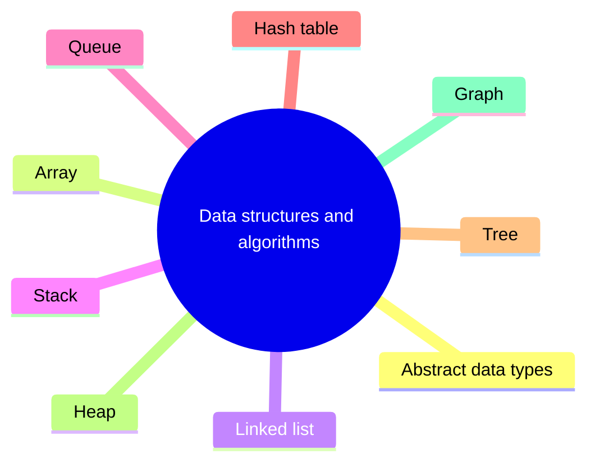

# Data structures and algorithms

Ways of organizing data in memory and the algorithms that operate on them, with their time and space costs.

This section corresponds to topic 16.3 of the [SWEBOK Guide V4.0](https://www.computer.org/education/bodies-of-knowledge/software-engineering).

## Map

The map shows the notes and sections of this part of the library.

## Reading order

1. [Abstract data types](abstract-data-types.md): An abstract data type (ADT) defines a type by the operations it supports and their behavior, not by how the data is stored.
2. [Array](array.md): An array data structure is a fundamental concept in computer science that stores a collection of elements in a contiguous block of memory.
3. [Linked list](linked-list.md): A linked list is a fundamental data structure in computer science.
4. [Stack](stack.md): A Stack is a linear data structure that follows a particular order in which the operations are performed.
5. [Queue](queue.md): A Queue Data Structure is a fundamental concept in computer science used for storing and managing data in a specific order.
6. [Hash table](hash-table.md): Hashing is a fundamental data structure that efficiently stores and retrieves data in a way that allows for quick access.
7. [Tree](tree.md): Tree Data Structure is a non-linear data structure in which a collection of elements known as nodes are connected to each other via edges such that there exists exactly one path between any two nodes.
8. [Heap](heap.md): A Heap is a complete binary tree data structure that satisfies the heap property: for every node, the value of its children is less than or equal to its own value.
9. [Graph](graph.md): Graph Data Structure is a collection of nodes connected by edges.

## Planned topics

- Asymptotic analysis and Big O notation
- Sorting algorithms
- Searching algorithms
- Recursion
- Dynamic programming
- Greedy algorithms
- Trie
- B-tree
- Bloom filter
- Graph algorithms (BFS, DFS, shortest paths)
