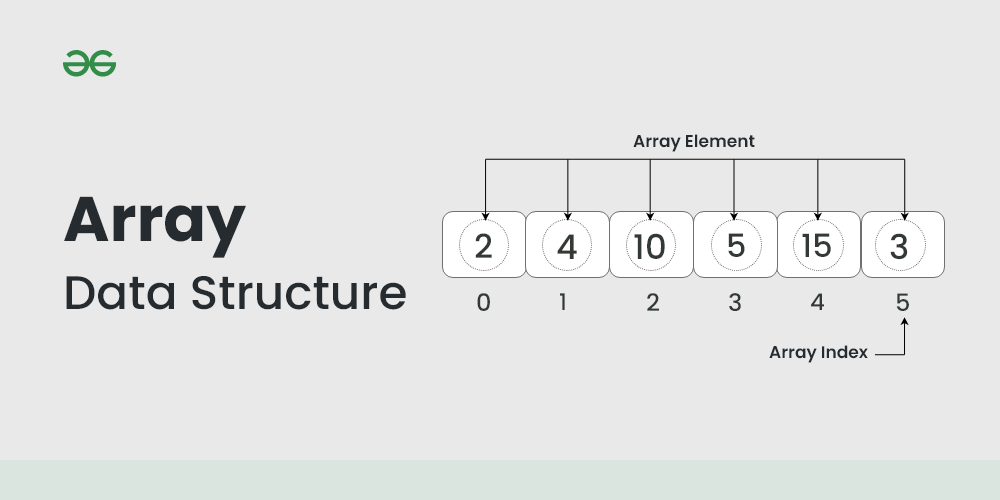

# Array

## Summary

An array data structure is a fundamental concept in computer science that stores a collection of elements in a contiguous block of memory. It allows for efficient access to elements using indices and is widely used in programming for organizing and manipulating data.

## Prerequisites

TODO: link the notes a reader should know first.

## Core concepts

An **array data structure** is a fundamental concept in computer science that stores a collection of elements in a contiguous block of memory. It allows for efficient access to elements using indices and is widely used in programming for organizing and manipulating data.

### Definition

An **array** is a collection of items of the same variable type that are stored at contiguous memory locations. It’s one of the most popular and simple data structures and is often used to implement other data structures. Each item in an array is indexed starting with **0**. Each element in an array is accessed through its index.

Arrays are a fundamental data structure in computer science. They are used in a wide variety of applications, including:

- Storing data for processing
- Implementing data structures such as stacks and queues
- Representing data in tables and matrices
- Creating dynamic data structures such as linked lists and trees

There are two main types of arrays:

- **One-dimensional arrays:** These arrays store a single row of elements.
- **Multidimensional arrays:** These arrays store multiple rows of elements.

### Operations

Common operations performed on arrays include:

- **Traversal**: Visiting each element of an array in a specific order (e.g., sequential, reverse).
- **Insertion**: Adding a new element to an array at a specific index.
- **Deletion**: Removing an element from an array at a specific index.
- **Searching**: Finding the index of an element in an array.

### Applications

Arrays are used in a wide variety of applications, including:

- Storing data for processing
- Implementing data structures such as stacks and queues
- Representing data in tables and matrices
- Creating dynamic data structures such as linked lists and trees

## Worked example

TODO: add a concrete, reproducible example with real values.

## Trade offs and when to use it

TODO: describe benefits, costs, alternatives and when this is the wrong choice.

## Common mistakes

TODO: list frequent misunderstandings and failure modes, with the fix for each.

## Practice

TODO: add three to five questions, with answers at the bottom.

## Further reading

- Cormen, T. H., Leiserson, C. E., Rivest, R. L., Stein, C. (2022). *Introduction to Algorithms, 4th Edition*. MIT Press. The standard reference for data structures and algorithms with proofs of their running times.

TODO: check the content of this note against the sources above and record what was verified and when.
