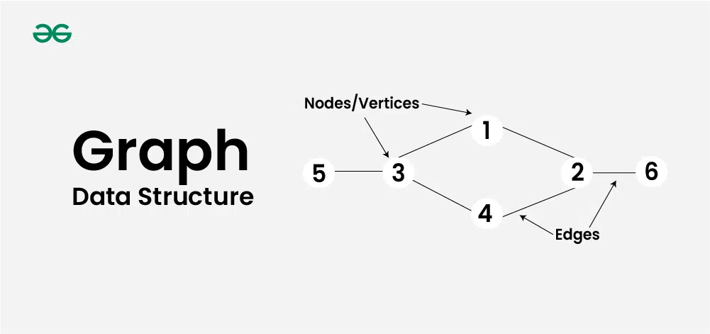
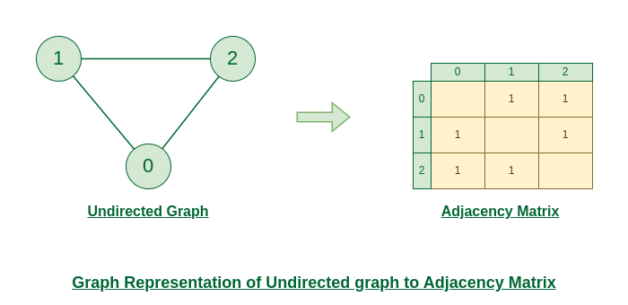
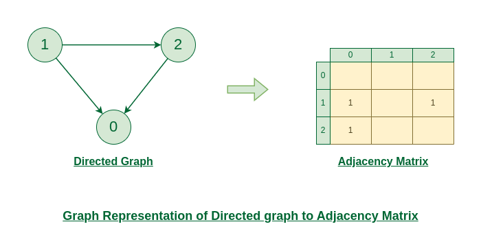
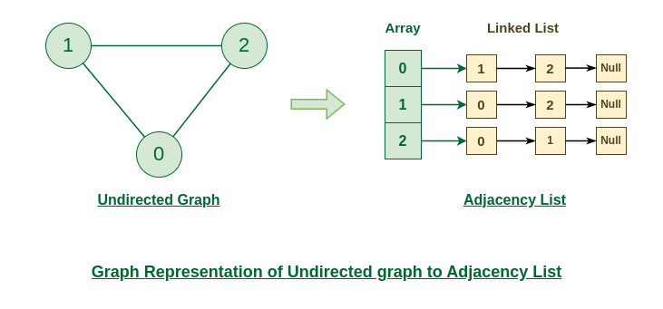
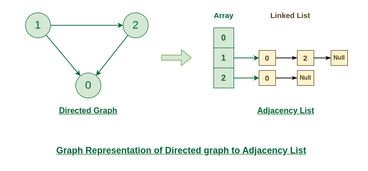

# Graph

## Summary

Graph Data Structure is a collection of nodes connected by edges. It’s used to represent relationships between different entities. Graph algorithms are methods used to manipulate and analyze graphs, solving various problems like finding the shortest path or detecting cycles.

## Prerequisites

TODO: link the notes a reader should know first.

## Core concepts

### Definition

**Graph Data Structure** is a collection of **nodes** connected by **edges**. It’s used to represent relationships between different entities. **Graph algorithms** are methods used to manipulate and analyze graphs, solving various problems like **finding the shortest path** or **detecting cycles.**

Graph is a non-linear data structure consisting of vertices and edges. The vertices are sometimes also referred to as nodes and the edges are lines or arcs that connect any two nodes in the graph. More formally a Graph is composed of a set of vertices( **V** ) and a set of edges( **E** ). The graph is denoted by **G(V, E).**

Graph data structures are a powerful tool for representing and analyzing complex relationships between objects or entities. They are particularly useful in fields such as social network analysis, recommendation systems, and computer networks. In the field of sports data science, graph data structures can be used to analyze and understand the dynamics of team performance and player interactions on the field.

#### Components

- **Vertices:** Vertices are the fundamental units of the graph. Sometimes, vertices are also known as vertex or nodes. Every node/vertex can be labeled or unlabeled.
- **Edges:** Edges are drawn or used to connect two nodes of the graph. It can be ordered pair of nodes in a directed graph. Edges can connect any two nodes in any possible way. There are no rules. Sometimes, edges are also known as arcs. Every edge can be labelled/unlabelled.

#### Representations

Here are the two most common ways to represent a graph:

1. Adjacency Matrix
2. Adjacency List

##### Adjacency matrix

An adjacency matrix is a way of representing a graph as a matrix of boolean (0’s and 1’s).

Let’s assume there are **n** vertices in the graph So, create a 2D matrix **adjMat[n][n]** having dimension n x n.

- *If there is an edge from vertex* ***i*** *to* ***j, mark* ***adjMat[i][j]*** *as* ***1.*
- *If there is no edge from vertex* ***i*** *to* ***j, mark* ***adjMat[i][j]*** *as* ***0.*

###### Undirected

The below figure shows an undirected graph. Initially, the entire Matrix is initialized to **0**. If there is an edge from source to destination, we insert **1** to both cases (**adjMat[destination]** and **adjMat**[**destination])** because we can go either way.

###### Directed

The below figure shows a directed graph. Initially, the entire Matrix is initialized to **0**. If there is an edge from source to destination, we insert **1** for that particular **adjMat[destination]**.

##### Adjacency list

An array of Lists is used to store edges between two vertices. The size of array is equal to the number of **vertices (i.e, n)**. Each index in this array represents a specific vertex in the graph. The entry at the index i of the array contains a linked list containing the vertices that are adjacent to vertex **i**.

Let’s assume there are **n** vertices in the graph So, create an **array of list** of size **n** as **adjList[n].**

- *adjList[0] will have all the nodes which are connected (neighbour) to vertex* ***0.*
- *adjList[1] will have all the nodes which are connected (neighbour) to vertex* ***1*** *and so on.*

###### Undirected

The below undirected graph has 3 vertices. So, an array of list will be created of size 3, where each indices represent the vertices. Now, vertex 0 has two neighbours (i.e, 1 and 2). So, insert vertex 1 and 2 at indices 0 of array. Similarly, For vertex 1, it has two neighbour (i.e, 2 and 0) So, insert vertices 2 and 0 at indices 1 of array. Similarly, for vertex 2, insert its neighbours in array of list.

###### Directed

The below directed graph has 3 vertices. So, an array of list will be created of size 3, where each indices represent the vertices. Now, vertex 0 has no neighbours. For vertex 1, it has two neighbour (i.e, 0 and 2) So, insert vertices 0 and 2 at indices 1 of array. Similarly, for vertex 2, insert its neighbours in array of list.

### Operations

- Insertion of Nodes/Edges in the graph, Insert a node into the graph.
- Deletion of Nodes/Edges in the graph, Delete a node from the graph.
- Searching on Graphs, Search an entity in the graph.
- Traversal of Graphs, Traversing all the nodes in the graph.

### Applications

- Graph data structures can be used to represent the interactions between players on a team, such as passes, shots, and tackles. Analyzing these interactions can provide insights into team dynamics and areas for improvement.
- Commonly used to represent social networks, such as networks of friends on social media.
- Graphs can be used to represent the topology of computer networks, such as the connections between routers and switches.
- Graphs are used to represent the connections between different places in a transportation network, such as roads and airports.
- Graphs are used in Neural Networks where vertices represent neurons and edges represent the synapses between them. Neural networks are used to understand how our brain works and how connections change when we learn. The human brain has about 10^11 neurons and close to 10^15 synapses.

## Worked example

TODO: add a concrete, reproducible example with real values.

## Trade offs and when to use it

TODO: describe benefits, costs, alternatives and when this is the wrong choice.

## Common mistakes

TODO: list frequent misunderstandings and failure modes, with the fix for each.

## Practice

TODO: add three to five questions, with answers at the bottom.

## Further reading

- Cormen, T. H., Leiserson, C. E., Rivest, R. L., Stein, C. (2022). *Introduction to Algorithms, 4th Edition*. MIT Press. The standard reference for data structures and algorithms with proofs of their running times.

TODO: check the content of this note against the sources above and record what was verified and when.
