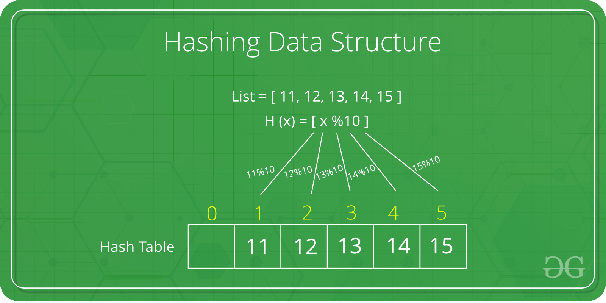

# Hash table

## Summary

Hashing is a fundamental data structure that efficiently stores and retrieves data in a way that allows for quick access. It involves mapping data to a specific index in a hash table using a hash function that enables fast retrieval of information based on its key. This method is commonly used in databases, caching systems, and various programming applications to optimize search and retrieval operations.

## Prerequisites

- [Array](array.md)

## Core concepts

### Definition

**Hashing** is a fundamental data structure that efficiently stores and retrieves data in a way that allows for quick access. It involves mapping data to a specific index in a hash table using a **hash function** that enables fast retrieval of information based on its key. This method is commonly used in databases, **c**aching systems, and various programming applications to optimize search and retrieval operations.

**Hashing** is a technique used in data structures to store and retrieve data efficiently. It involves using a **hash function** to map data items to a fixed-size array which is called a **hash table**.

**How it works:**

1. **Hash Function:** You provide your data items into the hash function.
2. **Hash Code:** The hash function crunches the data and give a unique hash code.
3. **Hash Table:** The hash code then points you to a specific location within the hash table.

4.

A **hash table** is also known as a hash map. It is a data structure that stores **key-value pairs**. It uses a **hash function** to map **keys** to a fixed-size array, called a **hash table**. This allows in faster **search**, **insertion**, and **deletion** operations.

#### Hash function

The **hash function** is a function that takes a **key** and returns an **index** into the **hash table**. The goal of a hash function is to distribute keys evenly across the hash table, minimizing collisions (when two keys map to the same index).

Common hash functions include:

- **Division Method:** Key % Hash Table Size
- **Multiplication Method:** (Key * Constant) % Hash Table Size
- **Universal Hashing:** A family of hash functions designed to minimize collisions

#### Hash collision

A hash collision occurs when two different keys map to the same index in a hash table. This can happen even with a good hash function, especially if the hash table is full or the keys are similar.

**Causes of Hash Collisions:**

- **Poor Hash Function:** A hash function that does not distribute keys evenly across the hash table can lead to more collisions.
- **High Load Factor:** A high load factor (ratio of keys to hash table size) increases the probability of collisions.
- **Similar Keys:** Keys that are similar in value or structure are more likely to collide.

#### Collision resolution techniques

There are two types of collision resolution techniques:

1. **Open Addressing:**
    - **Linear Probing:** Search for an empty slot sequentially
    - **Quadratic Probing:** Search for an empty slot using a quadratic function
2. **Closed Addressing:**
    - **Chaining:** Store colliding keys in a linked list or binary search tree at each index
    - **Cuckoo Hashing:** Use multiple hash functions to distribute keys

### Operations

- **Insert**: insert into hash table
- **Update**: update item in hash table
- **Delete**: delete item from hash table
- **Traversing**: loop over elements in hash table
- **Count**: checking size of hash table

### Applications

- **Databases:** Storing and retrieving data based on unique keys
- **Caching:** Storing frequently accessed data for faster retrieval
- **Symbol Tables:** Mapping identifiers to their values in programming languages
- **Network Routing:** Determining the best path for data packets

## Worked example

TODO: add a concrete, reproducible example with real values.

## Trade offs and when to use it

TODO: describe benefits, costs, alternatives and when this is the wrong choice.

## Common mistakes

TODO: list frequent misunderstandings and failure modes, with the fix for each.

## Practice

TODO: add three to five questions, with answers at the bottom.

## Further reading

- Cormen, T. H., Leiserson, C. E., Rivest, R. L., Stein, C. (2022). *Introduction to Algorithms, 4th Edition*. MIT Press. The standard reference for data structures and algorithms with proofs of their running times.

TODO: check the content of this note against the sources above and record what was verified and when.
