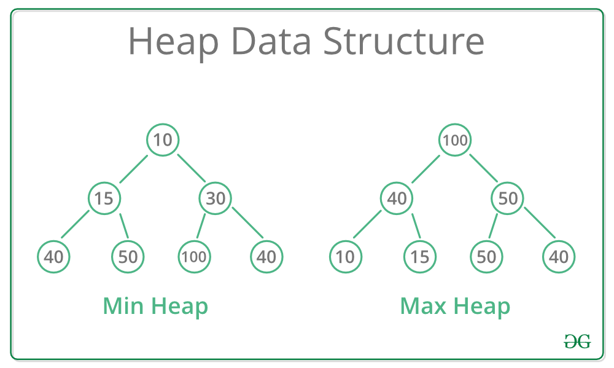

# Heap

## Summary

A Heap is a complete binary tree data structure that satisfies the heap property: for every node, the value of its children is less than or equal to its own value. Heaps are usually used to implement priority queues, where the smallest (or largest) element is always at the root of the tree.

## Prerequisites

- [Tree](tree.md)

## Core concepts

### Definition

A **Heap** is a complete binary tree data structure that satisfies the heap property: for every node, the value of its children is less than or equal to its own value. Heaps are usually used to implement priority queues, where the smallest (or largest) element is always at the root of the tree.

A **heap** is a binary tree-based data structure that satisfies the heap property: the value of each node is greater than or equal to the value of its children. This property makes sure that the root node contains the **maximum** or **minimum** value (depending on the type of heap), and the values decrease or increase as you move down the tree.

#### Types

There are two main types of heaps:

- **Max Heap:** The root node contains the maximum value, and the values decrease as you move down the tree.
- **Min Heap:** The root node contains the minimum value, and the values increase as you move down the tree.

### Operations

- **Insert**: Adds a new element to the heap while maintaining the heap property.
- **Extract Max/Min:** Removes the maximum or minimum element from the heap and returns it.
- **Heapify**: Converts an arbitrary binary tree into a heap.

### Applications

- Heaps are commonly used to implement priority queues, where elements are retrieved based on their priority (maximum or minimum value).
- Heapsort is a sorting algorithm that uses a heap to sort an array in ascending or descending order.
- Heaps are used in graph algorithms like **Dijkstra’s algorithm** and **Prim’s algorithm** for finding the shortest paths and minimum spanning trees.

## Worked example

TODO: add a concrete, reproducible example with real values.

## Trade offs and when to use it

TODO: describe benefits, costs, alternatives and when this is the wrong choice.

## Common mistakes

TODO: list frequent misunderstandings and failure modes, with the fix for each.

## Practice

TODO: add three to five questions, with answers at the bottom.

## Further reading

- Cormen, T. H., Leiserson, C. E., Rivest, R. L., Stein, C. (2022). *Introduction to Algorithms, 4th Edition*. MIT Press. The standard reference for data structures and algorithms with proofs of their running times.

TODO: check the content of this note against the sources above and record what was verified and when.
