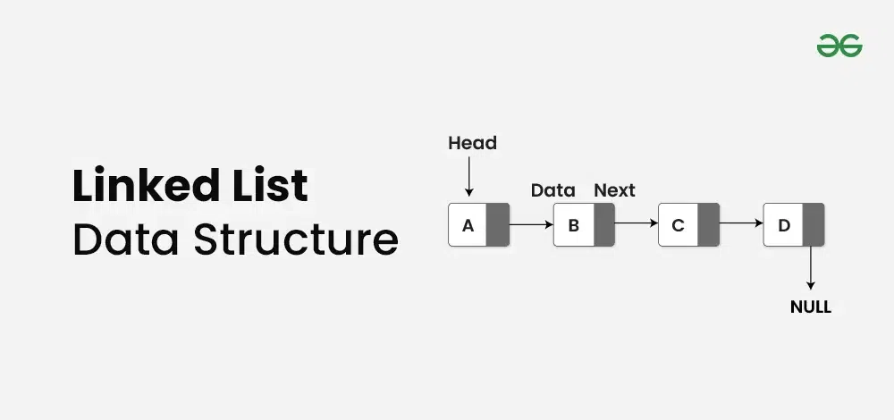

# Linked list

## Summary

A linked list is a fundamental data structure in computer science. It consists of nodes where each node contains data and a reference (link) to the next node in the sequence. This allows for dynamic memory allocation and efficient insertion and deletion operations compared to arrays.

## Prerequisites

TODO: link the notes a reader should know first.

## Core concepts

### Definition

A **linked list** is a fundamental data structure in computer science. It consists of nodes where each node contains **data** and a **reference (link)** to the next node in the sequence. This allows for dynamic memory allocation and efficient **insertion** and **deletion** operations compared to arrays.

A **linked list** is a linear data structure that consists of a series of nodes connected by pointers. Each node contains **data** and a **reference** to the next node in the list. Unlike **arrays, linked lists** allow for efficient **insertion** or **removal** of elements from any position in the list, as the nodes are not stored contiguously in memory.

Here’s the comparison of Linked List vs Arrays

**Linked List:**

- **Data Structure:** Non-contiguous
- **Memory Allocation:** Dynamic
- **Insertion/Deletion:** Efficient
- **Access:** Sequential

**Array:**

- **Data Structure:** Contiguous
- **Memory Allocation:** Static
- **Insertion/Deletion:** Inefficient
- **Access:** Random

### Operations

- Insertion
- Search an element (Iterative and Recursive)
- Find Length of a Linked List (Iterative and Recursive)
- Reverse a linked list
- Deletion (Deleting a given key)
- Deletion (Deleting a key at given position)
- Search for element

### Applications

- Implementing stacks and queues using linked lists.
- Using linked lists to handle collisions in hash tables.
- Representing graphs using linked lists.
- Allocating and deallocating memory dynamically.

## Worked example

TODO: add a concrete, reproducible example with real values.

## Trade offs and when to use it

TODO: describe benefits, costs, alternatives and when this is the wrong choice.

## Common mistakes

TODO: list frequent misunderstandings and failure modes, with the fix for each.

## Practice

TODO: add three to five questions, with answers at the bottom.

## Further reading

- Cormen, T. H., Leiserson, C. E., Rivest, R. L., Stein, C. (2022). *Introduction to Algorithms, 4th Edition*. MIT Press. The standard reference for data structures and algorithms with proofs of their running times.

TODO: check the content of this note against the sources above and record what was verified and when.
