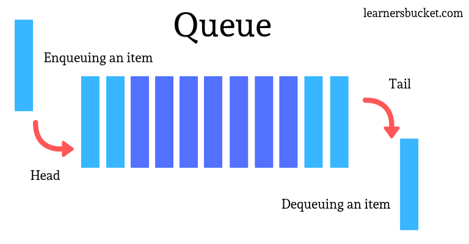

# Queue

## Summary

A Queue Data Structure is a fundamental concept in computer science used for storing and managing data in a specific order. It follows the principle of “First in, First out” (FIFO), where the first element added to the queue is the first one to be removed. Queues are commonly used in various algorithms and applications for their simplicity and efficiency in managing data flow.

## Prerequisites

- [Abstract data types](abstract-data-types.md)

## Core concepts

### Definition

A **Queue Data Structure** is a fundamental concept in computer science used for storing and managing data in a specific order. It follows the principle of “**First in, First out**” **(FIFO)**, where the first element added to the queue is the first one to be removed. Queues are commonly used in various algorithms and applications for their simplicity and efficiency in managing data flow.

A queue is a linear data structure that follows the **First-In-First-Out (FIFO)** principle. It operates like a line where elements are added at one end (**rear**) and removed from the other end (**front**).

#### Operations

- **Enqueue (Insert)**: Adds an element to the rear of the queue.
- **Dequeue (Delete)**: Removes and returns the element from the front of the queue.
- **Peek**: Returns the element at the front of the queue without removing it.
- **isEmpty**: Checks if the queue is empty.
- **isFull**: Checks if the queue is full.

#### Applications

- **Task scheduling** in operating systems
- **Data transfer** in network communication
- **Simulation** of real-world systems (e.g., waiting lines)
- **Priority queues** for event processing queues for event processing

## Worked example

TODO: add a concrete, reproducible example with real values.

## Trade offs and when to use it

TODO: describe benefits, costs, alternatives and when this is the wrong choice.

## Common mistakes

TODO: list frequent misunderstandings and failure modes, with the fix for each.

## Practice

TODO: add three to five questions, with answers at the bottom.

## Further reading

- Cormen, T. H., Leiserson, C. E., Rivest, R. L., Stein, C. (2022). *Introduction to Algorithms, 4th Edition*. MIT Press. The standard reference for data structures and algorithms with proofs of their running times.

TODO: check the content of this note against the sources above and record what was verified and when.
