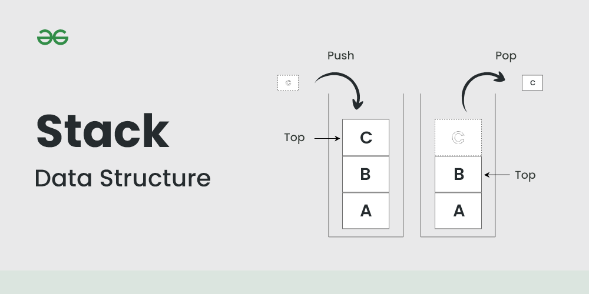

# Stack

## Summary

A Stack is a linear data structure that follows a particular order in which the operations are performed. The order may be LIFO(Last In First Out) or FILO(First In Last Out). LIFO implies that the element that is inserted last, comes out first and FILO implies that the element that is inserted first, comes out last.

## Prerequisites

- [Abstract data types](abstract-data-types.md)

## Core concepts

### Definition

A **Stack** is a linear data structure that follows a particular order in which the operations are performed. The order may be **LIFO(Last In First Out)** or **FILO(First In Last Out)**. **LIFO** implies that the element that is inserted last, comes out first and **FILO** implies that the element that is inserted first, comes out last.

A stack is a linear data structure that follows the **Last-In-First-Out (LIFO)** principle. It behaves like a stack of plates, where the last plate added is the first one to be removed.

**Think of it this way:**

- Pushing an element onto the stack is like adding a new plate on top.
- Popping an element removes the top plate from the stack.

### Operations

- **Push**: Adds an element to the top of the stack.
- **Pop**: Removes the top element from the stack.
- **Peek**: Returns the top element without removing it.
- **IsEmpty**: Checks if the stack is empty.
- **IsFull**: Checks if the stack is full (in case of fixed-size arrays).

### Applications

- Recursion
- Expression Evaluation and Parsing
- Depth-First Search (DFS)
- Undo/Redo Operations
- Browser History
- Function Calls

## Worked example

TODO: add a concrete, reproducible example with real values.

## Trade offs and when to use it

TODO: describe benefits, costs, alternatives and when this is the wrong choice.

## Common mistakes

TODO: list frequent misunderstandings and failure modes, with the fix for each.

## Practice

TODO: add three to five questions, with answers at the bottom.

## Further reading

- Cormen, T. H., Leiserson, C. E., Rivest, R. L., Stein, C. (2022). *Introduction to Algorithms, 4th Edition*. MIT Press. The standard reference for data structures and algorithms with proofs of their running times.

TODO: check the content of this note against the sources above and record what was verified and when.
