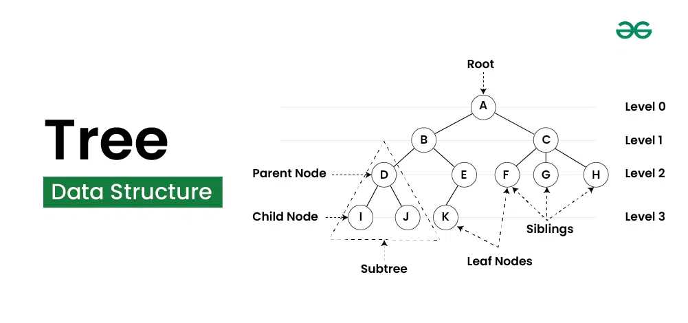

# Tree

## Summary

Tree Data Structure is a non-linear data structure in which a collection of elements known as nodes are connected to each other via edges such that there exists exactly one path between any two nodes.

## Prerequisites

TODO: link the notes a reader should know first.

## Core concepts

### Definition

**Tree Data Structure** is a non-linear data structure in which a collection of elements known as nodes are connected to each other via edges such that there exists exactly one path between any two nodes.

A **tree data structure** is a hierarchical structure that is used to represent and organize data in a way that is easy to navigate and search. It is a collection of nodes that are connected by edges and has a hierarchical relationship between the nodes.

The topmost node of the tree is called the root, and the nodes below it are called the child nodes. Each node can have multiple child nodes, and these child nodes can also have their own child nodes, forming a recursive structure.

#### Terminologies

- **Parent Node:** The node which is a predecessor of a node is called the parent node of that node. **{B}** is the parent node of **{D, E}**.
- **Child Node:** The node which is the immediate successor of a node is called the child node of that node. Examples: **{D, E}** are the child nodes of **{B}.**
- **Root Node:** The topmost node of a tree or the node which does not have any parent node is called the root node. {A**}** is the root node of the tree. A non-empty tree must contain exactly one root node and exactly one path from the root to all other nodes of the tree.
- **Leaf Node or External Node:** The nodes which do not have any child nodes are called leaf nodes. **{K, L, M, N, O, P, G}** are the leaf nodes of the tree.
- **Ancestor of a Node:** Any predecessor nodes on the path of the root to that node are called Ancestors of that node. **{A,B}** are the ancestor nodes of the node **{E}**
- **Descendant:** A node x is a descendant of another node y if and only if y is an ancestor of y.
- **Sibling:** Children of the same parent node are called siblings. **{D,E}** are called siblings.
- **Level of a node:** The count of edges on the path from the root node to that node. The root node has level **0**.
- **Internal node:** A node with at least one child is called Internal Node.
- **Neighbor of a Node:** Parent or child nodes of that node are called neighbors of that node.
- **Subtree**: Any node of the tree along with its descendant.

#### Types

- **Binary tree:** In a binary tree, each node can have a maximum of two children linked to it. Some common types of binary trees include full binary trees, complete binary trees, balanced binary trees, and degenerate or pathological binary trees.
- **Ternary Tree:** A Ternary Tree is a tree data structure in which each node has at most three child nodes, usually distinguished as “left”, “mid” and “right”.
- **N-ary Tree or Generic Tree:** Generic trees are a collection of nodes where each node is a data structure that consists of records and a list of references to its children(duplicate references are not allowed). Unlike the linked list, each node stores the address of multiple nodes.

### Operations

- Height of Tree
- Height and Depth of Node
- Level of a Given Node in Tree
- Search a Node in Tree
- Find the Parent of a Node
- Diameter of a Tree
- Find all Leaf nodes
- Find Siblings of a Node
- Find Children of a Node
- Tree Traversals (Inorder, Preorder and Postorder)

### Applications

- **File System:** This allows for efficient navigation and organization of files.
- **Data Compression**: Huffman coding is a popular technique for data compression that involves constructing a binary tree where the leaves represent characters and their frequency of occurrence. The resulting tree is used to encode the data in a way that minimizes the amount of storage required.
- **Compiler Design:** In compiler design, a syntax tree is used to represent the structure of a program.
- **Database Indexing**: B-trees and other tree structures are used in database indexing to efficiently search for and retrieve data.

## Worked example

TODO: add a concrete, reproducible example with real values.

## Trade offs and when to use it

TODO: describe benefits, costs, alternatives and when this is the wrong choice.

## Common mistakes

TODO: list frequent misunderstandings and failure modes, with the fix for each.

## Practice

TODO: add three to five questions, with answers at the bottom.

## Further reading

- Cormen, T. H., Leiserson, C. E., Rivest, R. L., Stein, C. (2022). *Introduction to Algorithms, 4th Edition*. MIT Press. The standard reference for data structures and algorithms with proofs of their running times.

TODO: check the content of this note against the sources above and record what was verified and when.
