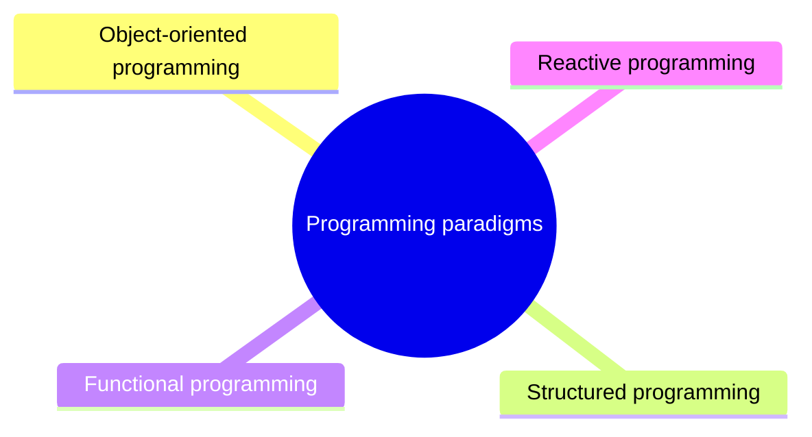

# Programming paradigms

Fundamental styles of organizing code, such as structured, object-oriented, functional and reactive programming.

This section corresponds to topic 16.4 of the [SWEBOK Guide V4.0](https://www.computer.org/education/bodies-of-knowledge/software-engineering).

## Overview

### Programming paradigms

A programming paradigm is a fundamental style or approach to solving problems using a programming language. Different programming paradigms provide different ways of organizing and structuring code, and have different strengths and weaknesses. Some of the most common programming paradigms include:

- Imperative programming
- Functional programming
- Object-oriented programming
- Logic programming
- Declarative programming

## Map

The map shows the notes and sections of this part of the library.

## Reading order

1. [Object-oriented programming](object-oriented-programming.md): OOP is a programming paradigm based on the concept of "objects," which can contain data and methods.
2. [Structured programming](structured-programming.md): Structured programming is a programming paradigm aimed at improving clarity, quality, and development time by emphasizing a well-organized structure in code.
3. [Functional programming](functional-programming.md): Functional programming is a programming paradigm centered on treating computation as the evaluation of mathematical functions.
4. [Reactive programming](reactive-programming.md): Reactive programming is a programming paradigm centered on asynchronous data streams and the propagation of change.

## Planned topics

- Logic programming
- Declarative versus imperative programming
