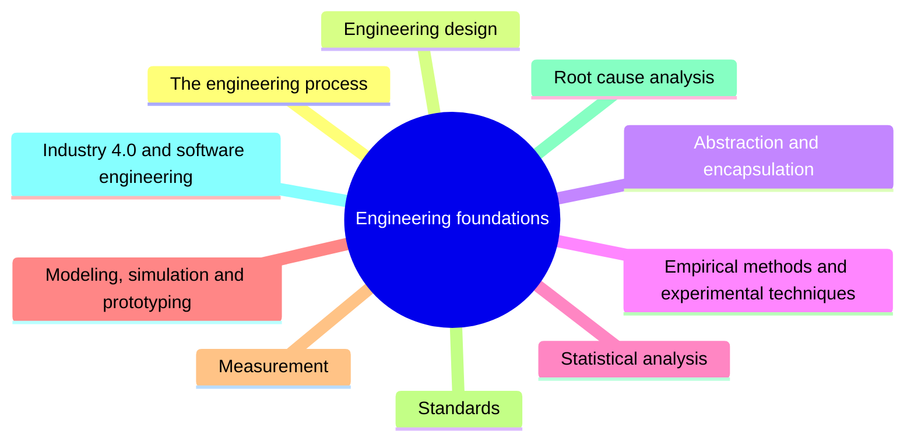

# Engineering foundations

Engineering foundations are the skills and methods that software engineering shares with other engineering disciplines: the engineering process and design, empirical methods, statistics, modeling, measurement, standards and root cause analysis.

This knowledge area follows Chapter 18 of the [SWEBOK Guide V4.0](https://www.computer.org/education/bodies-of-knowledge/software-engineering) (IEEE Computer Society, 2024). Its sections are the topics of that chapter, in the same order.

## Map

The map shows the sections of this part of the library.

## Topics

- [The engineering process](engineering-process/README.md) (planned): The general engineering cycle of understanding a problem, designing, building and evaluating a solution.
- [Engineering design](engineering-design/README.md) (planned): Design as an engineering activity under constraints.
- [Abstraction and encapsulation](abstraction-and-encapsulation/README.md) (planned): Levels of abstraction, encapsulation and hierarchy as general engineering tools.
- [Empirical methods and experimental techniques](empirical-methods-and-experimental-techniques/README.md) (planned): Designed experiments, observational studies and retrospective studies.
- [Statistical analysis](statistical-analysis/README.md) (planned): Statistical tools for analyzing engineering data.
- [Modeling, simulation and prototyping](modeling-simulation-and-prototyping/README.md) (planned): Using models, simulations and prototypes to explore solutions before building them.
- [Measurement](measurement/README.md) (planned): Levels of measurement, direct and derived measures, reliability and validity.
- [Standards](standards/README.md) (planned): The role of standards and standards bodies in software engineering.
- [Root cause analysis](root-cause-analysis/README.md) (planned): Techniques for finding the underlying cause of a problem.
- [Industry 4.0 and software engineering](industry-4-0/README.md) (planned): Software engineering in cyber-physical and connected industrial systems.

TODO: no notes yet. Start with the planned topics of the sections listed above.
