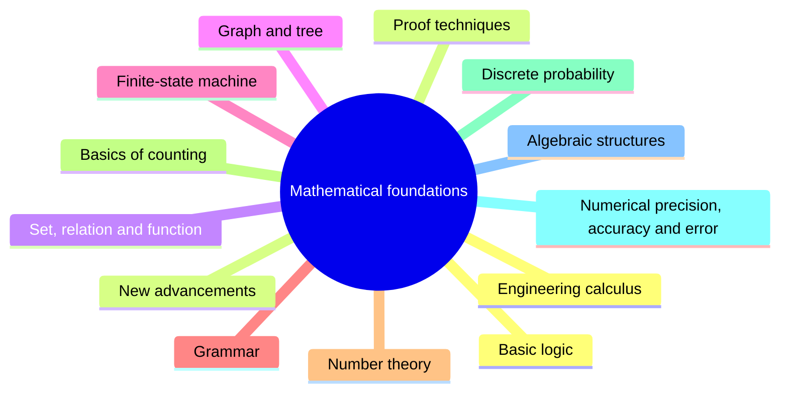

# Mathematical foundations

Mathematical foundations give software engineers the tools for precise reasoning about programs: logic, sets, graphs, automata, counting, probability and numerical precision.

This knowledge area follows Chapter 17 of the [SWEBOK Guide V4.0](https://www.computer.org/education/bodies-of-knowledge/software-engineering) (IEEE Computer Society, 2024). Its sections are the topics of that chapter, in the same order.

## Map

The map shows the sections of this part of the library.

## Topics

- [Basic logic](basic-logic/README.md) (planned): Propositional and predicate logic.
- [Proof techniques](proof-techniques/README.md) (planned): Direct proof, proof by contradiction, induction and their use in reasoning about programs.
- [Set, relation and function](set-relation-function/README.md) (planned): Sets, relations and functions as the vocabulary of data and specifications.
- [Graph and tree](graph-and-tree/README.md) (planned): Graphs and trees as mathematical objects.
- [Finite-state machine](finite-state-machine/README.md) (planned): Finite-state machines and their use for modeling behavior.
- [Grammar](grammar/README.md) (planned): Formal grammars and languages, the basis of parsers and domain-specific languages.
- [Number theory](number-theory/README.md) (planned): Divisibility, primes and modular arithmetic, used in hashing and cryptography.
- [Basics of counting](basics-of-counting/README.md) (planned): Combinatorics: sum and product rules, permutations and combinations.
- [Discrete probability](discrete-probability/README.md) (planned): Probability over finite sample spaces, used in reliability and randomized algorithms.
- [Numerical precision, accuracy and error](numerical-precision-accuracy-and-error/README.md) (planned): Floating point representation and its errors.
- [Algebraic structures](algebraic-structures/README.md) (planned): Groups, rings and other structures that appear in error correction and cryptography.
- [Engineering calculus](engineering-calculus/README.md) (planned): Derivatives, integrals and their applications in engineering.
- [New advancements](new-advancements/README.md) (planned): Mathematical topics that have recently become relevant to software engineering.

TODO: no notes yet. Start with the planned topics of the sections listed above.
