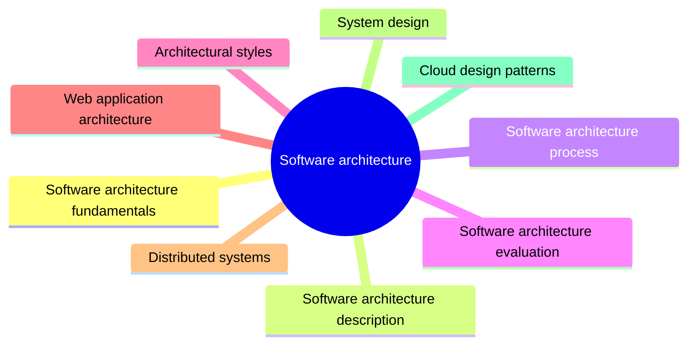

# Software architecture

Software architecture is the set of fundamental decisions about how a system is structured into elements, how those elements relate and which principles guide its evolution. This knowledge area covers the fundamentals, architecture description, the architecture process and evaluation, together with catalogs of architectural styles, distributed system concepts and cloud design patterns.

This knowledge area follows Chapter 2 of the [SWEBOK Guide V4.0](https://www.computer.org/education/bodies-of-knowledge/software-engineering) (IEEE Computer Society, 2024). Its sections are the topics of that chapter, in the same order.

## Map

The map shows the sections of this part of the library.

## Topics

- [Software architecture fundamentals](fundamentals/README.md) (6 notes): What software architecture is, why it matters, the levels at which architects work and the responsibilities of the role.
- [Software architecture description](description/README.md) (4 notes): How an architecture is documented: views, viewpoints, models and the enterprise architecture frameworks that organize them.
- [Software architecture process](process/README.md) (planned): How architectural decisions are made: from analyzing drivers to synthesizing and evaluating candidate designs.
- [Software architecture evaluation](evaluation/README.md) (planned): How an architecture is reviewed against its quality goals before and after it is built.
- [Architectural styles](architectural-styles/README.md) (9 notes): Recurring large scale structures of software systems, such as layered, client-server, service-oriented, microservices and serverless architectures, with their trade offs.
- [Web application architecture](web-architecture/README.md) (2 notes): Architectural choices specific to web applications: where pages are rendered and how a large frontend is split between teams.
- [Distributed systems](distributed-systems/README.md) (6 notes): Concepts that govern systems whose components run on networked computers: consistency, partitions, the CAP theorem and actor based concurrency.
- [System design](system-design/README.md) (19 notes): Building blocks used when designing a concrete system for a set of requirements: caching, background jobs, asynchronous processing and the performance antipatterns to avoid.
- [Cloud design patterns](cloud-design-patterns/README.md) (41 notes): Proven solutions to recurring problems in distributed cloud applications, grouped by the concern they address: messaging, data management, design and implementation, availability, resiliency and security.
