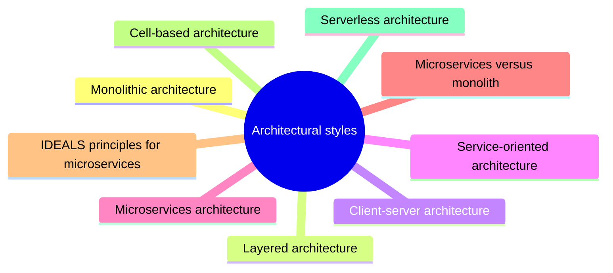

# Architectural styles

Recurring large scale structures of software systems, such as layered, client-server, service-oriented, microservices and serverless architectures, with their trade offs.

This is a catalog section: it groups a large body of related notes inside the knowledge area. It is not a separate SWEBOK topic.

## Map

The map shows the notes and sections of this part of the library.

## Reading order

1. [Monolithic architecture](monolithic-architecture.md): A monolithic architecture builds and deploys an application as a single unit: one codebase, one build artifact and usually one database, running as one process or as identical copies behind a load...
2. [Layered architecture](layered-architecture.md): The Layered Architecture is a software design pattern that organizes a system into logical layers, each responsible for a specific aspect of the application.
3. [Client-server architecture](client-server-architecture.md): Client-server architecture is a distributed system framework where tasks and workloads are divided between service providers (servers) and service requesters (clients).
4. [Service-oriented architecture](service-oriented-architecture.md): Service-Oriented Architecture (SOA) is a software design methodology that uses independent, self-contained software components called services to build business applications.
5. [Microservices architecture](microservices.md): Microservices are an architectural and organizational approach to software development where software is composed of small independent services that communicate over well-defined APIs.
6. [Microservices versus monolith](microservices-vs-monolith.md): A monolith is deployed as one unit, while microservices split an application into small services that are deployed and scaled independently.
7. [IDEALS principles for microservices](ideals-principles.md): IDEALS is a set of six principles for microservice design proposed as a counterpart of SOLID: interface segregation, deployability, event-driven, availability over consistency, loose coupling and...
8. [Cell-based architecture](cell-based-architecture.md): Cell-based architecture in software is a design framework where the application is divided into a collection of individual units called "cells." Each cell operates independently and can communicate...
9. [Serverless architecture](serverless-architecture.md): Serverless architecture (also known as serverless computing or function as a service, FaaS) is a software design pattern where applications are hosted by a third-party service, eliminating the need...

## Planned topics

- Modular monolith
- Event-driven architecture
- Pipe and filter architecture
- Microkernel (plugin) architecture
- Space-based architecture
- Hexagonal and clean architecture
