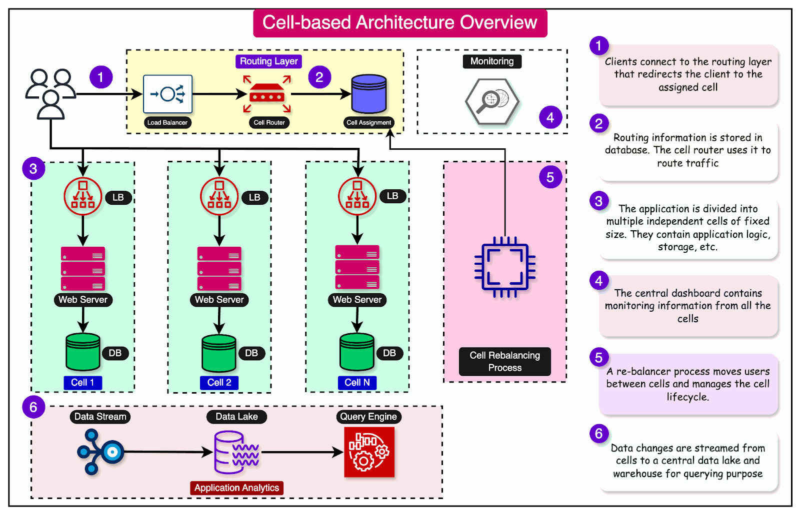

# Cell-based architecture

## Summary

Cell-based architecture in software is a design framework where the application is divided into a collection of individual units called "cells." Each cell operates independently and can communicate with other cells. This setup allows for better management and scaling because each cell can be developed, tested, and deployed separately. It's like building with blocks, you can add, remove, or change one without affecting the whole structure. This approach often leads to more reliable and easier-to-maintain software systems.

## Prerequisites

TODO: link the notes a reader should know first.

## Core concepts

### Definition

Cell-based architecture in software is a design framework where the application is divided into a collection of individual units called "cells." Each cell operates independently and can communicate with other cells. This setup allows for better management and scaling because each cell can be developed, tested, and deployed separately. It's like building with blocks, you can add, remove, or change one without affecting the whole structure. This approach often leads to more reliable and easier-to-maintain software systems.

No one wants to sail in a ship that can sink because of a single hull breach.

This led to the development of bulkheads, which are vertical partition walls that divide a ship’s interior into watertight compartments.

Cell-based architecture attempts to follow the same concept in software development.

In cell-based architecture, there are multiple isolated instances of a workload, where each instance is known as a cell. There are three properties of a cell:

- Each cell is independent.
- A cell does not share the state with other cells.
- Each cell handles a subset of the overall traffic.

For example, imagine a web application that handles user requests. In a cell-based architecture, multiple cells of the same web application would be deployed, each serving a subset of the user requests. These cells are copies of the same application working together to distribute the workload.

This approach reduces the blast radius of impact. If a workload uses 5 cells to service 50 requests, a failure in only one cell means that 80% of the requests are unaffected by the failure.

In other words, failure isolation is the biggest benefit of a cell-based architecture.

## Worked example

TODO: add a concrete, reproducible example with real values.

## Trade offs and when to use it

### Advantages

1. **Modularity**: Cell-based architecture breaks down the software into smaller, manageable pieces, or "cells." This makes it easier to understand, develop, and maintain.
2. **Scalability**: It's simpler to scale a cell-based system. If you need more power, you can just add more cells without changing the whole system.
3. **Flexibility**: Cells can be developed and deployed independently. This means you can update one part of the software without messing with the rest.
4. **Resilience**: If one cell fails, it doesn't bring down the entire system. The other cells can keep working, which makes the whole system more reliable.
5. **Efficiency in Development**: Different teams can work on different cells at the same time. This speeds up development because work happens in parallel.
6. **Easier Testing**: Since cells are independent, you can test them one by one. This makes finding and fixing bugs a lot easier.
7. **Reusability**: Cells can often be reused in different parts of the software or even in different projects, saving time and effort.
8. **Better Performance Management**: You can monitor and manage the performance of each cell separately, which helps in maintaining overall system performance.
9. **Customization**: It's easier to customize parts of the software for different users or uses when it's broken into cells.
10. **Simplified Integration**: Integrating with other systems or adding new features is often easier with a cell-based structure since you can focus on connecting or modifying only the relevant cells.

### Disadvantages

1. **Complexity in Design and Management**: Cell-based architecture can be quite complex to design properly. Each cell needs to be managed, which can be a lot of work.
2. **Difficulty in Scaling**: If your software needs to handle more users or data, it might be hard to scale up with a cell-based structure. You might need to add more cells or change the way they interact, which isn't always easy.
3. **Potential for Increased Latency**: Because cells often need to communicate with each other, there can be delays, known as latency. This means your software might run slower, especially if the cells are spread across different locations.
4. **Challenges with Consistency**: Keeping data consistent across all cells can be tough. If one cell has outdated information, it could cause problems.
5. **Higher Costs**: Setting up a cell-based system can be expensive. You need the right technology and possibly more staff to keep everything running smoothly.
6. **Risk of Isolation**: Sometimes, cells can become isolated from the rest of the system due to errors or network issues. This can lead to parts of your software not working.
7. **Trouble with Debugging and Testing**: Finding and fixing bugs in a cell-based system can be harder than in a traditional setup. Testing that everything works together properly can also be more complicated.
8. **Dependency on Network Reliability**: Since cells often rely on networks to communicate, any network problems can seriously affect your software's performance.
9. **Learning Curve**: Developers might need time to learn how to work with cell-based architectures effectively, which can slow down your project at the start.
10. **Overhead from Inter-Cell Communication**: There's extra work involved when cells talk to each other, which can use up valuable resources like processing power and memory.

## Common mistakes

TODO: list frequent misunderstandings and failure modes, with the fix for each.

## Practice

TODO: add three to five questions, with answers at the bottom.

## Further reading

- Amazon Web Services (2023). [*Reducing the Scope of Impact with Cell-Based Architecture*](https://docs.aws.amazon.com/wellarchitected/latest/reducing-scope-of-impact-with-cell-based-architecture/reducing-scope-of-impact-with-cell-based-architecture.html). AWS. An AWS Well-Architected whitepaper on cells, cell routers, cell sizing and migration to cells.

TODO: check the content of this note against the sources above and record what was verified and when.
