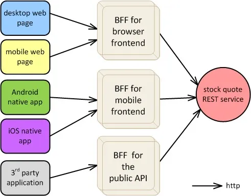
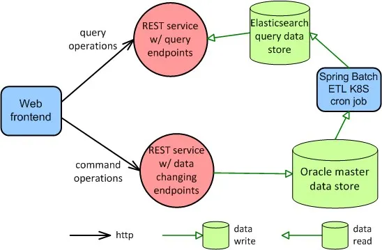

# IDEALS principles for microservices

## Summary

IDEALS is a set of six principles for microservice design proposed as a counterpart of SOLID: interface segregation, deployability, event-driven, availability over consistency, loose coupling and single responsibility. They address concerns of services that run and fail independently, which SOLID, aimed at classes, does not cover.

## Prerequisites

TODO: link the notes a reader should know first.

## Core concepts

### IDEALS

- For object-oriented design we follow the SOLID principles. For microservice design we propose developers follow the “IDEALS”: **interface segregation, deployability (is on you), event-driven, availability over consistency, loose-coupling, and single responsibility.**
- Interface segregation tells us that different types of clients (e.g., mobile apps, web apps, CLI programs) should be able to interact with services through the contract that best suits their needs.
- Deployability (is on you) acknowledges that in the microservice era, which is also the DevOps era, there are critical design decisions and technology choices developers need to make regarding packaging, deploying and running microservices.
- Event-driven suggests that whenever possible we should model our services to be activated by an asynchronous message or event instead of a synchronous call. Availability over consistency reminds us that more often end users value the availability of the system over strong data consistency, and they’re okay with eventual consistency.
- Loose-coupling remains an important design concern in the case of microservices, with respect to afferent (incoming) and efferent (outgoing) coupling. Single responsibility is the idea that enables modeling microservices that are not too large or too slim because they contain the right amount of cohesive functionality.

Although some of the SOLID principles apply to microservices, object orientation is a design paradigm that deals with elements (classes, interfaces, hierarchies, etc.) that are fundamentally different from elements in distributed systems in general, and microservices in particular.

Thus, we propose the following set of core principles for microservice design:

- **I**nterface segregation
- **D**eployability (is on you)
- **E**vent-driven
- **A**vailability over consistency
- **L**oose coupling
- **S**ingle responsibility

#### Interface segregation

The original [Interface Segregation Principle](https://web.archive.org/web/20150905081110/http:/www.objectmentor.com/resources/articles/isp.pdf) admonishes OO classes with "fat" interfaces. In other words, instead of a class interface with all possible methods clients might need, there should be separate interfaces catering to the specific needs of each type of client.

##### Realizing interface segregation for microservices

The goal of interface segregation for microservices is that each type of frontend sees the service contract that best suits its needs. For example: a mobile native app wants to call endpoints that respond with a short JSON representation of the data; the same system has a web application that uses the full JSON representation; there’s also an old desktop application that calls the same service and requires a full representation but in XML.

Instead of trying to impose the same service contract (using canonical models) on all types of service clients, we "segregate the interface" so that each type of client sees the service interface that it needs. How do we do that? A prominent alternative is to use an API gateway. It can do message format transformation, message structure transformation, protocol bridging, message routing, and much more. A popular alternative is the [Backend for Frontends](https://samnewman.io/patterns/architectural/bff/) (BFF) pattern. In this case, we have an API gateway for each type of client -- we commonly say we have a different BFF for each client, as illustrated in this figure.

#### Deployability (is on you)

The realm of technology and design decisions that here we’re calling "deployability" has become critical to the success of microservices. The main reason is the simple fact that microservices dramatically increase the number of deployment units.

So, the letter D in IDEALS indicates to the microservice developer that they are also responsible for making sure the software and its new versions are readily available to its happy users. Altogether, deployability involves:

- Configuring the runtime infrastructure, which includes containers, pods, clusters, persistence, security, and networking.
- Scaling microservices in and out, or migrating them from one runtime environment to another.
- Expediting the commit+build+test+deploy process.
- Minimizing downtime for replacing the current version.
- Synchronizing version changes of related software.
- Monitoring the health of the microservices to quickly identify and remedy faults.

##### Achieving good deployability

Automation is the key to effective deployability. Automation involves wisely employing tools and technologies, and this is the space where we have continuously seen the most change since the advent of microservices.

Here is a list of strategies and technologies that developers should consider in any microservice-based solution to improve deployability:

**Containerization and container orchestration**: a containerized microservice is much easier to replicate and deploy across platforms and cloud providers, and an orchestration platform provides shared resources and mechanisms for routing, scaling, replication, load-balancing, and more. Docker and Kubernetes are today’s de facto standards for containerization and container orchestration.

**Service mesh**: this kind of tool can be used for traffic monitoring, policy enforcement, authentication, RBAC, routing, circuit breaker, message transformation, among other things to help with the communication in a container orchestration platform. Popular service meshes include Istio, Linkerd, and Consul Connect.

**API gateway**: by intercepting calls to microservices, an API gateway product provides a rich set of features, including message transformation and protocol bridging, traffic monitoring, security controls, routing, cache, request throttling and API quota, and circuit breaking. Prominent players in this space include Ambassador, Kong, Apiman, WSO2 API Manager, Apigee, and Amazon API Gateway.

**Serverless architecture**: you can avoid much of the complexity and operational cost of container orchestration by deploying your services to a serverless platform, which follows the FaaS paradigm. AWS Lambda, Azure Functions, and Google Cloud Functions are examples of serverless platforms.

**Monitoring tools**: with microservices spread across your on-premises and cloud infrastructure, being able to predict, detect, and notify issues related to the health of the system is critical. There are several monitoring tools available, such as New Relic, CloudWatch, Datadog, Prometheus, and Grafana.

**Log consolidation tools**: microservices can easily increase the number of deployment units by an order of magnitude. We need tools to consolidate the log output from these components, with the ability to search, analyze, and generate alerts. Popular tools in this space are Fluentd, Graylog, Splunk, and ELK (Elasticsearch, Logstash, Kibana).

**Tracing tools**: these tools can be used to instrument your microservices, and then produce, collect, and visualize runtime tracing data that shows the calls across services. They help you to spot performance issues (and sometimes even help you to understand the architecture). Examples of tracing tools are Zipkin, Jaeger, and AWS X-Ray.

**DevOps**: microservices work better when devs and ops teams communicate and collaborate more closely, from infrastructure configuration to incident handling.

**Blue-green deployment and canary releasing**: these deployment strategies allow zero or near-zero downtime when releasing a new version of a microservice, with a quick switchback in case of problems.

**Infrastructure as Code (IaC)**: this practice enables minimal human interaction in the build-deploy cycle, which becomes faster, less error-prone, and more auditable.

**Continuous delivery**: this is a required practice to shorten the commit-to-deploy interval yet keeping the quality of the solutions. Traditional CI/CD tools include Jenkins, GitLab CI/CD, Bamboo, GoCD, CircleCI, and Spinnaker. More recently, GitOps tools such as Weaveworks and Flux have been added to the landscape, combining CD and IaC.

**Externalized configuration**: this mechanism allows configuration properties to be stored outside the microservice deployment unit and easily managed.

#### Event-Driven

The microservice architecture style is for creating (backend) services that are typically activated using one of these three general types of connectors:

- HTTP call (to a REST service)
- RPC-like call using a platform-specific component technology, such as gRPC or GraphQL
- An asynchronous message that goes through a queue in a message broker

The first two are typically synchronous, HTTP calls being the most common alternative. Often, services need to call others forming a service composition, and many times the interaction in a service composition is *synchronous*. If instead, we create (or adapt) the participating services to connect and receive messages from a queue/topic, we’ll be creating an event-driven architecture.

An important benefit of an event-driven architecture is improved scalability and throughput. This benefit stems from the fact that message senders are not blocked waiting for a response, and the same message/event can be consumed in parallel by multiple receivers in a publish-subscribe fashion.

##### Event-driven microservice

The design needs to account for faults and lost messages -- correction events, and mechanisms for undoing data changes such as the Saga pattern are often necessary. And for user-facing transactions carried over by an event-driven architecture, the *user experience* should be carefully conceived to keep the end-user informed of progress and mishaps.

#### Availability over consistency

The CAP theorem essentially gives you two options: availability XOR consistency. We see an enormous effort in the industry to provide mechanisms that enable you to choose availability, ergo embrace *eventual consistency*.

##### Availability with eventual consistency

For microservices, the main strategy that enables the availability choice is data replication. Different design patterns can be employed, sometimes combined:

**Service Data Replication pattern**: this basic pattern is used when a microservice needs to access data that belongs to other applications (and API calls are not suitable to get the data). We create a replica of that data and make it readily available to the microservice. The solution also requires a data synchronization mechanism (e.g., ETL tool/program, publish-subscribe messaging, materialized views), which will periodically or trigger-based make the replica and master data consistent.

[**Command Query Responsibility Segregation**](https://martinfowler.com/bliki/CQRS.html) **(CQRS) pattern**: here we separate the design and implementation of operations that change data (commands) from the ones that only read data (queries). CQRS typically builds on Service Data Replication for the queries for improved performance and autonomy.

#### Loose-Coupling

In software engineering, coupling refers to the degree of interdependence between two software elements. For service-based systems, *afferent coupling* is related to how service users interact with the service. We know this interaction should be through the service contract. Also, the contract should not be tightly coupled to implementation details or a specific technology. A service is a distributed component that can be called by different programs.

Services often need to interact with other services or other types of components thus generating *efferent coupling*. This interaction establishes runtime dependencies that directly impact the service autonomy. If a service is less autonomous, its behavior is less predictable: in the best-case scenario, the service will be as fast, reliable, and available as the slowest, least reliable, and least available component it needs to call.

##### Loose coupling strategies for services

The letter L in IDEALS prompts us to be attentive to coupling for services and therefore microservices. Several strategies can be used and combined to promote (afferent and efferent) loose coupling. Examples of such strategies include:

- **Point-to-point and publish-subscribe**: these building block messaging patterns and their variations promote loose coupling because senders and receivers are not aware of each other; the contract of a reactive microservice (e.g., a Kafka consumer) becomes the name of the message queue and the structure of the message.
- **API gateway and BFF**: these solutions prescribe an intermediary component that deals with any discrepancies between the contract of the service and the message format and protocol that the client wants to see, hence helping to uncouple them.
- **Contract-first design**: by designing the contract independently of any existing code we avoid creating APIs that are tightly coupled to technology and implementation.
- **Hypermedia**: for REST services, hypermedia helps frontends to be more independent of service endpoints.
- **Façade and Adapter/Wrapper patterns**: variations of these GoF patterns in microservice architectures can prescribe internal components or even services that can prevent undesirable coupling to spread across a microservice implementation.
- **Database per Microservice pattern**: with this pattern, microservices not only gain in autonomy but also avoid direct coupling to shared databases.

#### Single responsibility

The original Single Responsibility Principle (SRP) is about having cohesive functionality in an OO class. Having multiple responsibilities in a class naturally leads to tight coupling, and results in fragile designs that are hard to evolve and can break in unexpected ways upon changing. The idea is simple, but as Uncle Bob pointed out, SRP is very easy to understand, but difficult to get right.

The notion of single responsibility can be extended to the cohesiveness of services within a microservice. The microservice architecture style dictates that the [deployment unit should contain only one service or just a few cohesive services](https://insights.sei.cmu.edu/saturn/2015/11/defining-microservices.html). If a microservice is packed with responsibilities, that is, too many not quite cohesive services, then it might bear the pains of a monolith. A bloated microservice becomes harder to evolve in terms of functionality and the technology stack. Also, continuous delivery becomes burdensome with many developers working on several moving parts that go in the same deployment unit.

##### Right-grained microservices

An important aspect of maturity in microservice design is the ability to create microservices that are not too coarse- or too fine-grained. Here the solution is not in any tool or technology, but rather on proper *domain modeling*. Modeling the backend services and defining microservice boundaries for them can be done in many ways. An approach that has become popular in the industry to drive the scope of microservices is to follow [Domain-Driven Design (DDD)](https://www.infoq.com/minibooks/domain-driven-design-quickly/) precepts. In brief:

- A service (e.g., a REST service) can have the scope of a DDD aggregate.
- A microservice can have the scope of a DDD bounded context. Services within that microservice will correspond to the aggregates within that bounded context.
- For inter-microservice communication, we can use: domain events when asynchronous messaging fits the requirements; API calls using some form of an anti-corruption layer when a request-response connector is more appropriate; or data replication with eventual consistency when a microservice needs a substantial amount of data from the other BC readily available.

## Worked example

TODO: add a concrete, reproducible example with real values.

## Trade offs and when to use it

TODO: describe benefits, costs, alternatives and when this is the wrong choice.

## Common mistakes

TODO: list frequent misunderstandings and failure modes, with the fix for each.

## Practice

TODO: add three to five questions, with answers at the bottom.

## Further reading

- Merson, P., Yoder, J. (2020). [*IDEALS, Not SOLID: Principles for Microservice Design*](https://www.infoq.com/articles/microservices-design-ideals/). InfoQ. The article that proposed the IDEALS principles and explains each of them.

TODO: check the content of this note against the sources above and record what was verified and when.
