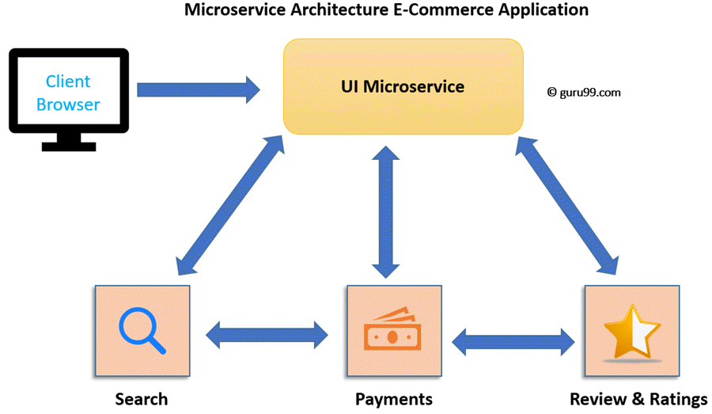

# Microservices versus monolith

## Summary

A monolith is deployed as one unit, while microservices split an application into small services that are deployed and scaled independently. Microservices buy team autonomy, independent deployment and fine grained scaling at the price of network calls, distributed data and operational complexity. The note compares the two styles and relates microservices to service-oriented architecture.

## Prerequisites

TODO: link the notes a reader should know first.

## Core concepts

**Microservices** is a service-oriented architecture pattern wherein applications are built as a collection of various smallest independent service units. It is a software engineering approach that focuses on decomposing an application into single-function modules with well-defined interfaces. These modules can be independently deployed and operated by small teams that own the entire lifecycle of the service.

### Monolithic architecture

In layman terms, you can say that Monolithic architecture is like a big container in which all the software components of an application are clubbed into a single package.

### Microservice architecture

**Microservice Architecture** is an architectural development style that allows building applications as a collection of small autonomous services developed for a business domain. It is a variant of structural style architecture that helps arrange applications as a loosely coupled service collection. The Microservice Architecture contains fine-grained services and lightweight protocols.

In the Monolithic Architecture, all the components coalesce into a single module. But, in Microservices Architecture they are spread into individual modules(microservice) which communicate with each other as shown in the Microservices example above. The communication between microservices is a stateless communication where each pair of request and response is independent. Hence, Microservices can communicate effortlessly. In the Microservice Architecture, the Data is federated. Each Microservice has its separate data store.

### Microservice challenges

- MicroServices rely on each other, and they will have to communicate with each other.
- Compared to monolithic systems, there are more services to monitor which are developed using different [programming languages](https://www.guru99.com/best-programming-language.html).
- As it is a distributed system, it is an inherently complex model.
- Different services will have its separate mechanism, resulting in a large amount of memory for an unstructured data.
- Effective management and teamwork required to prevent cascading issues
- Reproducing a problem will be a difficult task when it’s gone in one version, and comes back in the latest version.
- Independent Deployment is complicated with Microservices.
- Microservice architecture brings plenty of operations overhead.
- It is difficult to manage application when new services are added to the system
- A wide array of skilled professionals is required to support heterogeneously distributed microservices
- Microservice is costly, as you need to maintain different server space for different business tasks.

### Best practices of microservices architecture

- Separate data store for each Microservice
- Keep code of a similar level of maturity.
- Separate build for each Micro service.
- Always treat, severe as stateless.

## Worked example

TODO: add a concrete, reproducible example with real values.

## Trade offs and when to use it

### Microservices vs. monolithic architecture

| Microservices | Monolithic Architecture |
| --- | --- |
| Every unit of the entire application should be the smallest, and it should be able to deliver one specific business goal. | A single code base for all business goals |
| Service Startup is relatively quick | Service startup takes more time |
| Fault isolation is easy. Even if one service goes down, other can continue to function. | Fault isolation is difficult. If any specific feature is not working, the complete system goes down. In order to handle this issue, the application needs to re-built, re-tested and also re-deployed. |
| All microservices should be loosely coupled so that changes made in one does not affect the other. | Monolithic architecture is tightly coupled. Changes in one module of code affect the other |
| Businesses can deploy more resources to services that are generating higher ROI | Since services are not isolated, individual resource allocation not possible |
| More hardware resources could be allocated to the service that is frequently used. In the e-commerce example above, more number of users check the product listing and search compared to payments. So, more resources could be allocated to the search and product listing microservice. | Application scaling is challenging as well as wasteful. |
| Microservices always remains consistent and continuously available. | Development tools get overburdened as the process needs to start from the scratch. |
| Data is federated. This allows individual Microservice to adopt a data model best suited for its needs. | Data is centralized. |
| Small Focused Teams. Parallel and faster development | Large team and considerable team management effort is required |
| Change in the data model of one Microservice does not affect other Microservices. | Change in data model affects the entire database |
| Interacts with other microservices by using well-defined interfaces | Not applicable |
| Microservices work on the principle that focuses on products, not projects | Put emphasize on the entire project |
| No cross-dependencies between code bases. You can use different technologies for different Microservices. | One function or program depends on others. |

### SOA vs. microservices

SOA services are maintained in the organization by a registry which acts as a directory listing. Applications need to look up the services in the registry and invoke the service.

In another world, [SOA](https://www.guru99.com/soa-principles.html) is just like an orchestra where each artist is performing with his/her instrument while the music director gives instructions to all.

On the other end, Microservices is a form of service-oriented architecture style wherein applications are built as a collection of different smaller services instead of one software or application.

Microservices is just like a troupe where each dancer is independent and know what they need to do. So, if they miss some steps, they know how to get back on the correct sequence.

| Parameter | SOA | Microservices |
| --- | --- | --- |
| Design type | In SOA, software components are exposed to the outer world for usage in the form of services. | Micro Service is a part of SOA. It is an implementation of SOA. |
| Dependency | Business units are dependent. | They are independent of each other. |
| Size of the Software | Software size is larger than any conventional software | The size of the Software is always small in Microservices |
| Technology Stack | The technology stack is lower compared to Microservice. | Microservice technology stack could be very large |
| Nature of the application | Monolithic in nature | Full stack in nature |
| Independent and Focus | SOA applications are built to perform multiple business tasks. | They are built to perform a single business task. |
| Deployment | The deployment process is time- consuming. | Deployment is straightforward and less time-consuming. |
| Cost, effectiveness | More cost-effective. | Less cost-effective. |
| Scalability | Less compared to Microservices. | Highly scalable. |
| Business logic | Business logic components are stored inside of single service domain Simple wire protocols(HTTP with XML JSON)API is driven with SDKs/Clients | Business logic can live across domains enterprise Service Bus like layers between services Middleware |

## Common mistakes

TODO: list frequent misunderstandings and failure modes, with the fix for each.

## Practice

TODO: add three to five questions, with answers at the bottom.

## Further reading

- Lewis, J., Fowler, M. (2014). [*Microservices*](https://martinfowler.com/articles/microservices.html). martinfowler.com. The article that described the common characteristics of microservice architectures.
- Fowler, M. (2015). [*MonolithFirst*](https://martinfowler.com/bliki/MonolithFirst.html). martinfowler.com. An argument for starting with a monolith and splitting it once boundaries are understood.

TODO: check the content of this note against the sources above and record what was verified and when.
