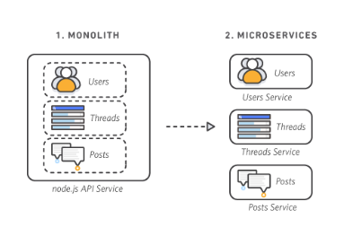
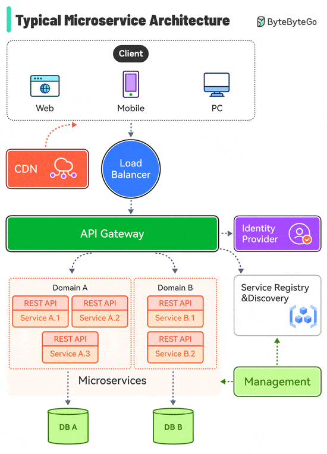
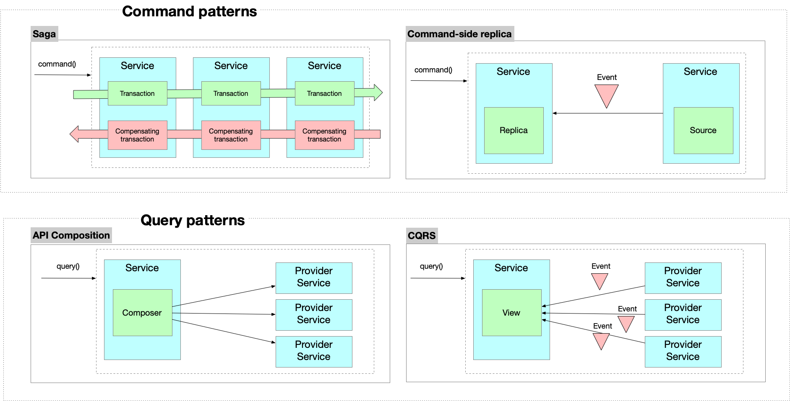

# Microservices architecture

## Summary

Microservices are an architectural and organizational approach to software development where software is composed of small independent services that communicate over well-defined APIs. These services are owned by small, self-contained teams.

## Prerequisites

TODO: link the notes a reader should know first.

## Core concepts

### Definition

Microservices are an architectural and organizational approach to software development where software is composed of small independent services that communicate over well-defined APIs. These services are owned by small, self-contained teams.

With a microservices architecture, an application is built as independent components that run each application process as a service. These services communicate via a well-defined interface using lightweight APIs. Services are built for business capabilities and each service performs a single function. Because they are independently run, each service can be updated, deployed, and scaled to meet demand for specific functions of an application.

### Characteristics

#### Autonomous

Each component service in a microservices architecture can be developed, deployed, operated, and scaled without affecting the functioning of other services. Services do not need to share any of their code or implementation with other services. Any communication between individual components happens via well-defined APIs.

##### Specialized

Each service is designed for a set of capabilities and focuses on solving a specific problem. If developers contribute more code to a service over time and the service becomes complex, it can be broken into smaller services.

##### Modular components

Microservices are divided into independent services, allowing updates and redeployment of specific parts without affecting the whole application. However, this adds complexity, expensive remote calls, and challenges in redistributing responsibilities.

##### Business-Oriented

Organized around business capabilities, microservices utilize cross-functional teams responsible for the entire product lifecycle, embracing the "You build it, you run it" philosophy.

##### Simple routing

Microservices handle requests, process them, and respond without complex routing systems. They rely on "smart endpoints" for logic and "dumb pipes" for data flow.

##### Decentralized

Unlike monolithic systems with centralized governance and a single database, microservices feature decentralized governance and each service manages its own database.

##### Resilient to failures

Designed to handle failures gracefully by isolating issues in individual services, ensuring the rest of the system continues functioning. Monitoring is key to reducing failure risks.

##### Evolutionary design

Suitable for adapting to unforeseen requirements and future technologies, microservices can evolve from monolithic systems by integrating via APIs.

### Architecture

#### Standard API

- Load Balancer: This distributes incoming traffic across multiple backend services.
- CDN (Content Delivery Network): CDN is a group of geographically distributed servers that hold static content for faster delivery. The clients look for content in CDN first, then progress to backend services.
- API Gateway: This handles incoming requests and routes them to the relevant services. It talks to the identity provider and service discovery.
- Identity Provider: This handles authentication and authorization for users.
- Service Registry & Discovery: Microservice registration and discovery happen in this component, and the API gateway looks for relevant services in this component to talk to.
- Management: This component is responsible for monitoring the services.
- Microservices: Microservices are designed and deployed in different domains. Each domain has its database.

#### Designing distributed operations

Another key design challenge when using microservices, is implementing distributed operations, which span multiple services. This is especially challenging since each service has its own database. The solution is to use the service collaboration patterns, which implement distributed operations as a series of local transactions:

There are four service collaboration patterns:

- [Saga](https://microservices.io/patterns/data/saga.html), which implements a distributed command as a series of local transactions
- [Command-side replica](https://microservices.io/patterns/data/cqrs.html), which replicas read-only data to the service that implements a command
- [API composition](https://microservices.io/patterns/data/api-composition.html), which implements a distributed query as a series of local queries
- [CQRS](https://microservices.io/patterns/data/cqrs.html), which implements a distributed query as a series of local queries

The Saga, Command-side replica and CQRS patterns use asynchronous messaging. Services typically need to use the [Transaction Outbox pattern](https://microservices.io/patterns/data/transactional-outbox.html) to atomically update persistent business entities and send a message.

### Patterns

- Service collaboration patterns:
    - [Saga](https://microservices.io/patterns/data/saga.html), which implements a distributed command as a series of local transactions
    - [Command-side replica](https://microservices.io/patterns/data/cqrs.html), which replicas read-only data to the service that implements a command
    - [API composition](https://microservices.io/patterns/data/api-composition.html), which implements a distributed query as a series of local queries
    - [CQRS](https://microservices.io/patterns/data/cqrs.html), which implements a distributed query as a series of local queries
- The [Messaging](https://microservices.io/patterns/communication-style/messaging.html) and [Remote Procedure Invocation](https://microservices.io/patterns/communication-style/rpi.html) patterns are two different ways that services can communicate.
- The [Database per Service pattern](https://microservices.io/patterns/data/database-per-service.html) describes how each service has its own database in order to ensure loose coupling.
- The [API Gateway pattern](https://microservices.io/patterns/apigateway.html) defines how clients access the services in a microservice architecture.
- The [Client-side Discovery](https://microservices.io/patterns/client-side-discovery.html) and [Server-side Discovery](https://microservices.io/patterns/server-side-discovery.html) patterns are used to route requests for a client to an available service instance in a microservice architecture.
- Testing patterns: [Service Component Test](https://microservices.io/patterns/testing/service-component-test.html) and [Service Integration Contract Test](https://microservices.io/patterns/testing/service-integration-contract-test.html)
- [Circuit Breaker](https://microservices.io/patterns/reliability/circuit-breaker.html)
- [Access Token](https://microservices.io/patterns/security/access-token.html)
- Observability patterns:
    - [Log aggregation](https://microservices.io/patterns/observability/application-logging.html)
    - [Application metrics](https://microservices.io/patterns/observability/application-metrics.html)
    - [Audit logging](https://microservices.io/patterns/observability/audit-logging.html)
    - [Distributed tracing](https://microservices.io/patterns/observability/distributed-tracing.html)
    - [Exception tracking](https://microservices.io/patterns/observability/exception-tracking.html)
    - [Health check API](https://microservices.io/patterns/observability/health-check-api.html)
    - [Log deployments and changes](https://microservices.io/patterns/observability/log-deployments-and-changes.html)
- UI patterns:
    - [Server-side page fragment composition](https://microservices.io/patterns/ui/server-side-page-fragment-composition.html)
    - [Client-side UI composition](https://microservices.io/patterns/ui/client-side-ui-composition.html)
- The [Single Service per Host](https://microservices.io/patterns/deployment/single-service-per-host.html) and [Multiple Services per Host](https://microservices.io/patterns/deployment/multiple-services-per-host.html) patterns are two different deployment strategies.
- Cross-cutting concerns patterns: [Microservice chassis pattern](https://microservices.io/patterns/microservice-chassis.html) and [Externalized configuration](https://microservices.io/patterns/externalized-configuration.html)

## Worked example

TODO: add a concrete, reproducible example with real values.

## Trade offs and when to use it

### Benefits

| Simpler to deploy | Deploy in literal pieces without affecting other services. |
| --- | --- |
| Simpler to understand | Code is easier to follow since the function is isolated and less dependent. |
| Reusable across business | Share small services like payment or login systems across the business. |
| Faster defect isolation | When a test fails or service goes down, isolate it quickly. |
| Minimized risk from change | Avoid locking in technologies or languages - change on the fly with minimal risk. |

#### Agility

Microservices foster an organization of small, independent teams that take ownership of their services. Teams act within a small and well understood context, and are empowered to work more independently and more quickly. This shortens development cycle times. You benefit significantly from the aggregate throughput of the organization.

##### Flexible scaling

Microservices allow each service to be independently scaled to meet demand for the application feature it supports. This enables teams to right-size infrastructure needs, accurately measure the cost of a feature, and maintain availability if a service experiences a spike in demand.

##### Easy deployment

Microservices enable continuous integration and continuous delivery, making it easy to try out new ideas and to roll back if something doesn’t work. The low cost of failure enables experimentation, makes it easier to update code, and accelerates time-to-market for new features.

##### Technological freedom

Microservices architectures don’t follow a “one size fits all” approach. Teams have the freedom to choose the best tool to solve their specific problems. As a consequence, teams building microservices can choose the best tool for each job.

##### Reusable code

Dividing software into small, well-defined modules enables teams to use functions for multiple purposes. A service written for a certain function can be used as a building block for another feature. This allows an application to bootstrap off itself, as developers can create new capabilities without writing code from scratch.

##### Resilience

Service independence increases an application’s resistance to failure. In a monolithic architecture, if a single component fails, it can cause the entire application to fail. With microservices, applications handle total service failure by degrading functionality and not crashing the entire application.

### Issues

#### Conway's law

- Systems mirror the communication structures of the organizations designing them. Team organization heavily influences system design.
- **Role Allocation in Teams**: Dividing responsibilities effectively (e.g., refunds vs. credits) balances customer satisfaction and operational risks, reflecting how organizational structures shape workflows.
- **Scaling Challenges**: As teams grow, overlapping responsibilities and competing priorities in shared codebases lead to inefficiencies, requiring structured approaches like service-oriented architecture (SOA).
- **SOA Benefits**: SOAs, including microservices, address conflicts arising from shifting priorities and misaligned domain knowledge, improving efficiency by centralizing friction points. However, they require careful coordination to avoid inefficiencies.
- **Interface Separation Principle**: SOAs enforce clear boundaries by isolating communication points. Without proper design, this can unintentionally create smaller, interconnected monoliths, leading to code duplication and mismanagement.

## Common mistakes

TODO: list frequent misunderstandings and failure modes, with the fix for each.

## Practice

TODO: add three to five questions, with answers at the bottom.

## Further reading

- Lewis, J., Fowler, M. (2014). [*Microservices*](https://martinfowler.com/articles/microservices.html). martinfowler.com. The article that described the common characteristics of microservice architectures.

TODO: check the content of this note against the sources above and record what was verified and when.
