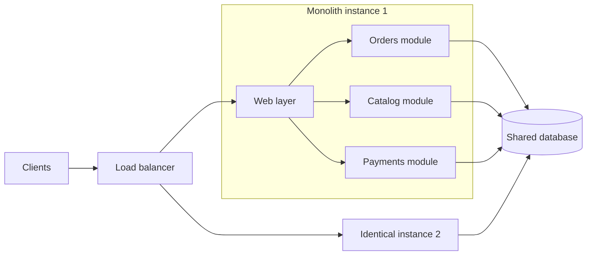

# Monolithic architecture

## Summary

A monolithic architecture builds and deploys an application as a single unit: one codebase, one build artifact and usually one database, running as one process or as identical copies behind a load balancer. It is the simplest architecture to develop, test, deploy and debug while the team and the domain are small. Its costs appear with growth: every change redeploys everything, parts cannot scale independently, and without discipline the internal structure decays into a "big ball of mud".

## Prerequisites

- [Layered architecture](layered-architecture.md), the usual internal structure of a monolith.
- [Coupling and cohesion](../../software-design/fundamentals/coupling-and-cohesion.md), which decide whether a monolith stays maintainable.

## Core concepts

### Definition

A *monolith* is an application whose components are packaged and deployed together as one deployable unit. The defining property is the deployment unit, not the code quality: a monolith can be well structured internally (a *modular monolith*) or tangled. Components call each other with in-process function calls, share one memory space and usually share one database schema.

The diagram contrasts a monolith with a set of services: in the monolith every module ships in the same artifact and talks to the same database.

### Analogy

A monolith is like a single restaurant kitchen where all cooks share one room, one pantry and one set of stoves. Coordination is easy because everyone can talk across the room, and a new dish only needs one kitchen. When the restaurant grows, the cooks start getting in each other's way, and closing the kitchen to repair one stove stops every dish. The analogy breaks in one place: cooks can be added to a kitchen one at a time, while a monolith can only be scaled by copying the whole kitchen.

### How it works

1. All modules are compiled and packaged into one artifact (for example one executable, one container image or one web archive).
2. The artifact runs as one process. To scale, identical copies run behind a load balancer (horizontal scaling of the whole application).
3. Modules communicate through in-process calls, which are fast (nanoseconds to microseconds) and cannot fail because of the network.
4. Data lives in one database, so a business operation that touches several modules can use one local ACID transaction.

### Modular monolith

A *modular monolith* keeps the single deployment unit but enforces strong internal boundaries: each module owns its data and exposes an explicit interface, and other modules may not reach into its internals. It keeps most of the operational simplicity of a monolith while preparing clean seams along which services can be extracted later if they are ever needed.

## Worked example

TODO: add a concrete example, such as an online shop with orders, catalog and payments modules, showing one change deployed as a monolith and the same change in a service based system.

## Trade offs and when to use it

| Aspect | Monolith | Microservices |
| --- | --- | --- |
| Deployment | One artifact, all or nothing | Each service independently |
| Scaling | Whole application | Per service |
| Calls between parts | In-process, fast, reliable | Over the network, slower, can fail |
| Transactions | Local ACID transactions | Distributed, usually eventual consistency |
| Operations | One thing to run and monitor | Many services, needs mature automation |
| Team autonomy | Shared codebase and release | Teams own services end to end |

Use a monolith when the team is small, the domain is not yet well understood or the product is new. Martin Fowler argues for "monolith first": almost all successful microservice systems started as monoliths that were split once the boundaries were clear, because splitting along wrong boundaries early is expensive. Consider moving away from a monolith when independent deployment, independent scaling or team autonomy become real bottlenecks. See [Microservices versus monolith](microservices-vs-monolith.md) for the comparison in detail.

## Common mistakes

- **Equating monolith with bad design.** The problem is a tangled structure, not a single deployment unit. Fix: enforce module boundaries inside the monolith.
- **Shared tables across modules.** When every module reads and writes every table, no module can change its data model alone. Fix: give each module ownership of its tables and access other modules through their interfaces.
- **Splitting too early.** Extracting services before the domain boundaries are stable creates a distributed monolith that has the costs of both styles. Fix: start modular, split later along proven seams, for example with the [strangler fig pattern](../cloud-design-patterns/design-and-implementation/strangler-fig.md).

## Practice

TODO: add three to five questions, with answers at the bottom.

## Further reading

- Fowler, M. (2015). [*MonolithFirst*](https://martinfowler.com/bliki/MonolithFirst.html). martinfowler.com. An argument for starting with a monolith and splitting it once boundaries are understood.
- Richards, M., Ford, N. (2020). *Fundamentals of Software Architecture*. O'Reilly Media. Covers the role and expectations of an architect, architecture characteristics and the main architectural styles.

TODO: check the content of this note against the sources above and record what was verified and when.
