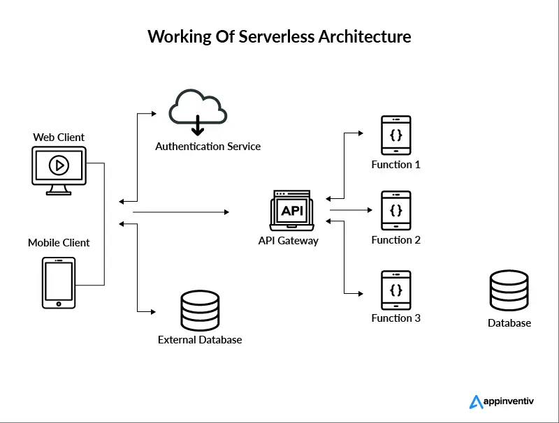

# Serverless architecture

## Summary

Serverless architecture (also known as serverless computing or function as a service, FaaS) is a software design pattern where applications are hosted by a third-party service, eliminating the need for server software and hardware management by the developer. Applications are broken up into individual functions that can be invoked and scaled individually.

## Prerequisites

TODO: link the notes a reader should know first.

## Core concepts

### Definition

Serverless architecture (also known as serverless computing or function as a service, FaaS) is a software design pattern where applications are hosted by a third-party service, eliminating the need for server software and hardware management by the developer. Applications are broken up into individual functions that can be invoked and scaled individually.

A serverless architecture is a way to build and run applications and services without having to manage infrastructure. Your application still runs on servers, but all the server management is done by cloud provider. You no longer have to provision, scale, and maintain servers to run your applications, databases, and storage systems.

Serverless architectures are application designs that incorporate third-party “Backend as a Service” (BaaS) services, and/or that include custom code run in managed, ephemeral containers on a “Functions as a Service” (FaaS) platform. By using these ideas, and related ones like single-page applications, such architectures remove much of the need for a traditional always-on server component.

Serverless can also mean applications where server-side logic is still written by the application developer, but, unlike traditional architectures, it’s run in stateless compute containers that are event-triggered, ephemeral (may only last for one invocation), and fully managed by a third party. One way to think of this is “Functions as a Service” or “FaaS”.

By using a serverless architecture, your developers can focus on their core product instead of worrying about managing and operating servers or runtimes, either in the cloud or on-premises. This reduced overhead lets developers reclaim time and energy that can be spent on developing great products which scale and that are reliable.

#### Key characteristics

1. **No Server Management**:
    - Developers don’t need to provision or maintain servers.
    - The cloud provider handles scaling, patching, and managing servers in the background.
2. **Event-Driven Execution**:
    - Serverless functions are triggered by specific events, such as HTTP requests, file uploads, or database changes.
    - This on-demand execution model makes serverless architecture efficient and cost-effective.
3. **Pay-Per-Use Billing**:
    - Costs are based on the actual execution time of functions and resources used, rather than on pre-allocated capacity.
    - This eliminates the expense of idle infrastructure.
4. **Automatic Scaling**:
    - Serverless applications scale automatically in response to demand.
    - For instance, if a spike in traffic occurs, the cloud provider will dynamically allocate resources to handle it.
5. **Stateless Functions**:
    - Functions in serverless architecture are stateless, meaning they don’t retain data between executions.
    - Any necessary state is managed using external services like databases or storage solutions.

#### Use cases

Serverless architecture is ideal for scenarios where scalability, cost efficiency, and rapid development are priorities. Common examples include:

- **Web Applications**: Build and deploy backend APIs or entire applications.
- **Data Processing**: Process data streams, ETL pipelines, or file uploads.
- **Real-Time Applications**: Power chat applications, IoT solutions, or gaming backends.
- **Scheduled Tasks**: Automate tasks like backups, notifications, or reports.
- **Mobile Backend Services**: Handle authentication, data storage, or API integrations for mobile apps.

#### Advantages

Serverless architecture offers a range of benefits, making it an attractive choice for many applications. These advantages primarily stem from its cost model, scalability, and focus on reducing operational overhead.

##### Cost-Effectiveness

- **Pay-per-Use Billing**: Charges are based on the actual execution time of functions and resources consumed, unlike traditional models requiring pre-provisioned infrastructure. Idle resources incur no costs.
- **No Over-Provisioning**: Avoids paying for unused capacity by scaling dynamically to meet demand.

###### Automatic scaling

- **Elastic Scalability**: Serverless applications automatically scale up to handle high loads and scale down when demand drops. Developers don’t need to manually configure scaling rules or manage infrastructure limits.
- **Fine-Grained Scaling**: Scaling occurs at the function level, ensuring each component of the application adjusts independently.

###### Reduced operational overhead

- **No Server Management**: Developers don’t deal with provisioning, maintaining, or updating servers. The cloud provider handles these tasks.
- **Faster Deployment**: Simplifies the development process, enabling teams to deploy and iterate on applications quickly.

###### Rapid development and iteration

- **Focus on Business Logic**: Developers concentrate on writing code for specific business needs rather than managing infrastructure.
- **Integration with Cloud Services**: Prebuilt services like authentication, database, and storage accelerate development timelines.

###### Built-In resilience

- **Fault Isolation**: Failures in one function don’t impact the entire system, ensuring higher reliability and availability.
- **Redundancy and Recovery**: Cloud providers offer high levels of redundancy, reducing downtime risks and improving disaster recovery.

###### Improved time-to-market

- Serverless platforms provide a faster path from idea to implementation, making them ideal for MVPs, startups, or rapidly evolving projects.

###### Global accessibility

- Functions can be deployed across multiple regions, enabling low-latency responses for users worldwide.

###### Environmentally friendly

- Serverless computing optimizes resource utilization, reducing energy waste and contributing to greener operations.

### Core components

Serverless architecture is built on two primary pillars: **Function-as-a-Service (FaaS)** and **Backend-as-a-Service (BaaS)**. Together, they enable developers to focus on application logic while offloading infrastructure and backend services to cloud providers.

#### Function-as-a-Service (FaaS)

FaaS is the core of serverless computing, allowing developers to run small units of code (functions) in response to events. The cloud provider automatically handles infrastructure, scaling, and execution.

**How it works**:

- Developers write code as discrete, stateless functions.
- Functions are triggered by events such as HTTP requests, database updates, or message queue events.
- The cloud provider provisions the necessary resources, runs the function, and releases resources afterward.

**Key Features**:

- Event-driven: Functions execute only when triggered.
- Stateless: Functions don’t maintain data between executions, promoting scalability.
- Short-lived: Functions typically have a limited execution time (e.g., 15 minutes in AWS Lambda).

##### Backend-as-a-Service (BaaS)

BaaS provides ready-made backend services, such as databases, authentication, storage, and notifications, that integrate seamlessly with serverless functions.

**Common Services**:

- **Databases**: Fully managed databases like AWS DynamoDB, Firebase Firestore, or Azure Cosmos DB.
- **Authentication**: User authentication and identity services like AWS Cognito or Firebase Authentication.
- **File Storage**: Scalable object storage such as AWS S3 or Google Cloud Storage.
- **Messaging**: Managed message queues and notification systems like AWS SNS/SQS or Firebase Cloud Messaging.

**Purpose**:

- Reduces the need for custom backend logic.
- Accelerates development by using pre-built services.
- Ensures scalability and reliability through managed solutions.

### Workflow

Serverless architecture operates by executing code in response to specific events and leveraging managed backend services for operations like storage, database interactions, and messaging.

#### Lifecycle

1. **Trigger/Event**:
    - A function is invoked by an event such as an HTTP request, file upload, database change, or scheduled task.
    - Examples of triggers:
        - API Gateway: HTTP request triggers a function.
        - Cloud Storage: A file upload triggers a processing function.
        - Cron Job: A scheduled event triggers routine operations.
2. **Execution**:
    - When triggered, the cloud provider provisions the resources required to execute the function.
    - The function runs to completion, performing its task (e.g., data processing, sending a response).
3. **Scaling**:
    - Serverless platforms automatically scale resources based on demand.
    - Example: If 10 users send simultaneous requests, 10 instances of the function may execute concurrently.
4. **Termination**:
    - After execution, resources are deprovisioned to minimize costs. Functions do not persist or consume resources when idle.

#### Concepts

**Cold Starts**:

- When a function is triggered after a period of inactivity, the cloud provider initializes the runtime environment, leading to a slight delay.
- Warm instances mitigate this issue, reducing latency for frequently called functions.

**Stateless Design**:

- Functions are stateless, meaning they don’t retain memory or data between executions.
- To maintain state, external storage services (e.g., databases, caches) are used.

**Event Triggers**:

- Events are the backbone of serverless systems. Triggers can include:
    - HTTP requests via API Gateway
    - Messages in a queue (e.g., AWS SQS)
    - Changes in a database (e.g., DynamoDB streams)
    - File uploads to object storage (e.g., S3 buckets)

**Integration with Managed Services**:

- Functions interact with services like databases, file storage, and message queues to perform tasks.
- Example: A function retrieves data from a database, processes it, and uploads the result to a storage bucket.

### Design principles

When designing applications with serverless architecture, it’s essential to follow principles that maximize scalability, maintainability, and efficiency. Below are the key design principles:

#### Decouple services and logic

Break applications into smaller, independent functions and services, each responsible for a specific task.

**Benefits**:

- Easier to scale individual components.
- Improves modularity and simplifies debugging.

**Example**: An e-commerce application might separate functions for inventory updates, payment processing, and order notifications.

##### Design stateless functions

Serverless functions should not retain state between executions.

**Implementation**:

- Use external storage solutions (e.g., databases, caches) for state persistence.
- Ensure each function can handle requests independently.

**Benefits**:

- Simplifies scaling and ensures fault tolerance.

**Example**: Store user session data in a managed service like Redis instead of the function itself.

###### Event-Driven workflows

Use event triggers to initiate serverless functions and build workflows that react to events.

**Implementation**:

- Use message queues (e.g., AWS SQS) or event streams (e.g., Kafka) to decouple event producers and consumers.

**Benefits**:

- Enables asynchronous processing and improves responsiveness.

**Example**: A function triggers on a file upload to process the file and send a notification.

###### Leverage managed services

Offload backend responsibilities to managed services (e.g., databases, storage, authentication).

**Benefits**:

- Reduces operational overhead.
- Improves reliability and security.

**Example**: Use AWS DynamoDB for NoSQL storage or Firebase Authentication for user management.

###### Implement observability and monitoring

Build observability into serverless applications to monitor performance and troubleshoot issues.

**Tools**:

- AWS CloudWatch, Azure Monitor, Datadog, or New Relic.

**Best Practices**:

- Add structured logging to functions.
- Use distributed tracing for end-to-end visibility.

**Benefits**:

- Helps identify bottlenecks and ensure smooth operation.

###### Optimize cold start performance

Reduce delays caused by the initialization of serverless functions after inactivity.

**Strategies**:

- Use smaller function packages for faster initialization.
- Avoid excessive dependencies in function code.
- Periodically invoke functions to keep them “warm.”

**Example**: Optimize AWS Lambda functions by bundling only essential libraries.

###### Secure by design

Protect serverless applications with robust security practices.

**Best Practices**:

- Use the principle of least privilege for IAM roles and permissions.
- Encrypt sensitive data in transit and at rest.
- Validate input data to prevent injection attacks.

**Benefits**:

- Reduces vulnerabilities and protects user data.

###### Design for failure

Assume that failures will occur and build resilience into your architecture.

**Strategies**:

- Implement retries with exponential backoff.
- Use dead-letter queues to handle failed messages.
- Set up fallback mechanisms for critical services.

**Example**: If a payment processing function fails, retry the request and notify support.

###### Optimize cost efficiency

Minimize costs by designing functions and workflows efficiently.

**Strategies**:

- Right-size function memory and compute resources.
- Use asynchronous workflows for high-throughput tasks.
- Identify and optimize high-frequency functions.

**Example**: Avoid over-provisioning by monitoring actual resource usage.

###### Modular and reusable code

Write functions that can be reused across multiple services or workflows.

**Benefits**:

- Reduces code duplication.
- Simplifies maintenance and updates.

**Example**: A function for user authentication can be shared across multiple APIs.

###### Graceful degradation

- **Description**: Ensure partial functionality when a service fails.
- **Implementation**:
    - Use feature toggles or fallback options.
    - Provide meaningful error messages to users.
- **Example**: If a recommendation engine is unavailable, show best-selling products instead.

## Worked example

TODO: add a concrete, reproducible example with real values.

## Trade offs and when to use it

### Challenges

While serverless architecture offers numerous benefits, it also comes with specific challenges that need to be addressed during design and implementation. Understanding these limitations helps in making informed decisions and mitigating potential risks.

#### Cold starts

**Problem**: When a serverless function is triggered after a period of inactivity, the cloud provider initializes the environment, causing a delay (typically a few hundred milliseconds to a few seconds).

**Impact**: Can affect user experience, especially for latency-sensitive applications.

**Mitigation**:

- Keep functions "warm" by periodically invoking them (e.g., through scheduled triggers).
- Optimize function runtime environments for faster initialization.

##### Vendor lock-in

**Problem**: Serverless platforms often use proprietary tools and services, making migration to another provider complex and costly.

**Impact**: Limits flexibility if business needs change or if the current provider's costs or features become unfavorable.

**Mitigation**:

- Use open standards and frameworks (e.g., Serverless Framework, Terraform).
- Abstract provider-specific logic into reusable modules.

###### Debugging and monitoring complexities

**Problem**: Traditional debugging tools (e.g., breakpoints, step-by-step execution) are less effective due to the distributed and stateless nature of serverless functions.

**Impact**: Troubleshooting issues across multiple services and functions can be time-consuming.

**Mitigation**:

- Use logging and monitoring tools (e.g., AWS CloudWatch, Datadog, New Relic).
- Implement distributed tracing to track events across services.

###### Limited execution time

**Problem**: Most serverless platforms impose execution time limits on functions (e.g., 15 minutes for AWS Lambda).

**Impact**: Unsuitable for long-running tasks or complex batch jobs.

**Mitigation**:

- Break tasks into smaller, independent functions.
- Use alternative solutions (e.g., containers or managed batch processing services) for extended workloads.

###### Stateless nature

**Problem**: Functions cannot retain state between invocations, requiring external storage solutions for maintaining session or application state.

**Impact**: Increased reliance on databases, caches, or external state management systems.

**Mitigation**:

- Use managed state solutions like AWS Step Functions or DynamoDB.
- Design workflows with statelessness in mind.

###### Security concerns

**Problem**: Exposing multiple endpoints and relying on third-party cloud services increases the attack surface.

**Impact**: Potential vulnerabilities in misconfigured services or weak access controls.

**Mitigation**:

- Implement strict access controls, encryption, and security best practices.
- Regularly audit and monitor services for vulnerabilities.

###### Costs of high-frequency functions

**Problem**: Serverless billing is cost-effective for infrequent use but can become expensive for high-frequency or long-duration tasks compared to traditional hosting.

**Impact**: May exceed the cost of reserved or dedicated infrastructure for certain workloads.

**Mitigation**:

- Analyze usage patterns and compare costs with alternative architectures.

###### Data privacy and compliance

**Problem**: Serverless environments may store and process data in regions that do not meet legal or regulatory compliance requirements.

**Impact**: Violations of data protection laws (e.g., GDPR, HIPAA).

**Mitigation**:

- Configure services to comply with data residency and privacy regulations.
- Use cloud providers with robust compliance certifications.

###### Integration and coordination overhead

**Problem**: Coordinating multiple serverless functions and services can lead to architectural complexity.

**Impact**: Increased need for clear design principles and robust testing.

**Mitigation**:

- Use orchestration tools like AWS Step Functions or Azure Logic Apps for managing workflows.
- Adopt event-driven architecture patterns.

###### Tooling and ecosystem maturity

**Problem**: Serverless tooling is still evolving, and the ecosystem may lack some features found in more mature architectures.

**Impact**: Developers may face learning curves or limitations in customization.

**Mitigation**:

- Stay updated with serverless advancements and adopt tools that best suit the project’s requirements.

### Comparison

#### Serverless vs. monolithic architecture

| **Aspect** | **Serverless** | **Monolithic** |
| --- | --- | --- |
| **Deployment** | Functions are deployed independently. | Entire application is deployed as a single unit. |
| **Scaling** | Automatic and fine-grained scaling per function. | Scaling requires provisioning resources for the entire application. |
| **Management** | No server management (fully managed by the cloud). | Requires managing servers, resources, and updates. |
| **Cost** | Pay-per-use (based on execution time and resource usage). | Pay for allocated resources, even if idle. |
| **Development Speed** | Faster iterations due to modularity and event-driven design. | Slower, as changes may affect the entire system. |
| **Complexity** | Distributed system, requiring careful orchestration. | Simpler initially, but grows more complex with scale. |
| **State Management** | Stateless, requiring external storage for persistence. | Easier to manage state internally within the monolith. |

##### Serverless vs. microservices

| **Aspect** | **Serverless** | **Microservices** |
| --- | --- | --- |
| **Granularity** | Fine-grained (function level). | Coarse-grained (service level). |
| **Scaling** | Automatic scaling for each function. | Scaling requires managing containers or VMs for services. |
| **Deployment** | Functions are independent and event-driven. | Services are modular but may have dependencies. |
| **State** | Stateless, externalized via databases or caches. | Often includes internal state within each service. |
| **Infrastructure** | Fully managed by the provider (e.g., AWS Lambda). | Requires managing the underlying infrastructure or using managed services. |
| **Cost Model** | Pay-per-use, ideal for sporadic workloads. | May involve higher fixed costs depending on resource usage. |

###### Serverless vs. container-based architecture

| **Aspect** | **Serverless** | **Container-Based** |
| --- | --- | --- |
| **Execution** | Event-driven, running only when triggered. | Always running or scheduled as required. |
| **Scaling** | Automatic, per-function scaling. | Requires manual or managed scaling of containers. |
| **Cost** | Only pay for function execution time. | Pay for container uptime, even when idle. |
| **Management** | Fully abstracted (no need to manage servers). | Requires managing container orchestration (e.g., Kubernetes). |
| **Complexity** | Simpler for event-driven tasks. | More control, suitable for complex, long-running workloads. |
| **Use Cases** | Ideal for lightweight, short-lived processes. | Better for applications requiring persistent services or complex workflows. |

## Common mistakes

TODO: list frequent misunderstandings and failure modes, with the fix for each.

## Practice

TODO: add three to five questions, with answers at the bottom.

## Further reading

- Jonas, E., et al. (2019). [*Cloud Programming Simplified: A Berkeley View on Serverless Computing*](https://arxiv.org/abs/1902.03383). arXiv. An analysis of what serverless computing is, its limits and research challenges.

TODO: check the content of this note against the sources above and record what was verified and when.
