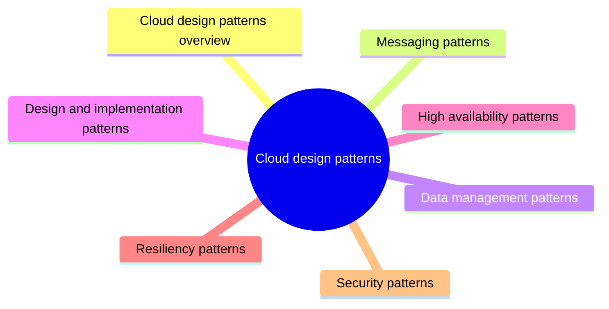

# Cloud design patterns

Proven solutions to recurring problems in distributed cloud applications, grouped by the concern they address: messaging, data management, design and implementation, availability, resiliency and security.

This is a catalog section: it groups a large body of related notes inside the knowledge area. It is not a separate SWEBOK topic.

## Map

The map shows the notes and sections of this part of the library.

## Reading order

1. [Cloud design patterns overview](cloud-design-patterns-overview.md): Design patterns are solutions to common problems that arise when building systems that run on a cloud platform.

## Sections

- [Messaging patterns](messaging/README.md) (8 notes): Patterns for communication between components through messages and events, so that senders and receivers stay decoupled.
- [Data management patterns](data-management/README.md) (5 notes): Patterns for storing, partitioning, caching and querying data that is spread across many locations.
- [Design and implementation patterns](design-and-implementation/README.md) (11 notes): Patterns that improve consistency, maintainability and reuse of components in cloud applications, many of them around gateways and helper processes.
- [High availability patterns](high-availability/README.md) (9 notes): Patterns that keep a system working and measurably available when load grows or parts of it fail.
- [Resiliency patterns](resiliency/README.md) (4 notes): Patterns that let a system recover gracefully from transient and permanent failures.
- [Security patterns](security/README.md) (3 notes): Patterns that protect cloud applications by controlling identity, access and exposure of services and data.

## Planned topics

- Saga pattern
- Event sourcing pattern
- Transactional outbox pattern
- Edge workload configuration pattern
