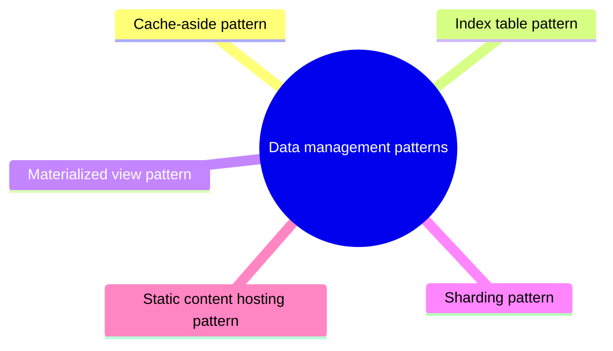

# Data management patterns

Patterns for storing, partitioning, caching and querying data that is spread across many locations.

This is a catalog section: it groups a large body of related notes inside the knowledge area. It is not a separate SWEBOK topic.

## Overview

Data management is the key element of cloud applications, and influences most of the quality attributes. Data is typically hosted in different locations and across multiple servers for reasons such as performance, scalability or availability, and this can present a range of challenges. For example, data consistency must be maintained, and data will typically need to be synchronized across different locations.

Additionally data should be protected at rest, in transit, and via authorized access mechanisms to maintain security assurances of confidentiality, integrity, and availability.

### Patterns

### Cache-Aside

Load data on demand into a cache from a data store

### CQRS

Segregate operations that read data from operations that update data by using separate interfaces.

### Event sourcing

Use an append-only store to record the full series of events that describe actions taken on data in a domain.

### Index table

Create indexes over the fields in data stores that are frequently referenced by queries.

### Materialized view

Generate prepopulated views over the data in one or more data stores when the data isn't ideally formatted for required query operations.

### Sharding

Divide a data store into a set of horizontal partitions or shards.

### Static content hosting

Deploy static content to a cloud-based storage service that can deliver them directly to the client.

### Valet key

Use a token or key that provides clients with restricted direct access to a specific resource or service.

## Map

The map shows the notes and sections of this part of the library.

## Reading order

1. [Cache-aside pattern](cache-aside.md): Load data on demand into a cache from a data store.
2. [Index table pattern](index-table.md): Create indexes over the fields in data stores that are frequently referenced by queries.
3. [Materialized view pattern](materialized-view.md): Generate prepopulated views over the data in one or more data stores when the data isn't ideally formatted for required query operations.
4. [Sharding pattern](sharding.md): Divide a data store into a set of horizontal partitions or shards.
5. [Static content hosting pattern](static-content-hosting.md): Deploy static content to a cloud-based storage service that can deliver them directly to the client.

## Planned topics

- Event sourcing pattern
- Valet key (see security patterns)
