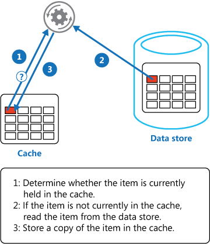

# Cache-aside pattern

## Summary

Load data on demand into a cache from a data store. This can improve performance and also helps to maintain consistency between data held in the cache and data in the underlying data store.

## Prerequisites

TODO: link the notes a reader should know first.

## Core concepts

### Definition

Load data on demand into a cache from a data store. This can improve performance and also helps to maintain consistency between data held in the cache and data in the underlying data store.

### Context and problem

Applications use a cache to improve repeated access to information held in a data store. However, it's impractical to expect that cached data will always be completely consistent with the data in the data store. Applications should implement a strategy that helps to ensure that the data in the cache is as up-to-date as possible, but can also detect and handle situations that arise when the data in the cache has become stale.

### Solution

Many commercial caching systems provide read-through and write-through/write-behind operations. In these systems, an application retrieves data by referencing the cache. If the data isn't in the cache, it's retrieved from the data store and added to the cache. Any modifications to data held in the cache are automatically written back to the data store as well.

For caches that don't provide this functionality, it's the responsibility of the applications that use the cache to maintain the data.

An application can emulate the functionality of read-through caching by implementing the cache-aside strategy. This strategy loads data into the cache on demand. The figure illustrates using the Cache-Aside pattern to store data in the cache.

If an application updates information, it can follow the write-through strategy by making the modification to the data store, and by invalidating the corresponding item in the cache.

When the item is next required, using the cache-aside strategy will cause the updated data to be retrieved from the data store and added back into the cache.

## Worked example

TODO: add a concrete, reproducible example with real values.

## Trade offs and when to use it

### Issues and considerations

Consider the following points when deciding how to implement this pattern:

**Lifetime of cached data**. Caches with expiration policies remove data if not accessed within a set period. To optimize cache-aside, align the policy with application access patterns. Avoid too short expiration times to prevent excessive data retrieval and caching. Also, avoid too long periods that risk stale data. Caching works best for static or frequently read data.

**Evicting data**. Caches, usually smaller than their data sources, evict data when full, often using a least-recently-used policy which can be customized. Set the cache's global expiration and item-specific properties for cost-effectiveness. Not all items should have the same eviction policy; items costly to fetch may warrant longer cache retention despite lower access frequency.

**Priming the cache**. Many solutions prepopulate the cache with the data that an application is likely to need as part of the startup processing. The Cache-Aside pattern can still be useful if some of this data expires or is evicted.

**Consistency**. The Cache-Aside pattern may not ensure data store and cache consistency. External processes can alter data store items, causing cache discrepancies until the item reloads. This issue intensifies with frequent data replication across stores.

**Local (in-memory) caching**. An in-memory local cache speeds up data access for an application but can lead to inconsistencies across instances. To mitigate this, consider using a shared or distributed cache and refreshing local caches more often.

### Use cases

Use this pattern when:

- A cache doesn't provide native read-through and write-through operations.
- Resource demand is unpredictable. This pattern enables applications to load data on demand. It makes no assumptions about which data an application will require in advance.

This pattern might not be suitable:

- When the cached data set is static. If the data will fit into the available cache space, prime the cache with the data on startup and apply a policy that prevents the data from expiring.
- For caching session state information in a web application hosted in a web farm. In this environment, you should avoid introducing dependencies based on client-server affinity.

## Common mistakes

TODO: list frequent misunderstandings and failure modes, with the fix for each.

## Practice

TODO: add three to five questions, with answers at the bottom.

## Further reading

- Microsoft. [*Cache-aside pattern*](https://learn.microsoft.com/en-us/azure/architecture/patterns/cache-aside). Azure Architecture Center. The full description of the pattern: context and problem, solution, issues and considerations, and when to use it.

TODO: check the content of this note against the sources above and record what was verified and when.
