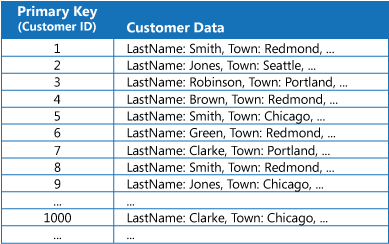
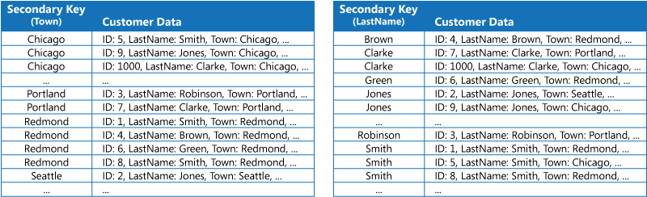
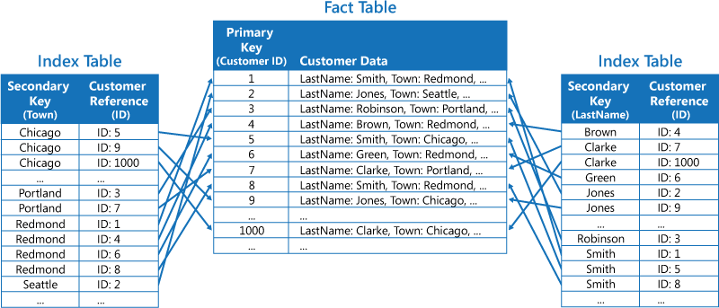
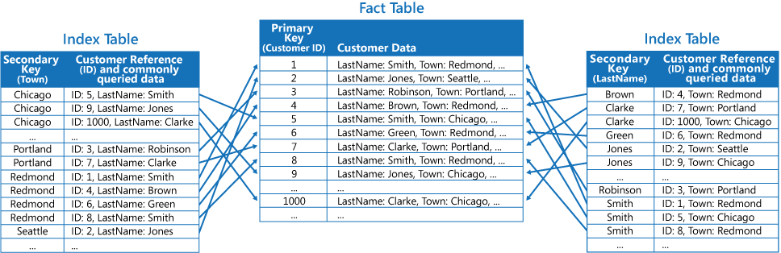

# Index table pattern

## Summary

Create indexes over the fields in data stores that are frequently referenced by queries. This pattern can improve query performance by allowing applications to more quickly locate the data to retrieve from a data store.

## Prerequisites

TODO: link the notes a reader should know first.

## Core concepts

### Definition

Create indexes over the fields in data stores that are frequently referenced by queries. This pattern can improve query performance by allowing applications to more quickly locate the data to retrieve from a data store.

### Context and problem

Many data stores organize the data for a collection of entities using the primary key. An application can use this key to locate and retrieve data. The figure shows an example of a data store holding customer information. The primary key is the Customer ID. The figure shows customer information organized by the primary key (Customer ID).

Primary keys are efficient for data retrieval by key value, but not when querying by other attributes, like a customer's town. This requires scanning all records, which is slow. Relational databases offer secondary indexes, organized by nonprimary fields, to streamline lookups and automatically maintained by the system. Multiple secondary indexes can be created to optimize various queries, such as indexing customers by town for frequent searches. However, some NoSQL cloud data stores lack this feature.

### Solution

If the data store lacks secondary indexes, create index tables to organize data by specific keys. Use one of three common strategies based on needed indexes and query types. For example, duplicate data across index tables sorted by different keys, such as Town and LastName, for complete denormalization.

Use this strategy for mostly static data that's frequently queried. If data changes often or is voluminous, index maintenance and storage demands become impractical.

Alternatively, create normalized index tables with different keys referencing the main data using the primary key to avoid duplication. The main data is known as a fact table.

This method conserves space and minimizes data duplication maintenance. However, it requires two lookups to access data via a secondary key, first to find the primary key in the index table, then to retrieve data from the fact table using that key.

Alternatively, partially normalized index tables can be created with duplicated fields for common queries, referring to the fact table for less common fields, as illustrated in the next figure.

With this strategy, you can strike a balance between the first two approaches. The data for common queries can be retrieved quickly by using a single lookup, while the space and maintenance overhead isn't as significant as duplicating the entire data set.

## Worked example

TODO: add a concrete, reproducible example with real values.

## Trade offs and when to use it

### Issues and considerations

Consider the following points when deciding how to implement this pattern:

- The overhead of maintaining secondary indexes can be significant. You must analyze and understand the queries that your application uses. Only create index tables when they're likely to be used regularly. Don't create speculative index tables to support queries that an application doesn't perform, or performs only occasionally.
- Duplicating data in an index table can add significant overhead in storage costs and the effort required to maintain multiple copies of data.
- Implementing an index table as a normalized structure that references the original data requires an application to perform two lookup operations to find data. The first operation searches the index table to retrieve the primary key, and the second uses the primary key to fetch the data.
- If a system incorporates a number of index tables over very large data sets, it can be difficult to maintain consistency between index tables and the original data. It might be possible to design the application around the eventual consistency model. For example, to insert, update, or delete data, an application could post a message to a queue and let a separate task perform the operation and maintain the index tables that reference this data asynchronously.
- Index tables might themselves be partitioned or sharded.

### Use cases

Use this pattern to improve query performance when an application frequently needs to retrieve data by using a key other than the primary (or shard) key.

This pattern might not be useful when:

- Data is volatile. An index table can become out of date very quickly, making it ineffective or making the overhead of maintaining the index table greater than any savings made by using it.
- A field selected as the secondary key for an index table is nondiscriminating and can only have a small set of values (for example, gender).
- The balance of the data values for a field selected as the secondary key for an index table are highly skewed. For example, if 90% of the records contain the same value in a field, then creating and maintaining an index table to look up data based on this field might create more overhead than scanning sequentially through the data. However, if queries very frequently target values that lie in the remaining 10%, this index can be useful. You should understand the queries that your application is performing, and how frequently they're performed.

## Common mistakes

TODO: list frequent misunderstandings and failure modes, with the fix for each.

## Practice

TODO: add three to five questions, with answers at the bottom.

## Further reading

- Microsoft. [*Index table pattern*](https://learn.microsoft.com/en-us/azure/architecture/patterns/index-table). Azure Architecture Center. The full description of the pattern: context and problem, solution, issues and considerations, and when to use it.

TODO: check the content of this note against the sources above and record what was verified and when.
