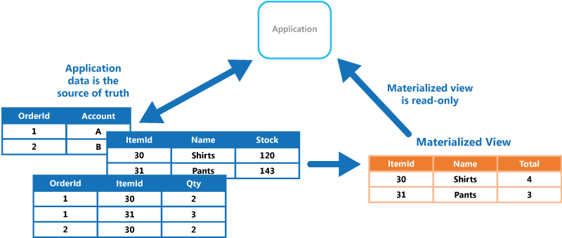

# Materialized view pattern

## Summary

Generate prepopulated views over the data in one or more data stores when the data isn't ideally formatted for required query operations. This can help support efficient querying and data extraction, and improve application performance.

## Prerequisites

TODO: link the notes a reader should know first.

## Core concepts

### Definition

Generate prepopulated views over the data in one or more data stores when the data isn't ideally formatted for required query operations. This can help support efficient querying and data extraction, and improve application performance.

### Context and problem

In data storage, developers and administrators often prioritize the storage method over retrieval efficiency. Storage formats are dictated by data format, size management, integrity needs, and store type. For instance, NoSQL document stores typically use aggregates to represent entities. This can hinder queries that only need partial data from these entities, forcing them to retrieve all data for relevant entities to get the necessary information.

### Solution

To facilitate efficient querying, pre-generated materialized views present data in an easily queryable format, especially when source data is unsuitable or queries are complex and slow. These views only hold necessary data for specific queries and can include joined tables, calculations, and transformations. Materialized views act as disposable caches, rebuilt from source data rather than updated directly. They must be refreshed when source data changes, either automatically or manually, as depicted in the example.

## Worked example

TODO: add a concrete, reproducible example with real values.

## Trade offs and when to use it

### Issues and considerations

Consider the following points when deciding how to implement this pattern:

The view should update in response to data changes, but to avoid high overhead, consider scheduled tasks, external triggers, or manual updates.

Using Event Sourcing, materialized views are essential to derive current state from events. Without Event Sourcing, assess the usefulness of materialized views, which suit limited queries but can increase storage needs and costs if overused.

Consider the impact on data consistency when generating the view, and when updating the view if this occurs on a schedule. If the source data is changing at the point when the view is generated, the copy of the data in the view won't be fully consistent with the original data.

Consider where you'll store the view. The view doesn't have to be located in the same store or partition as the original data. It can be a subset from a few different partitions combined.

A view can be rebuilt if lost. Because of that, if the view is transient and is only used to improve query performance by reflecting the current state of the data, or to improve scalability, it can be stored in a cache or in a less reliable location.

When defining a materialized view, maximize its value by adding data items or columns to it based on computation or transformation of existing data items, on values passed in the query, or on combinations of these values when appropriate.

Where the storage mechanism supports it, consider indexing the materialized view to further increase performance. Most relational databases support indexing for views, as do big data solutions based on Apache Hadoop.

### Use cases

This pattern is useful when:

- Creating materialized views over data that's difficult to query directly, or where queries must be very complex to extract data that's stored in a normalized, semi-structured, or unstructured way.
- Creating temporary views that can dramatically improve query performance, or can act directly as source views or data transfer objects for the UI, for reporting, or for display.
- Supporting occasionally connected or disconnected scenarios where connection to the data store isn't always available. The view can be cached locally in this case.
- Simplifying queries and exposing data for experimentation in a way that doesn't require knowledge of the source data format. For example, by joining different tables in one or more databases, or one or more domains in NoSQL stores, and then formatting the data to fit its eventual use.
- Providing access to specific subsets of the source data that, for security or privacy reasons, shouldn't be generally accessible, open to modification, or fully exposed to users.
- Bridging different data stores, to take advantage of their individual capabilities. For example, using a cloud store that's efficient for writing as the reference data store, and a relational database that offers good query and read performance to hold the materialized views.
- When using microservices, you are recommended to keep them loosely coupled, including their data storage. Therefore, materialized views can help you consolidate data from your services. If materialized views are not appropriate in your microservices architecture or specific scenario, please consider having well-defined boundaries that align to domain driven design (DDD) and aggregate their data when requested.

This pattern isn't useful in the following situations:

- The source data is simple and easy to query.
- The source data changes very quickly, or can be accessed without using a view. In these cases, you should avoid the processing overhead of creating views.
- Consistency is a high priority. The views might not always be fully consistent with the original data.

## Common mistakes

TODO: list frequent misunderstandings and failure modes, with the fix for each.

## Practice

TODO: add three to five questions, with answers at the bottom.

## Further reading

- Microsoft. [*Materialized view pattern*](https://learn.microsoft.com/en-us/azure/architecture/patterns/materialized-view). Azure Architecture Center. The full description of the pattern: context and problem, solution, issues and considerations, and when to use it.

TODO: check the content of this note against the sources above and record what was verified and when.
