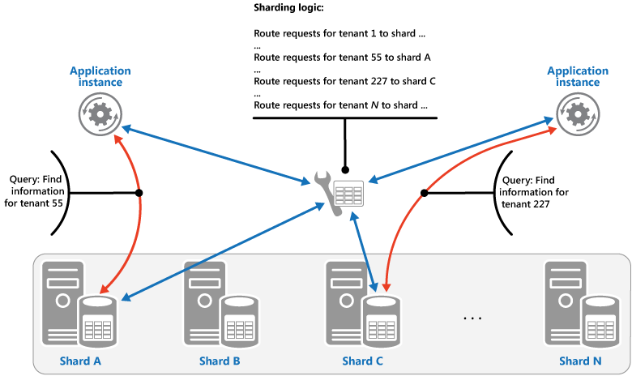
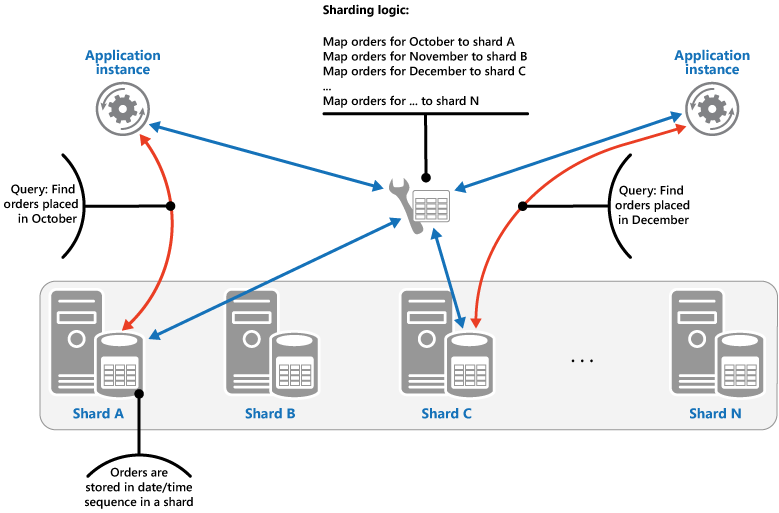
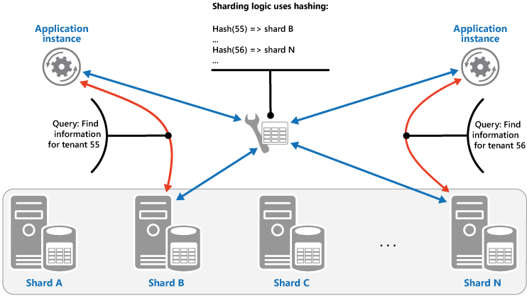

# Sharding pattern

## Summary

Divide a data store into a set of horizontal partitions or shards. This can improve scalability when storing and accessing large volumes of data. A data store hosted by a single server might be subject to the following limitations:

## Prerequisites

TODO: link the notes a reader should know first.

## Core concepts

### Definition

Divide a data store into a set of horizontal partitions or shards. This can improve scalability when storing and accessing large volumes of data.

### Context and problem

A data store hosted by a single server might be subject to the following limitations:

- **Storage space**. A data store for a large-scale cloud application is expected to contain a huge volume of data that could increase significantly over time. A server typically provides only a finite amount of disk storage, but you can replace existing disks with larger ones, or add further disks to a machine as data volumes grow. However, the system will eventually reach a limit where it isn't possible to easily increase the storage capacity on a given server.
- **Computing resources**. A cloud application is required to support a large number of concurrent users, each of which run queries that retrieve information from the data store. A single server hosting the data store might not be able to provide the necessary computing power to support this load, resulting in extended response times for users and frequent failures as applications attempting to store and retrieve data time out. It might be possible to add memory or upgrade processors, but the system will reach a limit when it isn't possible to increase the compute resources any further.
- **Network bandwidth**. Ultimately, the performance of a data store running on a single server is governed by the rate the server can receive requests and send replies. It's possible that the volume of network traffic might exceed the capacity of the network used to connect to the server, resulting in failed requests.
- **Geography**. It might be necessary to store data generated by specific users in the same region as those users for legal, compliance, or performance reasons, or to reduce latency of data access. If the users are dispersed across different countries or regions, it might not be possible to store the entire data for the application in a single data store.

Scaling vertically by adding more disk capacity, processing power, memory, and network connections can postpone the effects of some of these limitations, but it's likely to only be a temporary solution. A commercial cloud application capable of supporting large numbers of users and high volumes of data must be able to scale almost indefinitely, so vertical scaling isn't necessarily the best solution.

### Solution

Divide the data store into horizontal partitions or shards. Each shard has the same schema, but holds its own distinct subset of the data. A shard is a data store in its own right (it can contain the data for many entities of different types), running on a server acting as a storage node.

This pattern has the following benefits:

- You can scale the system out by adding further shards running on additional storage nodes.
- A system can use off-the-shelf hardware rather than specialized and expensive computers for each storage node.
- You can reduce contention and improve performance by balancing the workload across shards.
- In the cloud, shards can be located physically close to the users that'll access the data.

When sharding a data store, determine the appropriate data for each shard based on a static shard key comprised of one or more data attributes. Sharding sorts data physically, and its logic, embedded in the application or the storage system, directs data storage and retrieval to the correct shard. This abstraction allows control over data distribution and facilitates migration between shards without altering application business logic, despite increased data access overhead.

For best performance and scalability, split data to suit common application queries. While not all queries will align perfectly with the sharding scheme, prioritize a shard key that accommodates frequent queries. For multi-attribute retrieval, consider a composite shard key or an Index Table pattern for efficient lookups on non-key attributes.

#### Sharding strategies

Three strategies are commonly used when selecting the shard key and deciding how to distribute data across shards. Note that there doesn't have to be a one-to-one correspondence between shards and the servers that host them, a single server can host multiple shards. The strategies are:

##### Lookup strategy

In this strategy the sharding logic implements a map that routes a request for data to the shard that contains that data using the shard key. In a multitenant application all the data for a tenant might be stored together in a shard using the tenant ID as the shard key. Multiple tenants might share the same shard, but the data for a single tenant won't be spread across multiple shards. The figure illustrates sharding tenant data based on tenant IDs.

Shard key values can map to physical partitions or use virtual partitioning for easier rebalancing, where they map to consistent virtual shards that then map to fewer physical partitions. Applications locate data via virtual shards, which are transparently mapped to physical partitions, allowing changes without altering the application code.

##### Range strategy

This strategy organizes related items in the same shard by sequential shard keys, aiding applications that often use range queries to fetch item sets within specific ranges. For instance, storing all monthly orders in one shard, sorted by date, speeds up retrieval compared to fetching each order from separate shards using numerous point queries. The following figure shows sequential data ranges stored in a shard.

In this example, the shard key is a composite key containing the order month as the most significant element, followed by the order day and the time. The data for orders is naturally sorted when new orders are created and added to a shard. Some data stores support two-part shard keys containing a partition key element that identifies the shard and a row key that uniquely identifies an item in the shard. Data is usually held in row key order in the shard. Items that are subject to range queries and need to be grouped together can use a shard key that has the same value for the partition key but a unique value for the row key.

##### Hash strategy

The purpose of this strategy is to reduce the chance of hotspots (shards that receive a disproportionate amount of load). It distributes the data across the shards in a way that achieves a balance between the size of each shard and the average load that each shard will encounter. The sharding logic computes the shard to store an item in based on a hash of one or more attributes of the data. The chosen hashing function should distribute data evenly across the shards, possibly by introducing some random element into the computation. The next figure illustrates sharding tenant data based on a hash of tenant IDs.

To understand the advantage of the Hash strategy over other sharding strategies, consider how a multitenant application that enrolls new tenants sequentially might assign the tenants to shards in the data store. When using the Range strategy, the data for tenants 1 to n will all be stored in shard A, the data for tenants n+1 to m will all be stored in shard B, and so on. If the most recently registered tenants are also the most active, most data activity will occur in a small number of shards, which could cause hotspots. In contrast, the Hash strategy allocates tenants to shards based on a hash of their tenant ID. This means that sequential tenants are most likely to be allocated to different shards, which will distribute the load across them. The previous figure shows this for tenants 55 and 56.

#### Considerations

The three sharding strategies have the following advantages and considerations:

- **Lookup**. This offers more control over the way that shards are configured and used. Using virtual shards reduces the impact when rebalancing data because new physical partitions can be added to even out the workload. The mapping between a virtual shard and the physical partitions that implement the shard can be modified without affecting application code that uses a shard key to store and retrieve data. Looking up shard locations can impose an additional overhead.
- **Range**. This is easy to implement and works well with range queries because they can often fetch multiple data items from a single shard in a single operation. This strategy offers easier data management. For example, if users in the same region are in the same shard, updates can be scheduled in each time zone based on the local load and demand pattern. However, this strategy doesn't provide optimal balancing between shards. Rebalancing shards is difficult and might not resolve the problem of uneven load if the majority of activity is for adjacent shard keys.
- **Hash**. This strategy offers a better chance of more even data and load distribution. Request routing can be accomplished directly by using the hash function. There's no need to maintain a map. Note that computing the hash might impose an additional overhead. Also, rebalancing shards is difficult.

Most common sharding systems implement one of the approaches described above, but you should also consider the business requirements of your applications and their patterns of data usage. For example, in a multitenant application:

- You can shard data based on workload. You could segregate the data for highly volatile tenants in separate shards. The speed of data access for other tenants might be improved as a result.
- You can shard data based on the location of tenants. You can take the data for tenants in a specific geographic region offline for backup and maintenance during off-peak hours in that region, while the data for tenants in other regions remains online and accessible during their business hours.
- High-value tenants could be assigned their own private, high performing, lightly loaded shards, whereas lower-value tenants might be expected to share more densely packed, busy shards.
- The data for tenants that need a high degree of data isolation and privacy can be stored on a completely separate server.

#### Scaling and data movement operations

Sharding strategies vary in scale management, data movement, and state maintenance complexity. Lookup strategy allows user-level scaling and data movement, possibly during low-traffic times, involving data transfer, mapping updates, and cache refreshing, usually with central management and requiring highly cacheable, replicable state.

Range strategy restricts scaling and data movement, often requiring offline execution due to necessary data splitting and merging, and may need maintained state for range-to-partition mapping. Hash strategy complicates scaling and data movement as partition keys depend on hash functions, though it eliminates state maintenance needs.

## Worked example

TODO: add a concrete, reproducible example with real values.

## Trade offs and when to use it

### Issues and considerations

Consider the following points when deciding how to implement this pattern:

- Sharding is complementary to other forms of partitioning, such as vertical partitioning and functional partitioning. For example, a single shard can contain entities that have been partitioned vertically, and a functional partition can be implemented as multiple shards.
- Keep shards balanced so they all handle a similar volume of I/O. As data is inserted and deleted, it's necessary to periodically rebalance the shards to guarantee an even distribution and to reduce the chance of hotspots. Rebalancing can be an expensive operation. To reduce the necessity of rebalancing, plan for growth by ensuring that each shard contains sufficient free space to handle the expected volume of changes. You should also develop strategies and scripts you can use to quickly rebalance shards if this becomes necessary.
- Use stable data for the shard key. If the shard key changes, the corresponding data item might have to move between shards, increasing the amount of work performed by update operations. For this reason, avoid basing the shard key on potentially volatile information. Instead, look for attributes that are invariant or that naturally form a key.
- Ensure that shard keys are unique. For example, avoid using autoincrementing fields as the shard key. In some systems, autoincremented fields can't be coordinated across shards, possibly resulting in items in different shards having the same shard key.
- It might not be possible to design a shard key that matches the requirements of every possible query against the data. Shard the data to support the most frequently performed queries, and if necessary create secondary index tables to support queries that retrieve data using criteria based on attributes that aren't part of the shard key.
- Single-shard queries are more efficient than multi-shard ones, so avoid sharding that necessitates frequent cross-shard join queries. A shard can hold multiple entity types; denormalize data to colocate commonly queried related entities (like customer details and their orders) in one shard to minimize separate read operations.
- If an application must perform queries that retrieve data from multiple shards, it might be possible to fetch this data by using parallel tasks. Examples include fan-out queries, where data from multiple shards is retrieved in parallel and then aggregated into a single result. However, this approach inevitably adds some complexity to the data access logic of a solution.
- For many applications, creating a larger number of small shards can be more efficient than having a small number of large shards because they can offer increased opportunities for load balancing. This can also be useful if you anticipate the need to migrate shards from one physical location to another. Moving a small shard is quicker than moving a large one.
- Make sure the resources available to each shard storage node are sufficient to handle the scalability requirements in terms of data size and throughput.
- Consider replicating reference data to all shards. If an operation that retrieves data from a shard also references static or slow-moving data as part of the same query, add this data to the shard. The application can then fetch all of the data for the query easily, without having to make an additional round trip to a separate data store.
- Minimize operations affecting multiple shards to maintain integrity and consistency. If cross-shard modifications are necessary, consider if full consistency is essential; eventual consistency is a common cloud approach. Update data in partitions separately and handle application logic for successful updates and potential inconsistencies during queries.
- Configuring and managing a large number of shards can be a challenge. Tasks such as monitoring, backing up, checking for consistency, and logging or auditing must be accomplished on multiple shards and servers, possibly held in multiple locations. These tasks are likely to be implemented using scripts or other automation solutions, but that might not completely eliminate the additional administrative requirements.
- Shards can be geolocated so that the data that they contain is close to the instances of an application that use it. This approach can considerably improve performance, but requires additional consideration for tasks that must access multiple shards in different locations.

### Use cases

Use this pattern when a data store is likely to need to scale beyond the resources available to a single storage node, or to improve performance by reducing contention in a data store.

## Common mistakes

TODO: list frequent misunderstandings and failure modes, with the fix for each.

## Practice

TODO: add three to five questions, with answers at the bottom.

## Further reading

- Microsoft. [*Sharding pattern*](https://learn.microsoft.com/en-us/azure/architecture/patterns/sharding). Azure Architecture Center. The full description of the pattern: context and problem, solution, issues and considerations, and when to use it.
- Kleppmann, M. (2017). *Designing Data-Intensive Applications*. O'Reilly Media. A rigorous treatment of replication, partitioning, transactions, consistency models and stream processing.

TODO: check the content of this note against the sources above and record what was verified and when.
