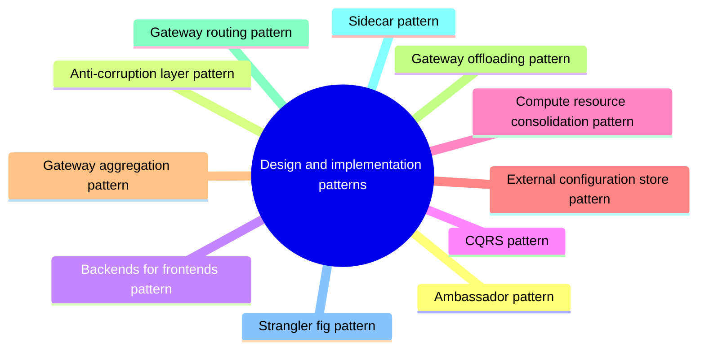

# Design and implementation patterns

Patterns that improve consistency, maintainability and reuse of components in cloud applications, many of them around gateways and helper processes.

This is a catalog section: it groups a large body of related notes inside the knowledge area. It is not a separate SWEBOK topic.

## Overview

Good design encompasses factors such as consistency and coherence in component design and deployment, maintainability to simplify administration and development, and reusability to allow components and subsystems to be used in other applications and in other scenarios. Decisions made during the design and implementation phase have a huge impact on the quality and the total cost of ownership of cloud hosted applications and services.

### Patterns

### Ambassador

Create helper services that send network requests on behalf of a consumer service or application.

### Anti-Corruption layer

Implement a façade or adapter layer between a modern application and a legacy system.

Backends for Frontends	Create separate backend services to be consumed by specific frontend applications or interfaces.

### CQRS

Segregate operations that read data from operations that update data by using separate interfaces.

### Compute resource consolidation

Consolidate multiple tasks or operations into a single computational unit

### Edge workload configuration

The great variety of systems and devices on the shop floor can make workload configuration a difficult problem.

### External configuration store

Move configuration information out of the application deployment package to a centralized location.

### Gateway aggregation

Use a gateway to aggregate multiple individual requests into a single request.

### Gateway offloading

Offload shared or specialized service functionality to a gateway proxy.

### Gateway routing

Route requests to multiple services using a single endpoint.

### Leader election

Coordinate the actions performed by a collection of collaborating task instances in a distributed application by electing one instance as the leader that assumes responsibility for managing the other instances.

### Pipes and filters

Break down a task that performs complex processing into a series of separate elements that can be reused.

### Sidecar

Deploy components of an application into a separate process or container to provide isolation and encapsulation.

### Static content hosting

Deploy static content to a cloud-based storage service that can deliver them directly to the client.

### Strangler fig

Incrementally migrate a legacy system by gradually replacing specific pieces of functionality with new applications and services.

## Map

The map shows the notes and sections of this part of the library.

## Reading order

1. [Ambassador pattern](ambassador.md): Create helper services that send network requests on behalf of a consumer service or application.
2. [Anti-corruption layer pattern](anti-corruption-layer.md): Implement a façade or adapter layer between different subsystems that don't share the same semantics.
3. [Backends for frontends pattern](backends-for-frontends.md): Create separate backend services to be consumed by specific frontend applications or interfaces.
4. [CQRS pattern](cqrs.md): CQRS stands for Command and Query Responsibility Segregation, a pattern that separates read and update operations for a data store.
5. [Compute resource consolidation pattern](compute-resource-consolidation.md): Consolidate multiple tasks or operations into a single computational unit.
6. [External configuration store pattern](external-configuration-store.md): Move configuration information out of the application deployment package to a centralized location.
7. [Gateway aggregation pattern](gateway-aggregation.md): Use a gateway to aggregate multiple individual requests into a single request.
8. [Gateway offloading pattern](gateway-offloading.md): Offload shared or specialized service functionality to a gateway proxy.
9. [Gateway routing pattern](gateway-routing.md): The gateway routing pattern exposes several services or service instances behind a single endpoint and routes each request to the right backend, usually by path, header or version.
10. [Sidecar pattern](sidecar.md): Deploy components of an application into a separate process or container to provide isolation and encapsulation.
11. [Strangler fig pattern](strangler-fig.md): Incrementally migrate a legacy system by gradually replacing specific pieces of functionality with new applications and services.
