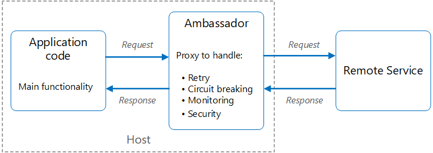

# Ambassador pattern

## Summary

Create helper services that send network requests on behalf of a consumer service or application. An ambassador service can be thought of as an out-of-process proxy that is co-located with the client.

## Prerequisites

TODO: link the notes a reader should know first.

## Core concepts

### Definition

Create helper services that send network requests on behalf of a consumer service or application. An ambassador service can be thought of as an out-of-process proxy that is co-located with the client.

This pattern can be useful for offloading common client connectivity tasks such as monitoring, logging, routing, security (such as TLS), and resiliency patterns in a language agnostic way. It's often used with legacy applications, or other applications that are difficult to modify, in order to extend their networking capabilities. It can also enable a specialized team to implement those features.

### Context and problem

Resilient cloud-based applications require features such as circuit breaking, routing, metering and monitoring, and the ability to make network-related configuration updates. It may be difficult or impossible to update legacy applications or existing code libraries to add these features, because the code is no longer maintained or can't be easily modified by the development team.

Network calls need significant setup for connection, authentication, and authorization. When used in various applications with different languages and frameworks, each instance needs separate configuration. Additionally, a central team often oversees network and security functions, and it's risky for them to modify unfamiliar application code in a large code base.

### Solution

Put client frameworks and libraries into an external process that acts as a proxy between your application and external services. Deploy the proxy on the same host environment as your application to allow control over routing, resiliency, security features, and to avoid any host-related access restrictions. You can also use the ambassador pattern to standardize and extend instrumentation. The proxy can monitor performance metrics such as latency or resource usage, and this monitoring happens in the same host environment as the application.

Ambassadors independently manage features offloaded from the application, enabling updates without impacting existing functionality and allowing dedicated teams to focus on security, networking, or authentication. Ambassadors can be deployed as sidecars for individual applications or as daemons or Windows services for shared use. For containerized services, deploy ambassadors as separate containers on the same host with configured communication links.

## Worked example

TODO: add a concrete, reproducible example with real values.

## Trade offs and when to use it

### Issues and considerations

- The proxy adds some latency overhead. Consider whether a client library, invoked directly by the application, is a better approach.
- Consider the possible impact of including generalized features in the proxy. For example, the ambassador could handle retries, but that might not be safe unless all operations are idempotent.
- Consider a mechanism to allow the client to pass some context to the proxy, and back to the client. For example, include HTTP request headers to opt out of retry or specify the maximum number of times to retry.
- Consider how you'll package and deploy the proxy.
- Consider whether to use a single shared instance for all clients or an instance for each client.

### Use cases

Use this pattern when you:

- Need to build a common set of client connectivity features for multiple languages or frameworks.
- Need to offload cross-cutting client connectivity concerns to infrastructure developers or other more specialized teams.
- Need to support cloud or cluster connectivity requirements in a legacy application or an application that is difficult to modify.

This pattern may not be suitable:

- When network request latency is critical. A proxy introduces some overhead, although minimal, and in some cases this may affect the application.
- When client connectivity features are consumed by a single language. In that case, a better option might be a client library that is distributed to the development teams as a package.
- When connectivity features can't be generalized and require deeper integration with the client application.

## Common mistakes

TODO: list frequent misunderstandings and failure modes, with the fix for each.

## Practice

TODO: add three to five questions, with answers at the bottom.

## Further reading

- Microsoft. [*Ambassador pattern*](https://learn.microsoft.com/en-us/azure/architecture/patterns/ambassador). Azure Architecture Center. The full description of the pattern: context and problem, solution, issues and considerations, and when to use it.

TODO: check the content of this note against the sources above and record what was verified and when.
