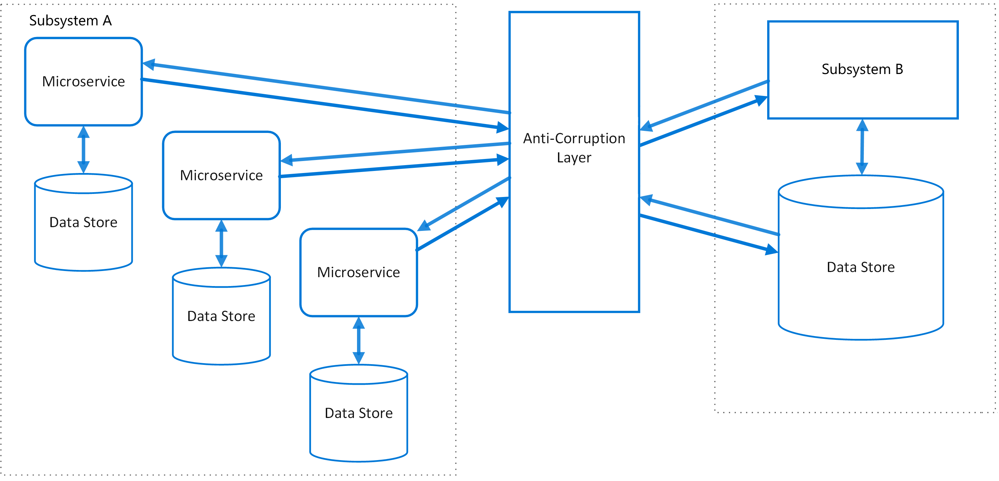

# Anti-corruption layer pattern

## Summary

Implement a façade or adapter layer between different subsystems that don't share the same semantics. This layer translates requests that one subsystem makes to the other subsystem. Use this pattern to ensure that an application's design is not limited by dependencies on outside subsystems. This pattern was first described by Eric Evans in Domain-Driven Design.

## Prerequisites

TODO: link the notes a reader should know first.

## Core concepts

### Definition

Implement a façade or adapter layer between different subsystems that don't share the same semantics. This layer translates requests that one subsystem makes to the other subsystem. Use this pattern to ensure that an application's design is not limited by dependencies on outside subsystems. This pattern was first described by Eric Evans in *Domain-Driven Design*.

### Context and problem

Applications often depend on external systems for data or functions. For instance, during a phased migration from an old to a new system, the new features must interact with the legacy system.

Legacy systems typically have outdated and complex features, such as poor-quality APIs and data schemas, which differ significantly from modern systems. Integrating with these systems may require the new application to accommodate obsolete infrastructure and technologies, compromising the design of the modern system. These challenges aren't exclusive to legacy systems but apply to any third-party system outside the development team's control.

### Solution

Isolate the different subsystems by placing an anti-corruption layer between them. This layer translates communications between the two systems, allowing one system to remain unchanged while the other can avoid compromising its design and technological approach.

The diagram above shows an application with two subsystems. Subsystem A calls to subsystem B through an anti-corruption layer. Communication between subsystem A and the anti-corruption layer always uses the data model and architecture of subsystem A. Calls from the anti-corruption layer to subsystem B conform to that subsystem's data model or methods. The anti-corruption layer contains all of the logic necessary to translate between the two systems. The layer can be implemented as a component within the application or as an independent service.

## Worked example

TODO: add a concrete, reproducible example with real values.

## Trade offs and when to use it

### Issues and considerations

- The anti-corruption layer may add latency to calls made between the two systems.
- The anti-corruption layer adds an additional service that must be managed and maintained.
- Consider how your anti-corruption layer will scale.
- Consider whether you need more than one anti-corruption layer. You may want to decompose functionality into multiple services using different technologies or languages, or there may be other reasons to partition the anti-corruption layer.
- Consider how the anti-corruption layer will be managed in relation with your other applications or services. How will it be integrated into your monitoring, release, and configuration processes?
- Make sure transaction and data consistency are maintained and can be monitored.
- Consider whether the anti-corruption layer needs to handle all communication between different subsystems, or just a subset of features.
- If the anti-corruption layer is part of an application migration strategy, consider whether it will be permanent, or will be retired after all legacy functionality has been migrated.
- This pattern is illustrated with distinct subsystems above, but can apply to other service architectures as well, such as when integrating legacy code together in a monolithic architecture.

### Use cases

Use this pattern when:

- A migration is planned to happen over multiple stages, but integration between new and legacy systems needs to be maintained.
- Two or more subsystems have different semantics, but still need to communicate.

## Common mistakes

TODO: list frequent misunderstandings and failure modes, with the fix for each.

## Practice

TODO: add three to five questions, with answers at the bottom.

## Further reading

- Microsoft. [*Anti-corruption layer pattern*](https://learn.microsoft.com/en-us/azure/architecture/patterns/anti-corruption-layer). Azure Architecture Center. The full description of the pattern: context and problem, solution, issues and considerations, and when to use it.
- Evans, E. (2003). *Domain-Driven Design: Tackling Complexity in the Heart of Software*. Addison-Wesley. The book that defined domain-driven design: ubiquitous language, bounded contexts, entities, value objects and aggregates.

TODO: check the content of this note against the sources above and record what was verified and when.
