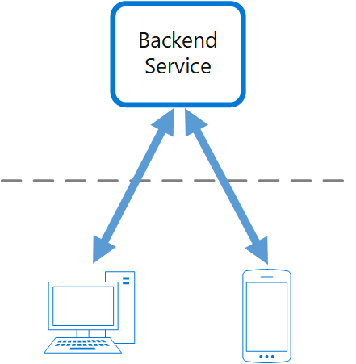
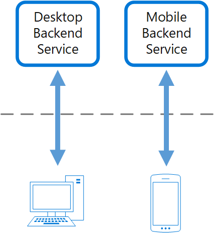

# Backends for frontends pattern

## Summary

Create separate backend services to be consumed by specific frontend applications or interfaces. This pattern is useful when you want to avoid customizing a single backend for multiple interfaces. This pattern was first described by Sam Newman.

## Prerequisites

TODO: link the notes a reader should know first.

## Core concepts

### Definition

Create separate backend services to be consumed by specific frontend applications or interfaces. This pattern is useful when you want to avoid customizing a single backend for multiple interfaces. This pattern was first described by Sam Newman.

### Context and problem

Initially targeting desktop web UIs, backend services are developed to support them. As usage expands to include mobile apps, the backend must adapt to serve both platforms. Mobile devices' unique characteristics necessitate different backend needs from desktops, leading to divergent backend requirements. Frequent modifications are required to cater to both interfaces, often causing bottlenecks as separate teams manage each frontend, complicating updates and maintenance for the shared backend resource.

Creating a separate team for backend management may cause a disconnect with UI teams, burdening the backend team to reconcile their differing needs. Backend changes from one UI team must be checked with others before integration.

### Solution

Create one backend per user interface. Fine-tune the behavior and performance of each backend to best match the needs of the frontend environment, without worrying about affecting other frontend experiences.

Each backend, tailored to a specific interface, is optimized to be leaner, simpler, and faster than a generic one. Interface teams have autonomy over their backend, allowing for flexible choices in programming language, release schedule, workload management, and feature integration.

## Worked example

TODO: add a concrete, reproducible example with real values.

## Trade offs and when to use it

### Issues and considerations

- Consider how many backends to deploy.
- If different interfaces (such as mobile clients) will make the same requests, consider whether it is necessary to implement a backend for each interface, or if a single backend will suffice.
- Code duplication across services is highly likely when implementing this pattern.
- Frontend-focused backend services should only contain client-specific logic and behavior. General business logic and other global features should be managed elsewhere in your application.
- Think about how this pattern might be reflected in the responsibilities of a development team.
- Consider how long it will take to implement this pattern. Will the effort of building the new backends incur technical debt, while you continue to support the existing generic backend?

### Use cases

Use this pattern when:

- A shared or general purpose backend service must be maintained with significant development overhead.
- You want to optimize the backend for the requirements of specific client interfaces.
- Customizations are made to a general-purpose backend to accommodate multiple interfaces.
- A programming language is better suited for the backend of a specific user interface, but not all user interfaces.

This pattern may not be suitable:

- When interfaces make the same or similar requests to the backend.
- When only one interface is used to interact with the backend.

## Common mistakes

TODO: list frequent misunderstandings and failure modes, with the fix for each.

## Practice

TODO: add three to five questions, with answers at the bottom.

## Further reading

- Microsoft. [*Backends for frontends pattern*](https://learn.microsoft.com/en-us/azure/architecture/patterns/backends-for-frontends). Azure Architecture Center. The full description of the pattern: context and problem, solution, issues and considerations, and when to use it.

TODO: check the content of this note against the sources above and record what was verified and when.
