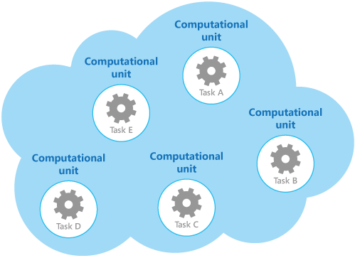

# Compute resource consolidation pattern

## Summary

Consolidate multiple tasks or operations into a single computational unit. This can increase compute resource utilization, and reduce the costs and management overhead associated with performing compute processing in cloud-hosted applications.

## Prerequisites

TODO: link the notes a reader should know first.

## Core concepts

### Definition

Consolidate multiple tasks or operations into a single computational unit. This can increase compute resource utilization, and reduce the costs and management overhead associated with performing compute processing in cloud-hosted applications.

### Context and problem

Cloud applications may employ the separation of concerns design principle, dividing operations into individually hosted and deployed units like App Service web apps or Virtual Machines. While this simplifies the solution's logical design, it can raise hosting costs and complicate system management when numerous units are deployed.

As an example, the figure shows the simplified structure of a cloud-hosted solution that is implemented using more than one computational unit. Each computational unit runs in its own virtual environment. Each function has been implemented as a separate task (labeled Task A through Task E) running in its own computational unit.

Each computational unit consumes chargeable resources, even when it's idle or lightly used. Therefore, this isn't always the most cost-effective solution.

### Solution

To help reduce costs, increase utilization, improve communication speed, and reduce management it's possible to consolidate multiple tasks or operations into a single computational unit.

Tasks can be grouped according to criteria based on the features provided by the environment and the costs associated with these features. A common approach is to look for tasks that have a similar profile concerning their scalability, lifetime, and processing requirements. Grouping these together allows them to scale as a unit. The elasticity provided by many cloud environments enables additional instances of a computational unit to be started and stopped according to the workload.

As a counter example to show how scalability can be used to determine which operations shouldn't be grouped together, consider the following two tasks:

- Task 1 polls for infrequent, time-insensitive messages sent to a queue.
- Task 2 handles high-volume bursts of network traffic.

The second task's elasticity requires starting and stopping many instances, but scaling the first task this way wastes resources by having more tasks await infrequent messages. Cloud environments let you allocate CPU cores, memory, and disk space to a computational unit; more resources mean higher costs.

To economize, ensure expensive units are consistently active, not idle. For tasks needing intense CPU power in bursts, combine them in one powerful unit, but avoid overloading to prevent contention. Separate long-running, compute-intensive tasks to their own units.

## Worked example

TODO: add a concrete, reproducible example with real values.

## Trade offs and when to use it

### Issues and considerations

Consider the following points when implementing this pattern:

**Scalability and elasticity**. Many cloud solutions implement scalability and elasticity at the level of the computational unit by starting and stopping instances of units. Avoid grouping tasks that have conflicting scalability requirements in the same computational unit.

**Lifetime**. The cloud infrastructure routinely refreshes the hosting virtual environment for computational units. For long-running tasks, either configure the unit to avoid recycling until task completion or implement check-pointing to allow clean pauses and resumptions upon restarts.

**Release cadence**. If the implementation or configuration of a task changes frequently, it might be necessary to stop the computational unit hosting the updated code, reconfigure and redeploy the unit, and then restart it. This process will also require that all other tasks within the same computational unit are stopped, redeployed, and restarted.

**Security**. Tasks in the same computational unit might share the same security context and be able to access the same resources. There must be a high degree of trust between the tasks, and confidence that one task isn't going to corrupt or adversely affect another. Additionally, increasing the number of tasks running in a computational unit increases the attack surface of the unit. Each task is only as secure as the one with the most vulnerabilities.

**Fault tolerance**. If one task in a computational unit fails or behaves abnormally, it can affect the other tasks running within the same unit. For example, if one task fails to start correctly it can cause the entire startup logic for the computational unit to fail, and prevent other tasks in the same unit from running.

**Contention**. Avoid introducing contention between tasks that compete for resources in the same computational unit. Ideally, tasks that share the same computational unit should exhibit different resource utilization characteristics. For example, two compute-intensive tasks should probably not reside in the same computational unit, and neither should two tasks that consume large amounts of memory. However, mixing a compute-intensive task with a task that requires a large amount of memory is a workable combination.

**Complexity**. Combining multiple tasks into a single computational unit adds complexity to the code in the unit, possibly making it more difficult to test, debug, and maintain.

**Stable logical architecture**. Design and implement the code in each task so that it shouldn't need to change, even if the physical environment the task runs in does change.

**Other strategies**. Consolidating compute resources is only one way to help reduce costs associated with running multiple tasks concurrently. It requires careful planning and monitoring to ensure that it remains an effective approach. Other strategies might be more appropriate, depending on the nature of the work and where the users these tasks are running are located.

### Use cases

Use this pattern for tasks that are not cost effective if they run in their own computational units. If a task spends much of its time idle, running this task in a dedicated unit can be expensive.

This pattern might not be suitable for tasks that perform critical fault-tolerant operations, or tasks that process highly sensitive or private data and require their own security context. These tasks should run in their own isolated environment, in a separate computational unit.

## Common mistakes

TODO: list frequent misunderstandings and failure modes, with the fix for each.

## Practice

TODO: add three to five questions, with answers at the bottom.

## Further reading

- Microsoft. [*Compute resource consolidation pattern*](https://learn.microsoft.com/en-us/azure/architecture/patterns/compute-resource-consolidation). Azure Architecture Center. The full description of the pattern: context and problem, solution, issues and considerations, and when to use it.

TODO: check the content of this note against the sources above and record what was verified and when.
