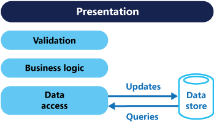
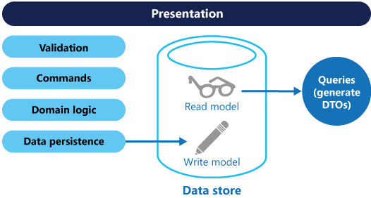
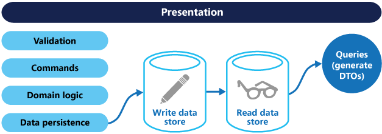

# CQRS pattern

## Summary

CQRS stands for Command and Query Responsibility Segregation, a pattern that separates read and update operations for a data store. Implementing CQRS in your application can maximize its performance, scalability, and security. The flexibility created by migrating to CQRS allows a system to better evolve over time and prevents update commands from causing merge conflicts at the domain level.

## Prerequisites

TODO: link the notes a reader should know first.

## Core concepts

### Definition

CQRS stands for Command and Query Responsibility Segregation, a pattern that separates read and update operations for a data store. Implementing CQRS in your application can maximize its performance, scalability, and security. The flexibility created by migrating to CQRS allows a system to better evolve over time and prevents update commands from causing merge conflicts at the domain level.

### Context and problem

In traditional architectures, the same data model is used to query and update a database. That's simple and works well for basic CRUD operations. In more complex applications, however, this approach can become unwieldy. For example, on the read side, the application may perform many different queries, returning data transfer objects (DTOs) with different shapes. Object mapping can become complicated. On the write side, the model may implement complex validation and business logic. As a result, you can end up with an overly complex model that does too much.

Read and write workloads are often asymmetrical, with very different performance and scale requirements.

- There is often a mismatch between the read and write representations of the data, such as additional columns or properties that must be updated correctly even though they aren't required as part of an operation.
- Data contention can occur when operations are performed in parallel on the same set of data.
- The traditional approach can have a negative effect on performance due to load on the data store and data access layer, and the complexity of queries required to retrieve information.
- Managing security and permissions can become complex, because each entity is subject to both read and write operations, which might expose data in the wrong context.

### Solution

CQRS separates reads and writes into different models, using **commands** to update data, and **queries** to read data.

- Commands should focus on tasks rather than data ("Book hotel room" instead of "set ReservationStatus to Reserved"). Adapt user interactions accordingly. Enhance business logic for higher command success rates, including client-side validations (e.g., disabling buttons with explanations like "no rooms left") to reduce server-side failures mainly to race conditions, which can be mitigated by additional measures (e.g., waitlisting guests).
- Commands may be placed on a queue for [asynchronous processing](https://learn.microsoft.com/en-us/dotnet/architecture/microservices/architect-microservice-container-applications/asynchronous-message-based-communication), rather than being processed synchronously.
- Queries never modify the database. A query returns a DTO that does not encapsulate any domain knowledge.

The models can then be isolated, as shown in the following diagram, although that's not an absolute requirement.

Having separate query and update models simplifies the design and implementation. However, one disadvantage is that CQRS code can't automatically be generated from a database schema using scaffolding mechanisms such as O/RM tools (However, you will be able to build your customization on top of the generated code).

For greater isolation, you can physically separate the read data from the write data. In that case, the read database can use its own data schema that is optimized for queries. For example, it can store a materialized view of the data, in order to avoid complex joins or complex O/RM mappings. It might even use a different type of data store. For example, the write database might be relational, while the read database is a document database.

If separate read and write databases are used, they must be kept in sync. Typically this is accomplished by having the write model publish an event whenever it updates the database.

The read store can be a replica of the write store or have a different structure. Multiple read-only replicas improve query performance, particularly in distributed systems near application instances. Separating read and write stores enables tailored scaling; read stores usually face higher loads than write stores.

CQRS may utilize Event Sourcing, where application state is a series of events that represent data changes. Replaying these events constructs the current state. In CQRS, Event Sourcing allows the use of events to update the read model for efficient querying but adds design complexity.

Benefits of CQRS include:

- **Independent scaling**. CQRS allows the read and write workloads to scale independently, and may result in fewer lock contentions.
- **Optimized data schemas**. The read side can use a schema that is optimized for queries, while the write side uses a schema that is optimized for updates.
- **Security**. It's easier to ensure that only the right domain entities are performing writes on the data.
- **Separation of concerns**. Segregating the read and write sides can result in models that are more maintainable and flexible. Most of the complex business logic goes into the write model. The read model can be relatively simple.
- **Simpler queries**. By storing a materialized view in the read database, the application can avoid complex joins when querying.

## Worked example

TODO: add a concrete, reproducible example with real values.

## Trade offs and when to use it

### Implementation issues and considerations

Some challenges of implementing this pattern include:

- **Complexity**. The basic idea of CQRS is simple. But it can lead to a more complex application design, especially if they include the Event Sourcing pattern.
- **Messaging**. Although CQRS does not require messaging, it's common to use messaging to process commands and publish update events. In that case, the application must handle message failures or duplicate messages.
- **Eventual consistency**. If you separate the read and write databases, the read data may be stale. The read model store must be updated to reflect changes to the write model store, and it can be difficult to detect when a user has issued a request based on stale read data.

### Use cases

Consider CQRS for the following scenarios:

- Collaborative domains where many users access the same data in parallel. CQRS allows you to define commands with enough granularity to minimize merge conflicts at the domain level, and conflicts that do arise can be merged by the command.
- Task-based user interfaces where users are guided through a complex process as a series of steps or with complex domain models. The write model has a full command-processing stack with business logic, input validation, and business validation. The write model may treat a set of associated objects as a single unit for data changes (an aggregate, in DDD terminology) and ensure that these objects are always in a consistent state. The read model has no business logic or validation stack, and just returns a DTO for use in a view model. The read model is eventually consistent with the write model.
- Scenarios where performance of data reads must be fine-tuned separately from performance of data writes, especially when the number of reads is much greater than the number of writes. In this scenario, you can scale out the read model, but run the write model on just a few instances. A small number of write model instances also helps to minimize the occurrence of merge conflicts.
- Scenarios where one team of developers can focus on the complex domain model that is part of the write model, and another team can focus on the read model and the user interfaces.
- Scenarios where the system is expected to evolve over time and might contain multiple versions of the model, or where business rules change regularly.
- Integration with other systems, especially in combination with event sourcing, where the temporal failure of one subsystem shouldn't affect the availability of the others.

This pattern isn't recommended when:

- The domain or the business rules are simple.
- A simple CRUD-style user interface and data access operations are sufficient.

Consider applying CQRS to limited sections of your system where it will be most valuable.

## Common mistakes

TODO: list frequent misunderstandings and failure modes, with the fix for each.

## Practice

TODO: add three to five questions, with answers at the bottom.

## Further reading

- Microsoft. [*CQRS pattern*](https://learn.microsoft.com/en-us/azure/architecture/patterns/cqrs). Azure Architecture Center. The full description of the pattern: context and problem, solution, issues and considerations, and when to use it.
- Fowler, M. (2011). [*CQRS*](https://martinfowler.com/bliki/CQRS.html). martinfowler.com. A short description of CQRS with a warning about the complexity it adds.

TODO: check the content of this note against the sources above and record what was verified and when.
