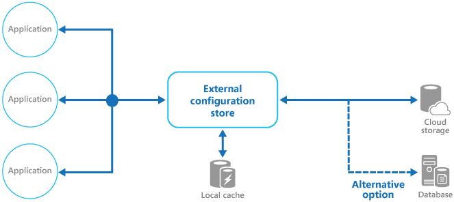

# External configuration store pattern

## Summary

Move configuration information out of the application deployment package to a centralized location. This can provide opportunities for easier management and control of configuration data, and for sharing configuration data across applications and application instances.

## Prerequisites

TODO: link the notes a reader should know first.

## Core concepts

### Definition

Move configuration information out of the application deployment package to a centralized location. This can provide opportunities for easier management and control of configuration data, and for sharing configuration data across applications and application instances.

### Context and problem

Application runtime environments often have configuration files that can be edited post-deployment to alter behavior, but this necessitates redeployment, causing downtime and overhead. Local configurations are limited to one application and don't support sharing settings like database strings or UI themes across multiple apps.

Managing local configurations is difficult across various instances, particularly in the cloud, leading to inconsistency during updates. Moreover, updating apps may require configuration schema changes, which many systems don't support versioning for.

### Solution

Store the configuration information in external storage, and provide an interface that can be used to quickly and efficiently read and update configuration settings. The type of external store depends on the hosting and runtime environment of the application. In a cloud-hosted scenario it's typically a cloud-based storage service or dedicated configuration service, but could be a hosted database or other custom system.

Choose a configuration backing store with a consistent, user-friendly interface that offers correctly formatted and typed data. Ensure it supports user authorization for data protection and can store various versions of the configuration, including different stages and releases.

## Worked example

TODO: add a concrete, reproducible example with real values.

## Trade offs and when to use it

### Issues and considerations

Consider the following points when deciding how to implement this pattern:

Choose a backing store that offers acceptable performance, high availability, robustness, and can be backed up as part of the application maintenance and administration process. In a cloud-hosted application, using a cloud storage mechanism or dedicated configuration platform service is usually a good choice to meet these requirements.

Create a flexible schema for the backing store to accommodate various information types, covering all configuration needs like typed data, settings collections, multiple settings versions, and other application necessities. Ensure it's easily extendable for new settings as requirements evolve.

Consider the backing store's physical capabilities, its impact on configuration storage, and performance effects. Storing configuration as an XML document necessitates parsing to read settings, complicating updates but caching can mitigate slower reads.

Design the configuration interface to manage settings' scope and inheritance at organization, application, and machine levels, support access control delegation, and enable or restrict application-specific setting overrides.

Ensure that the configuration interface can expose the configuration data in the required formats such as typed values, collections, key/value pairs, or property bags.

Evaluate the configuration store interface's response to erroneous or nonexistent settings, considering default returns and error logging. Address case sensitivity in setting keys, binary data management, and null or empty value processing.

Ensure configuration data is accessible only to authorized users and applications, typically through the configuration store interface. Prevent direct access to the backing store without proper permissions, enforce distinct read and write permissions, and consider encrypting settings as implemented by the interface.

Centralized configurations that alter app behavior at runtime are crucial and should be deployed, updated, and managed like application code. Changes affecting multiple apps require full testing and staged deployment to confirm suitability for all involved applications. An administrator's edit to update one app could negatively affect others sharing the setting.

If an application caches configuration information, the application needs to be alerted if the configuration changes. It might be possible to implement an expiration policy over cached configuration data so that this information is automatically refreshed periodically and any changes picked up (and acted on).

Caching configuration data can mitigate temporary connectivity issues during application runtime, but it won't fix problems if the external store is unavailable at startup. Ensure your deployment pipeline supplies a fallback configuration file with the last known values for such cases.

### Use cases

This pattern is useful for:

- Configuration settings that are shared between multiple applications and application instances, or where a standard configuration must be enforced across multiple applications and application instances.
- A standard configuration system that doesn't support all of the required configuration settings, such as storing images or complex data types.
- As a complementary store for some of the settings for applications, perhaps allowing applications to override some or all of the centrally-stored settings.
- As a way to simplify administration of multiple applications, and optionally for monitoring use of configuration settings by logging some or all types of access to the configuration store.

## Common mistakes

TODO: list frequent misunderstandings and failure modes, with the fix for each.

## Practice

TODO: add three to five questions, with answers at the bottom.

## Further reading

- Microsoft. [*External configuration store pattern*](https://learn.microsoft.com/en-us/azure/architecture/patterns/external-configuration-store). Azure Architecture Center. The full description of the pattern: context and problem, solution, issues and considerations, and when to use it.

TODO: check the content of this note against the sources above and record what was verified and when.
