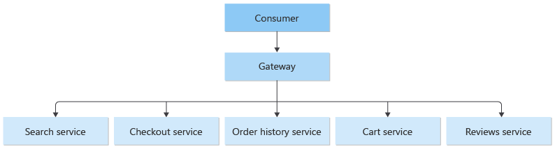

# Gateway routing pattern

## Summary

The gateway routing pattern exposes several services or service instances behind a single endpoint and routes each request to the right backend, usually by path, header or version. Clients then depend on one address, and the backends can be split, moved or versioned without changing the clients.

## Prerequisites

TODO: link the notes a reader should know first.

## Core concepts

### Definition

Route requests to multiple services or multiple service instances using a single endpoint. The pattern is useful when you want to:

- Expose multiple services on a single endpoint and route to the appropriate service based on the request
- Expose multiple instances of the same service on a single endpoint for load balancing or availability purposes
- Expose differing versions of the same service on a single endpoint and route traffic across the different versions

### Context and problem

When a client needs to consume multiple services, multiple service instances or a combination of both, the client must be updated when services are added or removed. Consider the following scenarios.

- **Multiple disparate services** - An e-commerce application might provide services such as search, reviews, cart, checkout, and order history. Each service has a different API that the client must interact with, and the client must know about each endpoint in order to connect to the services. If an API changes, the client must be updated as well. If you refactor a service into two or more separate services, the code must change in both the service and the client.
- **Multiple instances of the same service** - The system can require running multiple instances of the same service in the same or different regions. Running multiple instances can be done for load balancing purposes or to meet availability requirements. Each time an instance is spun up or down to match demand, the client must be updated.
- **Multiple versions of the same service** - As part of the deployment strategy, new versions of a service can be deployed along side existing versions. This is known as blue green deployments. In these scenarios, the client must be updated each time there are changes to the percentage of traffic being routed to the new version and existing endpoint.

### Solution

Place a gateway in front of a set of applications, services, or deployments. Use application Layer 7 routing to route the request to the appropriate instances.

With this pattern, the client application only needs to know about a single endpoint and communicate with a single endpoint. The following illustrate how the Gateway Routing pattern addresses the three scenarios outlined in the context and problem section.

## Worked example

TODO: add a concrete, reproducible example with real values.

## Trade offs and when to use it

### Issues and considerations

- The gateway service can introduce a single point of failure. Ensure it's properly designed to meet your availability requirements. Consider resiliency and fault tolerance capabilities in the implementation.
- The gateway service can introduce a bottleneck. Ensure the gateway has adequate performance to handle load and can easily scale in line with your growth expectations.
- Perform load testing against the gateway to ensure you don't introduce cascading failures for services.
- Gateway routing is level 7. It can be based on IP, port, header, or URL.
- Gateway services can be global or regional.
- Use a global gateway if your solution requires multi-region deployments of services. Consider using Application Gateway if you have a regional workload that requires granular control how traffic is balanced. For example, you want to balance traffic between virtual machines.
- The gateway service is the public endpoint for services it sits in front of. Consider limiting public network access to the backend services, by making the services only accessible via the gateway or via a private virtual network.

### Use cases

Use this pattern when:

- A client needs to consume multiple services that can be accessed behind a gateway.
- You want to simplify client applications by using a single endpoint.
- You need to route requests from externally addressable endpoints to internal virtual endpoints, such as exposing ports on a VM to cluster virtual IP addresses.
- A client needs to consume services running in multiple regions for latency or availability benefits.
- A client needs to consume a variable number of service instances.
- You want to implement a deployment strategy where clients access multiple versions of the service at the same time.

This pattern may not be suitable when you have a simple application that uses only one or two services.

## Common mistakes

TODO: list frequent misunderstandings and failure modes, with the fix for each.

## Practice

TODO: add three to five questions, with answers at the bottom.

## Further reading

- Microsoft. [*Gateway routing pattern*](https://learn.microsoft.com/en-us/azure/architecture/patterns/gateway-routing). Azure Architecture Center. The full description of the pattern: context and problem, solution, issues and considerations, and when to use it.

TODO: check the content of this note against the sources above and record what was verified and when.
