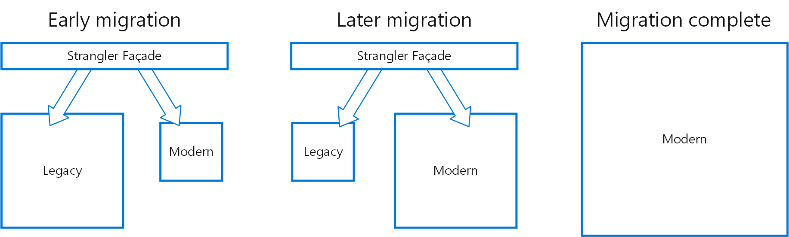

# Strangler fig pattern

## Summary

Incrementally migrate a legacy system by gradually replacing specific pieces of functionality with new applications and services. As features from the legacy system are replaced, the new system eventually replaces all of the old system's features, strangling the old system and allowing you to decommission it.

## Prerequisites

TODO: link the notes a reader should know first.

## Core concepts

### Definition

Incrementally migrate a legacy system by gradually replacing specific pieces of functionality with new applications and services. As features from the legacy system are replaced, the new system eventually replaces all of the old system's features, strangling the old system and allowing you to decommission it.

### Context and problem

As systems age, they may become obsolete, and added features can significantly increase complexity, making maintenance and updates difficult. Replacing a complex system usually requires gradual migration, maintaining the old system for unmigrated features. This dual system operation necessitates clients to track feature locations and update their access points whenever a service is migrated.

### Solution

Incrementally replace specific pieces of functionality with new applications and services. Create a façade that intercepts requests going to the backend legacy system. The façade routes these requests either to the legacy application or the new services. Existing features can be migrated to the new system gradually, and consumers can continue using the same interface, unaware that any migration has taken place.

This pattern reduces migration risk and allows flexible development pacing. The façade directs users to the appropriate application, letting you enhance the new system incrementally while maintaining legacy functionality. Gradually, the legacy system is phased out until it can be decommissioned.

## Worked example

TODO: add a concrete, reproducible example with real values.

## Trade offs and when to use it

### Issues and considerations

- Consider how to handle services and data stores that are potentially used by both new and legacy systems. Make sure both can access these resources side-by-side.
- Structure new applications and services in a way that they can easily be intercepted and replaced in future strangler fig migrations.
- At some point, when the migration is complete, the strangler fig façade will either go away or evolve into an adaptor for legacy clients.
- Make sure the façade keeps up with the migration.
- Make sure the façade doesn't become a single point of failure or a performance bottleneck.

### Use cases

Use this pattern when gradually migrating a back-end application to a new architecture.

This pattern may not be suitable:

- When requests to the back-end system cannot be intercepted.
- For smaller systems where the complexity of wholesale replacement is low.

## Common mistakes

TODO: list frequent misunderstandings and failure modes, with the fix for each.

## Practice

TODO: add three to five questions, with answers at the bottom.

## Further reading

- Microsoft. [*Strangler fig pattern*](https://learn.microsoft.com/en-us/azure/architecture/patterns/strangler-fig). Azure Architecture Center. The full description of the pattern: context and problem, solution, issues and considerations, and when to use it.
- Fowler, M. (2004). [*StranglerFigApplication*](https://martinfowler.com/bliki/StranglerFigApplication.html). martinfowler.com. The article that named the strangler fig approach to replacing a legacy system gradually.

TODO: check the content of this note against the sources above and record what was verified and when.
