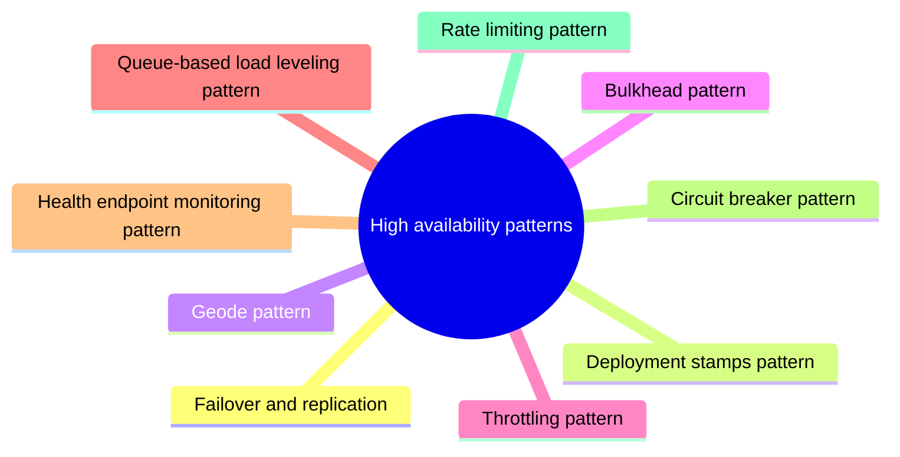

# High availability patterns

Patterns that keep a system working and measurably available when load grows or parts of it fail.

This is a catalog section: it groups a large body of related notes inside the knowledge area. It is not a separate SWEBOK topic.

## Overview

Availability is measured as a percentage of uptime, and defines the proportion of time that a system is functional and working. Availability is affected by system errors, infrastructure problems, malicious attacks, and system load. Cloud applications typically provide users with a service level agreement (SLA), which means that applications must be designed and implemented to maximize availability.

Infrastructure is composed of geographies, regions, and Availability Zones, which limit the blast radius of a failure and therefore limit potential impact to customer applications and data. The Azure Availability Zones construct was developed to provide a software and networking solution to protect against datacenter failures and to provide increased high availability (HA) to our customers. With HA architecture there is a balance between high resilience, low latency, and cost.

## Map

The map shows the notes and sections of this part of the library.

## Reading order

1. [Failover and replication](failover-and-replication.md): Failover and replication are the two basic techniques for high availability.
2. [Deployment stamps pattern](deployment-stamps.md): The deployment stamp pattern involves provisioning, managing, and monitoring a heterogeneous group of resources to host and operate multiple workloads or tenants.
3. [Geode pattern](geode.md): The Geode pattern involves deploying a collection of backend services into a set of geographical nodes, each of which can service any request for any client in any region.
4. [Bulkhead pattern](bulkhead.md): The bulkhead pattern isolates the resources of an application into separate pools, so that a failure or overload in one pool cannot exhaust the resources of the others.
5. [Throttling pattern](throttling.md): Control the consumption of resources used by an instance of an application, an individual tenant, or an entire service.
6. [Queue-based load leveling pattern](queue-based-load-leveling.md): Use a queue that acts as a buffer between a task and a service it invokes in order to smooth intermittent heavy loads that can cause the service to fail or the task to time out.
7. [Health endpoint monitoring pattern](health-endpoint-monitoring.md): To verify that applications and services are performing correctly, you can use the Health Endpoint Monitoring pattern.
8. [Circuit breaker pattern](circuit-breaker.md): Handle faults that might take a variable amount of time to recover from, when connecting to a remote service or resource.
9. [Rate limiting pattern](rate-limiting.md): The rate limiting pattern makes a client control the rate at which it sends requests to a service that enforces limits, so that it stays under the limit instead of repeatedly hitting it and being...
