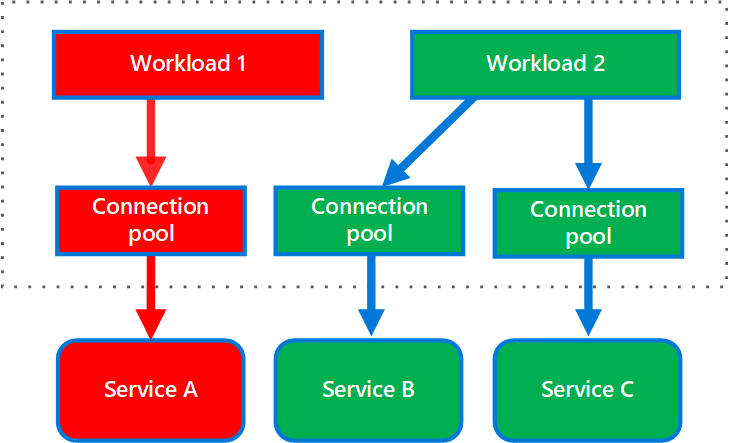

# Bulkhead pattern

## Summary

The bulkhead pattern isolates the resources of an application into separate pools, so that a failure or overload in one pool cannot exhaust the resources of the others. Like the watertight compartments of a ship, it limits the damage of a fault to one part of the system.

## Prerequisites

TODO: link the notes a reader should know first.

## Core concepts

### Definition

The Bulkhead pattern is a type of application design that is tolerant of failure. In a bulkhead architecture, also known as cell-based architecture, elements of an application are isolated into pools so that if one fails, the others will continue to function. It's named after the sectioned partitions (bulkheads) of a ship's hull. If the hull of a ship is compromised, only the damaged section fills with water, which prevents the ship from sinking.

### Context and problem

A cloud-based application may include multiple services, with each service having one or more consumers. Excessive load or failure in a service will impact all consumers of the service.

A consumer can concurrently send requests to various services, using resources. If a service is misconfigured or unresponsive, it may not release resources quickly, leading to exhaustion, such as depleting the client's connection pool. This affects requests to other services and can eventually prevent the consumer from sending any requests, not just to the initially unresponsive service.

The same issue of resource exhaustion affects services with multiple consumers. A large number of requests originating from one client may exhaust available resources in the service. Other consumers are no longer able to consume the service, causing a cascading failure effect.

### Solution

Partition service instances into different groups, based on consumer load and availability requirements. This design helps to isolate failures, and allows you to sustain service functionality for some consumers, even during a failure.

A consumer can also partition resources, to ensure that resources used to call one service don't affect the resources used to call another service. For example, a consumer that calls multiple services may be assigned a connection pool for each service. If a service begins to fail, it only affects the connection pool assigned for that service, allowing the consumer to continue using the other services.

The benefits of this pattern include:

- Isolates consumers and services from cascading failures. An issue affecting a consumer or service can be isolated within its own bulkhead, preventing the entire solution from failing.
- Allows you to preserve some functionality in the event of a service failure. Other services and features of the application will continue to work.
- Allows you to deploy services that offer a different quality of service for consuming applications. A high-priority consumer pool can be configured to use high-priority services.

## Worked example

TODO: add a concrete, reproducible example with real values.

## Trade offs and when to use it

### Issues and considerations

- Define partitions around the business and technical requirements of the application.
- If using tactical DDD to design microservices, partition boundaries should align with the bounded contexts.
- When partitioning services or consumers into bulkheads, consider the level of isolation offered by the technology as well as the overhead in terms of cost, performance and manageability.
- Consider combining bulkheads with retry, circuit breaker, and throttling patterns to provide more sophisticated fault handling.
- When partitioning consumers into bulkheads, consider using processes, thread pools, and semaphores. Projects like resilience4j and Polly offer a framework for creating consumer bulkheads.
- When partitioning services into bulkheads, consider deploying them into separate virtual machines, containers, or processes. Containers offer a good balance of resource isolation with fairly low overhead.
- Services that communicate using asynchronous messages can be isolated through different sets of queues. Each queue can have a dedicated set of instances processing messages on the queue, or a single group of instances using an algorithm to dequeue and dispatch processing.
- Determine the level of granularity for the bulkheads. For example, if you want to distribute tenants across partitions, you could place each tenant into a separate partition, or put several tenants into one partition.
- Monitor each partition's performance and SLA.

### Use cases

Use this pattern to:

- Isolate resources used to consume a set of backend services, especially if the application can provide some level of functionality even when one of the services is not responding.
- Isolate critical consumers from standard consumers.
- Protect the application from cascading failures.

This pattern may not be suitable when:

- Less efficient use of resources may not be acceptable in the project.
- The added complexity is not necessary

## Common mistakes

TODO: list frequent misunderstandings and failure modes, with the fix for each.

## Practice

TODO: add three to five questions, with answers at the bottom.

## Further reading

- Microsoft. [*Bulkhead pattern*](https://learn.microsoft.com/en-us/azure/architecture/patterns/bulkhead). Azure Architecture Center. The full description of the pattern: context and problem, solution, issues and considerations, and when to use it.

TODO: check the content of this note against the sources above and record what was verified and when.
