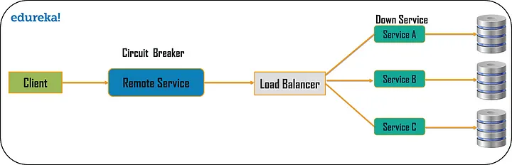
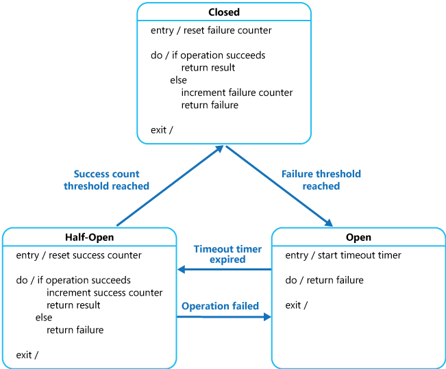

# Circuit breaker pattern

## Summary

Handle faults that might take a variable amount of time to recover from, when connecting to a remote service or resource. This can improve the stability and resiliency of an application.

## Prerequisites

TODO: link the notes a reader should know first.

## Core concepts

### Definition

Handle faults that might take a variable amount of time to recover from, when connecting to a remote service or resource. This can improve the stability and resiliency of an application.

### Context and problem

In a distributed environment, remote calls can fail due to temporary issues like network lags, timeouts, or unavailable resources. Such faults usually resolve themselves quickly, and a resilient cloud application should address them by implementing a Retry pattern. However, some faults caused by unexpected events may take longer to fix and could range from reduced connectivity to total service outage. In these cases, it's better for the application to recognize the failure rather than repeatedly retrying a futile operation.

Furthermore, if a service is overwhelmed, one system's failure might cause cascading failures elsewhere. Operations that use timeouts and reply with failure when a service doesn't respond in time can lead to many simultaneous requests getting blocked, tying up essential resources like memory and database connections. This can trigger failures in unrelated system parts needing those resources. It's better for operations to fail fast and only call services likely to respond successfully. While shorter timeouts can help, they shouldn't be so brief that they cause premature operation failures.

### Solution

he Circuit Breaker pattern can prevent an application from repeatedly trying to execute an operation that's likely to fail. Allowing it to continue without waiting for the fault to be fixed or wasting CPU cycles while it determines that the fault is long lasting. The Circuit Breaker pattern also enables an application to detect whether the fault has been resolved. If the problem appears to have been fixed, the application can try to invoke the operation.

The purpose of the Circuit Breaker pattern is different than the Retry pattern. The Retry pattern enables an application to retry an operation in the expectation that it'll succeed. The Circuit Breaker pattern prevents an application from performing an operation that is likely to fail. An application can combine these two patterns by using the Retry pattern to invoke an operation through a circuit breaker. However, the retry logic should be sensitive to any exceptions returned by the circuit breaker and abandon retry attempts if the circuit breaker indicates that a fault is not transient.

A circuit breaker acts as a proxy for operations that might fail. The proxy should monitor the number of recent failures that have occurred, and use this information to decide whether to allow the operation to proceed, or simply return an exception immediately.

The proxy can be implemented as a state machine with the following states that mimic the functionality of an electrical circuit breaker:

- **Closed**: The application's request is directed to the operation. The proxy counts recent failures, adding to this count if an operation fails. Exceeding a failure threshold within a set time triggers the proxy's **Open** state, starting a timeout timer. After expiration, the proxy enters the **Half-Open** state, allowing time for system fixes before retrying the operation.
- **Open**: The request from the application fails immediately and an exception is returned to the application.
- **Half-Open**: A limited number of requests can invoke the operation. Successful requests indicate a resolved fault, switching the circuit breaker to **Closed** and resetting the failure count. Failed requests mean the fault persists, reverting the circuit breaker to **Open** and restarting the timeout for recovery. The Half-Open state prevents overload on a recovering service by allowing a controlled volume of requests, avoiding potential timeouts or failures during recovery.

The **Closed** state's failure counter is time-based and resets periodically, preventing unnecessary transition to the **Open** state from sporadic failures. The circuit breaker switches to **Open** when failures exceed a threshold within a set time. In the **Half-Open** state, successful operations are counted, and consistent success leads back to **Closed**. Any failure prompts an immediate shift to **Open**. Recovery methods, such as component reset or network repair, are external. The Circuit Breaker pattern enhances stability and response times by rejecting likely-to-fail operations and can signal system health changes or alerts. It's adaptable for various failures, with strategies like escalating timeouts or returning default values instead of exceptions.

## Worked example

TODO: add a concrete, reproducible example with real values.

## Trade offs and when to use it

### Issues and considerations

You should consider the following points when deciding how to implement this pattern:

**Exception Handling**. An application invoking an operation through a circuit breaker must be prepared to handle the exceptions raised if the operation is unavailable. The way exceptions are handled will be application specific. For example, an application could temporarily degrade its functionality, invoke an alternative operation to try to perform the same task or obtain the same data, or report the exception to the user and ask them to try again later.

**Types of Exceptions**. A request might fail for many reasons, some of which might indicate a more severe type of failure than others. For example, a request might fail because a remote service has crashed and will take several minutes to recover, or because of a timeout due to the service being temporarily overloaded. A circuit breaker might be able to examine the types of exceptions that occur and adjust its strategy depending on the nature of these exceptions. For example, it might require a larger number of timeout exceptions to trip the circuit breaker to the **Open** state compared to the number of failures due to the service being completely unavailable.

**Logging**. A circuit breaker should log all failed requests (and possibly successful requests) to enable an administrator to monitor the health of the operation.

**Recoverability**. You should configure the circuit breaker to match the likely recovery pattern of the operation it's protecting. For example, if the circuit breaker remains in the **Open** state for a long period, it could raise exceptions even if the reason for the failure has been resolved. Similarly, a circuit breaker could fluctuate and reduce the response times of applications if it switches from the **Open** state to the **Half-Open** state too quickly.

**Testing Failed Operations**. In the **Open** state, rather than using a timer to determine when to switch to the **Half-Open** state, a circuit breaker can instead periodically ping the remote service or resource to determine whether it's become available again. This ping could take the form of an attempt to invoke an operation that had previously failed, or it could use a special operation provided by the remote service specifically for testing the health of the service, as described by the Health Endpoint Monitoring pattern.

**Manual Override**. In a system where the recovery time for a failing operation is extremely variable, it's beneficial to provide a manual reset option that enables an administrator to close a circuit breaker (and reset the failure counter). Similarly, an administrator could force a circuit breaker into the **Open** state (and restart the timeout timer) if the operation protected by the circuit breaker is temporarily unavailable.

**Concurrency**. The same circuit breaker could be accessed by a large number of concurrent instances of an application. The implementation shouldn't block concurrent requests or add excessive overhead to each call to an operation.

**Resource Differentiation**. Be careful when using a single circuit breaker for one type of resource if there might be multiple underlying independent providers. For example, in a data store that contains multiple shards, one shard might be fully accessible while another is experiencing a temporary issue. If the error responses in these scenarios are merged, an application might try to access some shards even when failure is highly likely, while access to other shards might be blocked even though it's likely to succeed.

**Accelerated Circuit Breaking**. Sometimes a failure response can contain enough information for the circuit breaker to trip immediately and stay tripped for a minimum amount of time. For example, the error response from a shared resource that's overloaded could indicate that an immediate retry isn't recommended and that the application should instead try again in a few minutes.

**Replaying Failed Requests**. In the **Open** state, rather than simply failing quickly, a circuit breaker could also record the details of each request to a journal and arrange for these requests to be replayed when the remote resource or service becomes available.

**Inappropriate Timeouts on External Services**. A circuit breaker might not be able to fully protect applications from operations that fail in external services that are configured with a lengthy timeout period. If the timeout is too long, a thread running a circuit breaker might be blocked for an extended period before the circuit breaker indicates that the operation has failed. In this time, many other application instances might also try to invoke the service through the circuit breaker and tie up a significant number of threads before they all fail.

### Use cases

Use this pattern:

- To prevent an application from trying to invoke a remote service or access a shared resource if this operation is highly likely to fail.

This pattern isn't recommended:

- For handling access to local private resources in an application, such as in-memory data structure. In this environment, using a circuit breaker would add overhead to your system.
- As a substitute for handling exceptions in the business logic of your applications.

## Common mistakes

TODO: list frequent misunderstandings and failure modes, with the fix for each.

## Practice

TODO: add three to five questions, with answers at the bottom.

## Further reading

- Microsoft. [*Circuit breaker pattern*](https://learn.microsoft.com/en-us/azure/architecture/patterns/circuit-breaker). Azure Architecture Center. The full description of the pattern: context and problem, solution, issues and considerations, and when to use it.

TODO: check the content of this note against the sources above and record what was verified and when.
