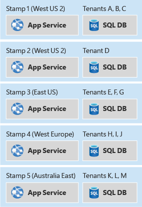

# Deployment stamps pattern

## Summary

The deployment stamp pattern involves provisioning, managing, and monitoring a heterogeneous group of resources to host and operate multiple workloads or tenants. Each individual copy is called a stamp, or sometimes a service unit, scale unit, or cell.

## Prerequisites

TODO: link the notes a reader should know first.

## Core concepts

### Definition

The deployment stamp pattern involves provisioning, managing, and monitoring a heterogeneous group of resources to host and operate multiple workloads or tenants. Each individual copy is called a *stamp*, or sometimes a *service unit*, *scale unit*, or *cell*.

In a multitenant environment, every stamp or scale unit can serve a predefined number of tenants. Multiple stamps can be deployed to scale the solution almost linearly and serve an increasing number of tenants. This approach can improve the scalability of your solution, allow you to deploy instances across multiple regions, and separate your customer data.

### Context and problem

When hosting an application in the cloud, it's important to consider the performance and reliability of your application. If you host a single instance of your solution, you might be subject to the following limitations:

- **Scale limits.** Deploying a single instance of your application might result in natural scaling limits. For example, you might use services that have limits on the number of inbound connections, host names, TCP sockets, or other resources.
- **Non-linear scaling or cost.** Some of your solution's components might not scale linearly with the number of requests or the amount of data. Instead, there can be a sudden decrease in performance or increase in cost once a threshold has been met. For example, you might use a database and discover that the marginal cost of adding more capacity (scaling up) becomes prohibitive, and that scaling out is a more cost-effective strategy.
- **Separation of customers.** You might need to keep certain customers' data isolated from other customers' data. Similarly, you might have some customers that require more system resources to service than others, and consider grouping them on different sets of infrastructure.
- **Handling single- and multitenant instances.** You might have some large customers who need their own independent instances of your solution. You might also have a pool of smaller customers who can share a multitenant deployment.
- **Complex deployment requirements.** You might need to deploy updates to your service in a controlled manner, and to deploy to different subsets of your customer base at different times.
- **Update frequency.** You might have some customers who are tolerant of having frequent updates to your system, while others might be risk-averse and want infrequent updates to the system that services their requests. It might make sense to have these customers deployed to isolated environments.
- **Geographical or geopolitical restrictions.** To architect for low latency, or to comply with data sovereignty requirements, you might deploy some of your customers into specific regions.

These limitations are often applicable to independent software vendors (ISVs) who build software as a service (SaaS), which are frequently designed to be multitenanted. However, the same limitations can also apply to other scenarios too.

### Solution

To avoid these issues, consider grouping resources in *scale units* and provisioning multiple copies of your *stamps*. Each *scale unit* will host and serve a subset of your tenants. Stamps operate independently of each other and can be deployed and updated independently. A single geographical region might contain a single stamp, or might contain multiple stamps to allow for horizontal scale-out within the region. Stamps contain a subset of your customers.

Deployment stamps work for IaaS or PaaS-based solutions, and are particularly beneficial for scaling IaaS-heavy workloads. They enable deployment rings, allowing customers to receive updates at varying frequencies by grouping them onto different stamps with separate update schedules. Stamps operate independently, leading to implicit data sharding, and can further shard internally for scalability. Azure services like App Service, Azure Stack, and Azure Storage use this pattern.

While similar to geodes, where all instances can serve any user, deployment stamps are independent instances serving subsets of customers. Combining deployment stamps with geodes is possible, creating a hybrid system that can leverage traffic routing for more complex scenarios.

## Worked example

TODO: add a concrete, reproducible example with real values.

## Trade offs and when to use it

### Issues and considerations

You should consider the following points when deciding how to implement this pattern:

- **Deployment process.** When deploying multiple stamps, it's highly advisable to have automated and fully repeatable deployment processes. Consider using Bicep, JSON ARM templates, or Terraform modules to declaratively define your stamps, and to keep the definitions consistent.
- **Cross-stamp operations.** When your solution is deployed independently across multiple stamps, questions like "how many customers do we have across all of our stamps?" can become more complex to answer. Queries might need to be executed against each stamp and the results aggregated. Alternatively, consider having all of the stamps publish data into a centralized data warehouse for consolidated reporting.
- **Determining scale-out policies.** Stamps have a finite capacity, which might be defined using a proxy metric such as the number of tenants that can be deployed to the stamp. It's important to monitor the available capacity and used capacity for each stamp, and to proactively deploy additional stamps to allow for new tenants to be directed to them.
- **Minimum number of stamps.** When you use the Deployment Stamp pattern, it's advisable to deploy at least two stamps of your solution. If you only deploy a single stamp, it's easy to accidentally hard-code assumptions into your code or configuration that won't apply when you scale out.
- **Cost.** The Deployment Stamp pattern involves deploying multiple copies of your infrastructure component, which will likely involve a substantial increase in the cost of operating your solution.
- **Moving between stamps.** Each stamp is deployed and operated independently, so moving tenants between stamps can be difficult. Your application would need custom logic to transmit the information about a given customer to a different stamp, and then to remove the tenant's information from the original stamp. This process might require a backplane for communication between stamps, further increasing the complexity of the overall solution.
- **Traffic routing.** As described earlier in this article, routing traffic to the correct stamp for a given request can require an additional component to resolve tenants to stamps. This component, in turn, might need to be made highly available.
- **Shared components.** You might have some components that can be shared across stamps. For example, if you have a shared single-page app for all tenants, consider deploying that into one region and using Azure CDN to replicate it globally.

### Use cases

This pattern is useful when you have:

- Natural limits on scalability. For example, if some components cannot or should not scale beyond a certain number of customers or requests, consider scaling out using stamps.
- A requirement to separate certain tenants from others. If you have customers that cannot be deployed into a multitenant stamp with other customers due to security concerns, they can be deployed onto their own isolated stamp.
- A need to have some tenants on different versions of your solution at the same time.
- Multi-region applications where each tenant's data and traffic should be directed to a specific region.
- A desire to achieve resiliency during outages. As stamps are independent of one another, if an outage affects a single stamp then the tenants deployed to other stamps should not be affected. This isolation helps to contain the 'blast radius' of an incident or outage.

This pattern is not suitable for:

- Simple solutions that do not need to scale to a high degree.
- Systems that can be easily scaled out or up within a single instance, such as by increasing the size of the application layer or by increasing the reserved capacity for databases and the storage tier.
- Solutions in which data should be replicated across all deployed instances. Consider the geode pattern for this scenario.
- Solutions in which only some components need to be scaled, but not others. For example, consider whether your solution could be scaled by sharding the data store rather than deploying a new copy of all of the solution components.
- Solutions comprised solely of static content, such as a front-end JavaScript application. Consider storing such content in a storage account and using Azure CDN.

## Common mistakes

TODO: list frequent misunderstandings and failure modes, with the fix for each.

## Practice

TODO: add three to five questions, with answers at the bottom.

## Further reading

- Microsoft. [*Deployment stamps pattern*](https://learn.microsoft.com/en-us/azure/architecture/patterns/deployment-stamp). Azure Architecture Center. The full description of the pattern: context and problem, solution, issues and considerations, and when to use it.

TODO: check the content of this note against the sources above and record what was verified and when.
