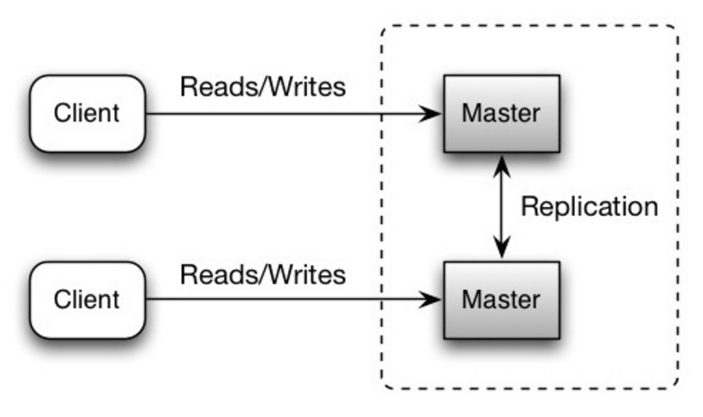
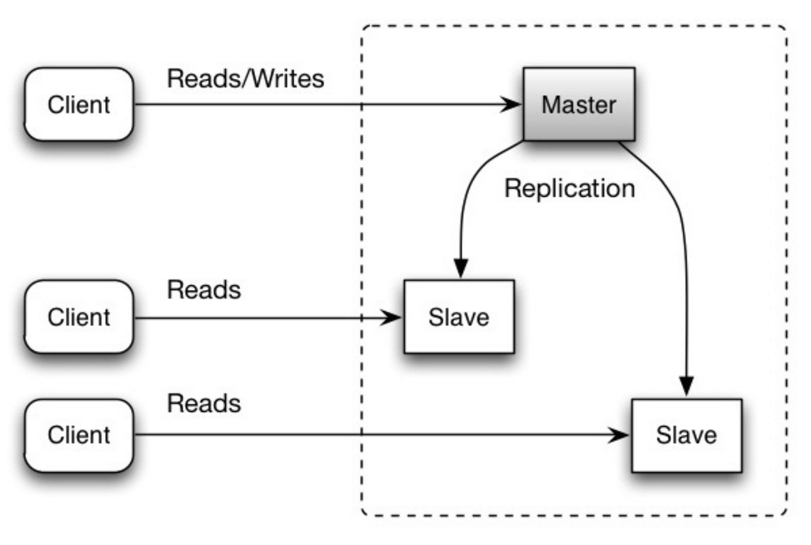

# Failover and replication

## Summary

Failover and replication are the two basic techniques for high availability. Failover moves traffic to a standby component when the active one fails (active-passive) or spreads it over several active components (active-active). Replication keeps copies of data on several nodes (primary-replica or primary-primary), so that a failure does not lose data or stop service.

## Prerequisites

- [Availability](../../../software-quality/fundamentals/quality-attributes/availability.md)

## Core concepts

### Introduction

When architecting workloads, leverage industry patterns to tackle common challenges, enabling intentional tradeoffs and optimization for desired outcomes. These patterns mitigate risks affecting security, performance, cost, and operations, thus averting reliability issues. Rooted in real-world experience, they cater to cloud-scale operations, are vendor-agnostic, and uphold operational excellence through standardized workload design.

### Fail-Over

Failover is an availability pattern that is used to ensure that a system can continue to function in the event of a failure. It involves having a backup component or system that can take over in the event of a failure.

In a failover system, there is a primary component that is responsible for handling requests, and a secondary (or backup) component that is on standby. The primary component is monitored for failures, and if it fails, the secondary component is activated to take over its duties. This allows the system to continue functioning with minimal disruption.

Failover can be implemented in various ways, such as active-passive, active-active, and hot-standby.

#### Types

##### Active-passive

With active-passive fail-over, heartbeats are sent between the active and the passive server on standby. If the heartbeat is interrupted, the passive server takes over the active’s IP address and resumes service.

The length of downtime is determined by whether the passive server is already running in ‘hot’ standby or whether it needs to start up from ‘cold’ standby. Only the active server handles traffic.

Active-passive failover can also be referred to as master-slave failover.

##### Active-active

In active-active, both servers are managing traffic, spreading the load between them.

If the servers are public-facing, the DNS would need to know about the public IPs of both servers. If the servers are internal-facing, application logic would need to know about both servers.

Active-active failover can also be referred to as master-master failover.

#### Disadvantages

- Fail-over adds more hardware and additional complexity.
- There is a potential for loss of data if the active system fails before any newly written data can be replicated to the passive.

### Replication

Replication is an availability pattern that involves having multiple copies of the same data stored in different locations. In the event of a failure, the data can be retrieved from a different location. There are two main types of replication: Master-Master replication and Master-Slave replication.

#### Master-Master replication

In this type of replication, multiple servers are configured as “masters,” and each one can accept read and write operations. This allows for high availability and allows any of the servers to take over if one of them fails. However, this type of replication can lead to conflicts if multiple servers update the same data at the same time, so some conflict resolution mechanism is needed to handle this.

##### Disadvantages

- You'll need a load balancer or you'll need to make changes to your application logic to determine where to write.
- Most master-master systems are either loosely consistent (violating ACID) or have increased write latency due to synchronization.
- Conflict resolution comes more into play as more write nodes are added and as latency increases.

#### Master-Slave replication

In this type of replication, one server is designated as the “master” and handles all write operations, while multiple “slave” servers handle read operations. If the master fails, one of the slaves can be promoted to take its place. This type of replication is simpler to set up and maintain compared to Master-Master replication.

##### Disadvantages

- Additional logic is needed to promote a slave to a master.

#### Disadvatages

- There is a potential for loss of data if the master fails before any newly written data can be replicated to other nodes.
- Writes are replayed to the read replicas. If there are a lot of writes, the read replicas can get bogged down with replaying writes and can't do as many reads.
- The more read slaves, the more you have to replicate, which leads to greater replication lag.
- On some systems, writing to the master can spawn multiple threads to write in parallel, whereas read replicas only support writing sequentially with a single thread.
- Replication adds more hardware and additional complexity.

## Worked example

TODO: add a concrete, reproducible example with real values.

## Trade offs and when to use it

TODO: describe benefits, costs, alternatives and when this is the wrong choice.

## Common mistakes

TODO: list frequent misunderstandings and failure modes, with the fix for each.

## Practice

TODO: add three to five questions, with answers at the bottom.

## Further reading

- Microsoft. [*Cloud design patterns*](https://learn.microsoft.com/en-us/azure/architecture/patterns/). Microsoft Learn. The Azure Architecture Center catalog that groups cloud patterns by concern and links each pattern to its full description.
- Kleppmann, M. (2017). *Designing Data-Intensive Applications*. O'Reilly Media. A rigorous treatment of replication, partitioning, transactions, consistency models and stream processing.

TODO: check the content of this note against the sources above and record what was verified and when.
