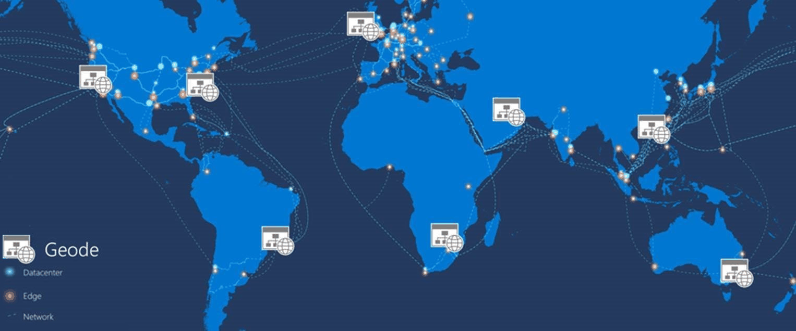
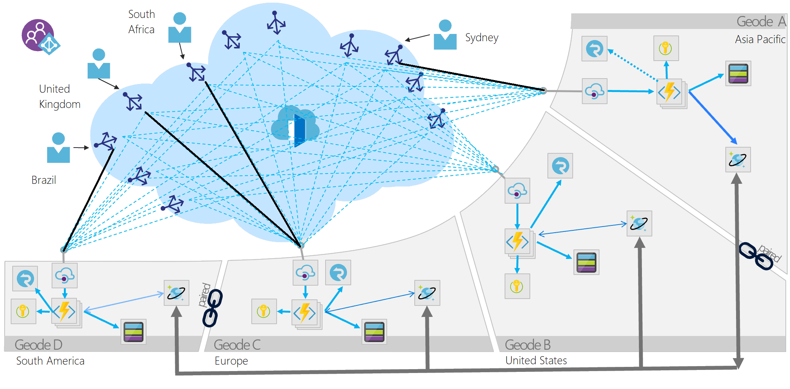

# Geode pattern

## Summary

The Geode pattern involves deploying a collection of backend services into a set of geographical nodes, each of which can service any request for any client in any region. This pattern allows serving requests in an active-active style, improving latency and increasing availability by distributing request processing around the globe.

## Prerequisites

TODO: link the notes a reader should know first.

## Core concepts

### Definition

The Geode pattern involves deploying a collection of backend services into a set of **ge**ographical n**ode**s, each of which can service any request for any client in any region. This pattern allows serving requests in an *active-active* style, improving latency and increasing availability by distributing request processing around the globe.

### Context and problem

Many large-scale services have specific challenges around geo-availability and scale. Classic designs often *bring the data to the compute* by storing data in a remote SQL server that serves as the compute tier for that data, relying on scale-up for growth.

The classic approach may present a number of challenges:

- Network latency issues for users coming from the other side of the globe to connect to the hosting endpoint
- Traffic management for demand bursts that can overwhelm the services in a single region
- Cost-prohibitive complexity of deploying copies of app infrastructure into multiple regions for a 24x7 service

Modern cloud infrastructure supports geographic load balancing for front-end services and geographic replication for backend services. For better availability and performance, data should be close to the user. With a widely distributed user base, datastores must be colocated with compute resources, embodying the geode pattern: bringing compute to the data.

### Solution

Deploy the service into a number of satellite deployments spread around the globe, each of which is called a *geode*. The geode pattern harnesses key features of Azure to route traffic via the shortest path to a nearby geode, which improves latency and performance. Each geode is behind a global load balancer, and uses a geo-replicated read-write service like Azure Cosmos DB to host the data plane, ensuring cross-geode data consistency. Data replication services ensure that data stores are identical across geodes, so *all* requests can be served from *all* geodes.

**The key difference between a deployment stamp and a geode is that geodes never exist in isolation. There should always be more than one geode in a production platform.**

Geodes have the following characteristics:

- Consist of a collection of disparate types of resources, often defined in a template.
- Have no dependencies outside of the geode footprint and are self-contained. No geode is dependent on another to operate, and if one dies, the others continue to operate.
- Are loosely coupled via an edge network and replication backplane. For example, you can use Azure Traffic Manager or Azure Front Door for fronting the geodes, while Azure Cosmos DB can act as the replication backplane. Geodes are not the same as clusters because they share a replication backplane, so the platform takes care of quorum issues.

The geode pattern processes data on commodity hardware using MapReduce and improves by co-locating compute near the network edge to cut response times. It scales across numerous geodes, enhancing resiliency as each additional geode can compensate for regional outages.

While adding complexity, it complements local availability strategies like zones or paired regions for global reach, especially when using storage engines limited to specific replication areas. Geodes can be deployed within various footprints considering regulatory and latency limitations.

## Worked example

TODO: add a concrete, reproducible example with real values.

## Trade offs and when to use it

### Issues and considerations

Use the following techniques and technologies to implement this pattern:

- Modern DevOps practices and tools to produce and rapidly deploy identical geodes across a large number of regions or instances.
- Autoscaling to scale out compute and database throughput instances within a geode. Each geode individually scales out, within the common backplane constraints.
- A front-end service like Azure Front Door that does dynamic content acceleration, split TCP, and Anycast routing.
- A replicating data store like Azure Cosmos DB to control data consistency.
- Serverless technologies where possible, to reduce always-on deployment cost, especially when load is frequently rebalanced around the globe. This strategy allows for many geodes to be deployed with minimal additional investment. Serverless and consumption-based billing technologies reduce waste and cost from duplicate geo-distributed deployments.
- API Management is not required to implement the design pattern, but can be added to each geode that fronts the region's Azure Function App to provide a more robust API layer, enabling the implementation of additional functionality like rate limiting, for instance.

Consider the following points when deciding how to implement this pattern:

- Choose whether to process data locally in each region, or to distribute aggregations in a single geode and replicate the result across the globe. The Azure Cosmos DB change feed processor offers this granular control using its *lease container* concept, and the *leasecollectionprefix* in the corresponding Azure Functions binding. Each approach has distinct advantages and drawbacks.
- Geodes can work in tandem, using the Azure Cosmos DB change feed and a real-time communication platform like SignalR. Geodes can communicate with remote users via other geodes in a mesh pattern, without knowing or caring where the remote user is located.
- This design pattern ensures extreme distribution and decoupling, necessitating a way to monitor components of the same request across instances. Integrate Azure Front Door and Azure Cosmos DB with Log Analytics, and deploy Azure Functions with Application Insights for comprehensive monitoring.
- Distributed deployments need enhanced security for numerous secrets and access points. Key Vault secures secret management, and all API layers must be secured to limit API ingress to front-facing services like Azure Front Door. Azure Cosmos DB should only allow traffic from Azure Function Apps, which in turn should connect solely to Azure Front Door, using Microsoft Entra ID or IP restriction methods.
- Performance hinges on geode count and App Service Plan tiers for the API. Adding geodes or upgrading plans raises costs, not per transaction. Load test post-deployment and compare adding geodes vs. tier upgrades for cost-efficiency.
- Determine the availability requirements for your data. Azure Cosmos DB has optional flags for enabling multi-region write, availability zones, and more. These increase the availability for the Azure Cosmos DB instance and creates a more resilient data layer, but come with additional costs.
- Azure offers a variety of load balancers that provide different functionalities for distribution of traffic. Use the decision tree to help select the right option for your API's front end.

### Use cases

Use this pattern:

- To implement a high-scale platform that has users distributed over a wide area.
- For any service that requires extreme availability and resilience characteristics, because services based on the geode pattern can survive the loss of multiple service regions at the same time.

This pattern might not be suitable for

- Architectures that have constraints so that all geodes can't be equal for data storage. For example, there may be data residency requirements, an application that needs to maintain temporary state for a particular session, or a heavy weighting of requests towards a single region. In this case, consider using deployment stamps in combination with a global routing plane that is aware of where a user's data sits, such as the traffic routing component described within the deployment stamps pattern.
- Situations where there's no geographical distribution required. Instead, consider availability zones and paired regions for clustering.
- Situations where a legacy platform needs to be retrofitted. This pattern works for cloud-native development only, and can be difficult to retrofit.
- Simple architectures and requirements, where geo-redundancy and geo-distribution aren't required or advantageous.

## Common mistakes

TODO: list frequent misunderstandings and failure modes, with the fix for each.

## Practice

TODO: add three to five questions, with answers at the bottom.

## Further reading

- Microsoft. [*Geode pattern*](https://learn.microsoft.com/en-us/azure/architecture/patterns/geodes). Azure Architecture Center. The full description of the pattern: context and problem, solution, issues and considerations, and when to use it.

TODO: check the content of this note against the sources above and record what was verified and when.
