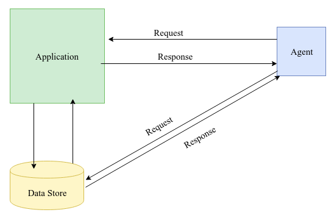
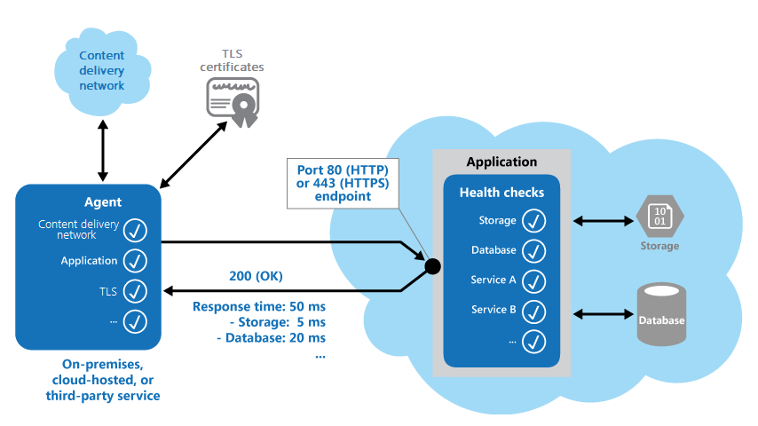

# Health endpoint monitoring pattern

## Summary

To verify that applications and services are performing correctly, you can use the Health Endpoint Monitoring pattern. This pattern specifies the use of functional checks in an application. External tools can access these checks at regular intervals through exposed endpoints.

## Prerequisites

TODO: link the notes a reader should know first.

## Core concepts

### Definition

To verify that applications and services are performing correctly, you can use the Health Endpoint Monitoring pattern. This pattern specifies the use of functional checks in an application. External tools can access these checks at regular intervals through exposed endpoints.

### Context and problem

It's a good practice to monitor web applications and back-end services. Monitoring helps ensure that applications and services are available and performing correctly. Business requirements often include monitoring.

It's sometimes more difficult to monitor cloud services than on-premises services. One reason is that you don't have full control of the hosting environment. Another is that the services typically depend on other services that platform vendors and others provide.

Cloud-hosted applications are impacted by network latency, compute and storage system performance, availability, and bandwidth. Partial or complete service failure can result from these issues. Regular performance checks are necessary to maintain the availability levels specified in your SLA.

### Solution

Implement health monitoring by sending requests to an endpoint on your application. The application should perform the necessary checks and then return an indication of its status.

A health monitoring check typically combines two factors:

- The checks (if any) that the application or service performs in response to the request to the health verification endpoint
- The analysis of the results by the tool or framework that performs the health verification check

The response code indicates the status of the application. Optionally, the response code also provides the status of components and services that the app uses.

The health monitoring code in the application might also run other checks to determine:

- The availability and response time of cloud storage or a database.
- The status of other resources or services that the application uses. These resources and services might be in the application or outside it.

Tools monitor web apps by sending requests to endpoints and assessing the results against rules, making it easy to create a service endpoint for functional system tests.

Typical checks that monitoring tools perform include:

- Validating the response code. For example, an HTTP response of 200 (OK) indicates that the application responded without error. The monitoring system might also check for other response codes to give more comprehensive results.
- Checking the content of the response to detect errors, even when the status code is 200 (OK). By checking the content, you can detect errors that affect only a section of the returned web page or service response. For example, you might check the title of a page or look for a specific phrase that indicates that the app returned the correct page.
- Measuring the response time. The value includes the network latency and the time that the application took to issue the request. An increasing value can indicate an emerging problem with the application or network.
- Checking resources or services that are located outside the application. An example is a content delivery network that the application uses to deliver content from global caches.
- Checking for the expiration of TLS certificates.
- Measuring the response time of a DNS lookup for the URL of the application. This check measures DNS latency and DNS failures.
- Validating the URL that a DNS lookup returns. By validating, you can ensure that entries are correct. You can also help prevent malicious request redirection that might result after an attack on your DNS server.

Run checks from various locations and compare response times to monitor applications near customers for an accurate performance view, ensuring a robust checking mechanism.The results can also help you make the following decisions:

- Where to deploy your application
- Whether to deploy it in more than one datacenter

## Worked example

TODO: add a concrete, reproducible example with real values.

## Trade offs and when to use it

### Issues and considerations

Consider the following points when you decide how to implement this pattern:

- Consider validating responses beyond a 200 (OK) status code. While it indicates application availability, it offers limited insight into operations, trends, and potential future issues.
- Determine the necessary number of application endpoints, ensuring at least one for core services and another for less critical ones. Assign varying importance levels to monitoring outcomes. Enhance monitoring detail by exposing additional endpoints for each key service. For instance, health checks could monitor separate components like databases, storage, and external services, each with distinct uptime and response needs. Background tasks might tolerate brief downtime without affecting overall application health.
- Decide on using one endpoint for both monitoring and general access, creating a special path like */health* for health checks. This lets monitoring tools perform functional tests such as user registration, sign-in, and test orders while confirming the endpoint's availability.
- Decide what information to gather and how to return it for monitoring requests. Most tools only check the endpoint's HTTP status code. For more data, consider developing a custom monitoring utility or service.
- Determine the necessary amount of information to collect. Overprocessing can burden the application and impact other users, possibly leading to timeouts and false unavailability alerts. Utilize existing instrumentation like error handlers and performance counters for logging performance and errors, rather than adding more data to health checks.
- Cache endpoint status to reduce health check costs. Periodically update system health and provide an endpoint for the cached status instead of checking on each dashboard request.
- Plan how to configure security for the monitoring endpoints. By configuring security, you can help protect the endpoints from public access, which might:
    - Expose the application to malicious attacks.
    - Risk the exposure of sensitive information.
    - Attract denial of service (DoS) attacks.
- Typically, you configure security in the application configuration. Then you can update the settings easily without restarting the application. Consider using one or more of the following techniques:
    - Secure the endpoint by requiring authentication. If the monitoring service or tool supports authentication, you can use an authentication security key in the request header. You can also pass credentials with the request. When you use authentication, consider how to access your health check endpoints.
    - Use a hidden endpoint by exposing it on a different IP than the default URL, configuring it on a nonstandard HTTP port, and using a complex path. Specify extra addresses and ports in the app configuration and add DNS entries to eliminate direct IP specification.
    - Expose a method on an endpoint that accepts a parameter such as a key value or an operation mode value. When a request arrives, the code can run specific tests that depend on the value of the parameter. The code can return a 404 (Not Found) error if it doesn't recognize the parameter value. Make it possible to define parameter values in the application configuration.
    - Use a dedicated endpoint for basic functional tests to mitigate DoS attack impact. Avoid tests that reveal sensitive data. If disclosure is necessary, secure the endpoint and data against unauthorized access. Obscurity is insufficient; consider HTTPS and data encryption, though this adds server load.
- Decide how to ensure that the monitoring agent is performing correctly. One approach is to expose an endpoint that returns a value from the application configuration or a random value that you can use to test the agent. Also ensure that the monitoring system performs checks on itself. You can use a self-test or built-in test to prevent the monitoring system from issuing false positive results.

### Use cases

This pattern is useful for:

- Monitoring websites and web applications to verify availability.
- Monitoring websites and web applications to check for correct operation.
- Monitoring middle-tier or shared services to detect and isolate failures that can disrupt other applications.
- Complementing current app instrumentation like performance counters and error handlers, health checks don't replace logging and auditing needs. Instrumentation aids monitoring frameworks by tracking counters and logs to identify failures, but it can't inform on app availability.

## Common mistakes

TODO: list frequent misunderstandings and failure modes, with the fix for each.

## Practice

TODO: add three to five questions, with answers at the bottom.

## Further reading

- Microsoft. [*Health endpoint monitoring pattern*](https://learn.microsoft.com/en-us/azure/architecture/patterns/health-endpoint-monitoring). Azure Architecture Center. The full description of the pattern: context and problem, solution, issues and considerations, and when to use it.

TODO: check the content of this note against the sources above and record what was verified and when.
