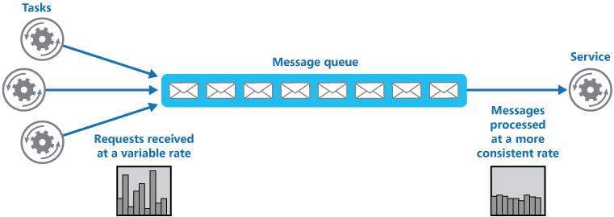

# Queue-based load leveling pattern

## Summary

Use a queue that acts as a buffer between a task and a service it invokes in order to smooth intermittent heavy loads that can cause the service to fail or the task to time out. This can help to minimize the impact of peaks in demand on availability and responsiveness for both the task and the service.

## Prerequisites

- [Message queues](../../system-design/asynchronous-processing/message-queues.md)

## Core concepts

### Definition

Use a queue that acts as a buffer between a task and a service it invokes in order to smooth intermittent heavy loads that can cause the service to fail or the task to time out. This can help to minimize the impact of peaks in demand on availability and responsiveness for both the task and the service.

### Context and problem

Cloud tasks often invoke services which can struggle under unpredictable, intermittent heavy loads, leading to performance or reliability issues. These services may be internal or third-party, like caches or storage services. Concurrent tasks can flood the service with requests, causing overloads and failures if it cannot manage the demand spikes.

### Solution

Refactor to use a queue for asynchronous communication between the task and service. The task sends data messages to the queue, which buffers them until the service retrieves and processes them. This setup allows multiple tasks to send requests at variable rates to one service via the message queue, balancing the service's load.

The queue decouples the tasks from the service, and the service can handle the messages at its own pace regardless of the volume of requests from concurrent tasks. Additionally, there's no delay to a task if the service isn't available at the time it posts a message to the queue.

This pattern provides the following benefits:

- It can help to maximize availability because delays arising in services won't have an immediate and direct impact on the application, which can continue to post messages to the queue even when the service isn't available or isn't currently processing messages.
- It can help to maximize scalability because both the number of queues and the number of services can be varied to meet demand.
- It can help to control costs because the number of service instances deployed only have to be adequate to meet average load rather than the peak load.

> Some services implement throttling when demand reaches a threshold beyond which the system could fail. Throttling can reduce the functionality available. You can implement load leveling with these services to ensure that this threshold isn't reached.

## Worked example

TODO: add a concrete, reproducible example with real values.

## Trade offs and when to use it

### Issues and considerations

Consider the following points when deciding how to implement this pattern:

- It's necessary to implement application logic that controls the rate at which services handle messages to avoid overwhelming the target resource. Avoid passing spikes in demand to the next stage of the system. Test the system under load to ensure that it provides the required leveling, and adjust the number of queues and the number of service instances that handle messages to achieve this.
- Message queues are a one-way communication mechanism. If a task expects a reply from a service, it might be necessary to implement a mechanism that the service can use to send a response.
- Be careful if you apply autoscaling to services that are listening for requests on the queue. This can result in increased contention for any resources that these services share and diminish the effectiveness of using the queue to level the load.
- Depending on the load of the service, you can run into a situation where you're effectively always trailing behind, where the system is always queuing up more requests than you're processing. The variability of incoming traffic to your application needs to be taken into consideration
- The pattern can lose information depending on the persistence of the Queue. If your queue crashes or drops information (due to system limits) there's a possibility that you don't have a guaranteed delivery. The behavior of your queue and system limits needs to be taken into consideration based on the needs of your solution.

### Use cases

This pattern is useful to any application that uses services that are subject to overloading.

This pattern isn't useful if the application expects a response from the service with minimal latency.

## Common mistakes

TODO: list frequent misunderstandings and failure modes, with the fix for each.

## Practice

TODO: add three to five questions, with answers at the bottom.

## Further reading

- Microsoft. [*Queue-based load leveling pattern*](https://learn.microsoft.com/en-us/azure/architecture/patterns/queue-based-load-leveling). Azure Architecture Center. The full description of the pattern: context and problem, solution, issues and considerations, and when to use it.

TODO: check the content of this note against the sources above and record what was verified and when.
