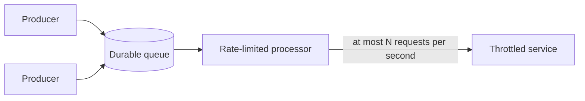

# Rate limiting pattern

## Summary

The rate limiting pattern makes a client control the rate at which it sends requests to a service that enforces limits, so that it stays under the limit instead of repeatedly hitting it and being throttled. The client buffers work in a queue and releases it at a known, safe rate. This gives predictable throughput and avoids wasting capacity on rejected requests and retries. It is the client side counterpart of the [throttling pattern](throttling.md), which the service uses to protect itself.

## Prerequisites

- [Throttling pattern](throttling.md), the service side limit this pattern adapts to.
- [Retry pattern](../resiliency/retry.md), the usual reaction to throttling errors that rate limiting tries to make rare.

## Core concepts

### Definition

*Rate limiting* is the practice of limiting the number of operations a client sends to a resource per unit of time. In the cloud design patterns catalog it is a client side pattern: when a service (for example a database or a third-party API) throttles callers above a quota, the caller shapes its own traffic to stay below that quota, instead of sending as fast as possible and handling the throttling errors afterward.

### Context and problem

Many services enforce limits such as requests per second or capacity units per second, and reject requests above them with an error such as HTTP `429 Too Many Requests`. A client that sends a large batch as fast as it can will hit the limit, receive errors, retry and hit the limit again. Throughput becomes unpredictable, retries consume part of the quota, and several clients sharing one quota make each other's errors worse.

### Solution

The diagram shows the shape of the solution: producers write work to a durable queue, and a processor reads from the queue and sends to the limited service no faster than the allowed rate.

1. Producers put work items in a durable queue instead of calling the service directly.
2. One or more processors read items and send them to the service at a controlled rate.
3. When several processors share one quota, they coordinate, for example by leasing slices of the capacity (such as 100 requests per second each) through a shared lock or lease store, so the total stays under the limit.
4. Throttling errors that still occur are retried, but they are the exception rather than the normal flow.

### Common rate limiting algorithms

| Algorithm | How it works | Property |
| --- | --- | --- |
| Fixed window counter | Count requests per fixed interval, reset at the boundary | Simple, but allows bursts of up to twice the limit around a boundary |
| Sliding window | Count requests in the last interval, measured continuously | Smoother than a fixed window, needs more state |
| Token bucket | Tokens are added at a fixed rate up to a capacity, each request takes one | Allows short bursts up to the bucket size, enforces the average rate |
| Leaky bucket | Requests enter a queue that drains at a fixed rate | Produces a constant output rate, bursts wait in the queue |

TODO: verify the algorithm descriptions against a primary source and add one as a reference.

## Worked example

TODO: add a reproducible example, for example a token bucket limiter that sends 1,000 queued writes to a service limited to 50 requests per second, with the expected duration of 20 seconds and zero throttling errors.

## Trade offs and when to use it

- **Use it** when a client sends large volumes of work to a service with known limits, when the work can be done asynchronously, and when predictable throughput matters more than the latency of an individual request.
- **Costs.** The queue adds latency and moving parts. Coordinating several processors that share one quota requires a lease or lock service.
- **Do not use it** for interactive requests where the user waits for the result, or when the limit is not known or changes often. In those cases rely on [retry](../resiliency/retry.md) with backoff and on the service's [throttling](throttling.md) signals.

## Common mistakes

- **Treating rate limiting as a replacement for retries.** Limits can change and other clients can share the quota, so throttling errors still happen. Fix: keep a retry policy with exponential backoff.
- **Each processor assumes it owns the whole quota.** Two processors at 100 requests per second against a 100 request per second limit cause constant throttling. Fix: divide the capacity explicitly between processors.

## Practice

TODO: add three to five questions, with answers at the bottom.

## Further reading

- Microsoft. [*Rate limiting pattern*](https://learn.microsoft.com/en-us/azure/architecture/patterns/rate-limiting-pattern). Azure Architecture Center. The full description of the pattern: context and problem, solution, issues and considerations, and when to use it.

TODO: check the content of this note against the sources above and record what was verified and when.
